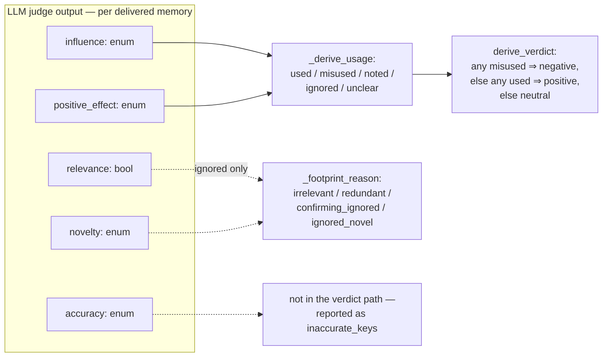

# mem-eval

Trajectory analysis for memory-system quality evaluation. Two tools consume
schema-v6 gate trajectories: **memgraph** visualizes every memory operation
and its relationships, and **injudge** scores each recall injection's impact
with an LLM rubric. Both are read-only over their inputs.

The methodology in one line: an injection is judged by its *subsequent
influence* on the agent — never by the final task result.

## Input contract

Schema-v6 gate trajectories. The traj-recorder writes the memory system's
logical actions as explicit `memory_*` annotation events (`memory_session` /
`memory_role_bind` / `memory_generate_*` / `memory_change` /
`memory_search_*` / `memory_delivery`) — the tools consume exactly those: no
label conventions, no prompt prefixes, no payload guessing.

A run without annotations yields zero memory operations plus a validation
note — valid input, not an error. Each input path may be a trajectory dir
(containing `trajectory.jsonl`), a `trajectory.jsonl` file, or a root dir
scanned recursively.

## Setup

Requires Python 3.11+; the tools themselves are stdlib-only. The package
imports as `eval`, so clone the repo under that name and run the tools from
its parent directory:

```bash
git clone <repo-url> eval
cd eval && cp .env.example .env   # fill in the judge endpoint (injudge only)
```

Tests need pytest in a checkout-local uv environment (never the system
python or another checkout's venv):

```bash
uv venv .venv && uv pip install pytest   # once, inside the checkout
```

## memgraph — memory-operation visualization

Extracts every memory-related action from the trajectories and renders the
relationships: for each memory, **which (trajectory, step) created it** and
**which (trajectory, step) later recalled it** — including cross-trajectory
reuse when several runs are loaded together.

```bash
python3 -m eval.memgraph <trajectory paths> -o memgraph.html --json memgraph.json
```

The graph is annotation-driven: lanes come from `memory_role_bind`,
extraction ops from generation events (approvals, rejections, deletions),
and recall ops from `memory_delivery` (delivered refs, linked search,
placement cost). Agent step = count of completed main-lane turns;
attribution is bound by annotation call refs, never inferred from message
order.

The HTML is fully self-contained and works offline: per-trajectory lanes,
creation→use edges, lifecycle chains, a memory sidebar, op popovers,
filters, and zoom. Trajectories with zero memory operations render as empty
lanes.

Options:

- `--json PATH` — also write the machine-readable graph artifact
  (`{trajectories, ops, memories, edges, validation}`).
- `--verdicts PATH` — merge an injudge report before rendering: recall nodes
  are colored by their span's verdict (green positive / red negative / gray
  neutral / amber error), the header gains a tally, and popovers show the
  judge's rationale and per-memory usage. The join is by `(run_id, op seq)`;
  unmatched injections are validation notes, never errors.

## injudge — recall-injection verdicts

Judges each recall injection's impact — **positive / negative / neutral** —
from its subsequent influence on the trajectory.

Injections repeat identical content, so the judged unit is the **injection
span**: a maximal run of consecutive injections with identical delivered
content. Re-deliveries roll up as `restated` — counted, never in verdict
rates.

**One LLM judge call per span** scores *every delivered memory* on five
signals, given the span plus the complete agent step stream (every completed
agent turn with its reasoning, content, and tool results — no windows, no
caps):

| Signal | Type | Question |
|---|---|---|
| `relevance` | bool | Is the memory topically related to the task and the agent's current subgoal at the injection point? |
| `accuracy` | enum | `corroborated` (evidence it is right) / `uncontradicted` (no evidence either way) / `contradicted` (evidence it is wrong) |
| `novelty` | enum | `novel` (substance never appeared pre-injection) / `confirming` (agent had articulated it as open — suspicion, hypothesis, hesitation — and the memory settles it) / `redundant` (already established, no open doubt ⇒ the delivery was redundant/late) |
| `influence` | enum | `none` / `referenced` (mentioned only) / `acted_on` (shaped a command, edit, or test — or an observably anchored skip: announced intent dropped, or explicit credit) / `decisive` (explicitly credited with a pivot) |
| `positive_effect` | enum / null | `improved` / `no_effect` / `harmed`; null unless influence is `acted_on`/`decisive`. Saved effort needs an observable anchor (announced intent or explicit credit) — an absent action alone is never evidence |

Everything downstream is **derived in code, never asked of the LLM**. Per
memory: `used` = acted-on ∧ improved; `misused` = acted-on ∧ (no_effect ∨
harmed); `noted` = referenced; `ignored` = no footprint (with a reason:
`irrelevant` / `redundant` / `confirming_ignored` / `ignored_novel`);
`unclear` = gaps. The span
verdict: any `misused` ⇒ **negative**, else any `used` ⇒ **positive**, else
**neutral**. Mere reference never yields negative.



An unparseable or empty-coverage judge answer becomes an `error` verdict —
never silently neutral — and the exit code is 2 if any span errored.

**Delivery cost** is accounted deterministically (never judged): each span's
deliveries × content size, with a chars/4 token estimate, charged to its
verdict class. **Delivery policy** is measured per trajectory and overall:
injection density, restated ratio, and the injected share of the trajectory's
real prompt-token budget. The aggregates pre-register the headline numbers:
positive/negative span rates and the wasted-token share.

```bash
python3 -m eval.injudge <trajectory paths> --json injudge.json -o injudge.md

# inspect the judge input (span + whole step stream), no judge calls:
python3 -m eval.injudge <trajectory paths> --dry-run --limit 3
```

Tuning flags: `--timeout`, `--retries`, `--judge-max-tokens` (default 24000
— a cap, not a reservation; reasoning models burn most of it on
`reasoning_content`), `--limit N`, `--env PATH`, `--judge-model`.

### Judge endpoint configuration

Configured via `.env` (copy `.env.example`; see it for the full comments):

| Key | Default | Purpose |
|---|---|---|
| `MODEL` | required | Judge model; `--judge-model` overrides |
| `API_KEY`, `BASE_URL` | required | Judge endpoint; `OPENAI_API_KEY` / `OPENAI_BASE_URL` shadow them |
| `API` | `openai-chat` | Wire format: `openai-chat` · `responses` · `anthropic` |
| `TEMPERATURE` | `0.0` | Sampling temperature |
| `THINKING` | provider default | `enabled` / `disabled`; disabled is a true off (suppresses the effort field) |
| `THINKING_EFFORT` | unset | `none` … `max`, provider-native |
| `THINKING_BUDGET` | — | Anthropic only; required with `API=anthropic` + `THINKING=enabled`, must be < `--judge-max-tokens` |
| `FAST_*` | per-key primary value | Optional fast lane: `FAST_MODEL`, `FAST_API_KEY`, `FAST_API`, `FAST_BASE_URL`, `FAST_THINKING*`, `FAST_TEMPERATURE` — reserved; nothing consumes it yet |

Thinking controls map to provider-native fields: `thinking.type` +
`reasoning_effort` on openai-chat, `reasoning.effort` on responses (`none`
turns thinking off), `thinking` + `output_config.effort` on anthropic
(enabled thinking drops `temperature`). The formats follow DeepSeek's
reference implementation.

Empty-content responses are retried like transient failures; a verdict
routed entirely into `reasoning_content` is recovered and noted per span in
validation.

### Output

The `injudge.report/v4` JSON artifact (default `injudge-report.json`,
rewritten after every trajectory so a crash keeps completed work) carries
per-span verdicts with rubric, analysis, evidence, and delivery cost, plus
trajectory policy blocks and the aggregates. `-o` renders a markdown report.
Trajectories with zero injections yield an empty verdict set — valid input.

Feed the artifact back to memgraph to see the verdicts in the visualization:

```bash
python3 -m eval.memgraph <trajectory paths> --verdicts injudge.json -o memgraph-verdicts.html
```

## Tests

```bash
# from the parent directory (the checkout imports as `eval`)
eval/.venv/bin/python -m pytest eval/tests -q
```

## Project layout

- `memgraph/annotations.py` — schema-v6 memory-annotation index + MemoryRef mapping
- `memgraph/model.py` — Trajectory / MemoryOp / MemoryUnit / Edge dataclasses
- `memgraph/parse_trajectory.py` — trajectory.jsonl → ops (annotation-driven)
- `memgraph/graph.py` — discovery, cross-trajectory linking, validation
- `memgraph/html.py` — self-contained HTML renderer
- `memgraph/verdicts.py` — merge injudge verdicts onto recall ops
- `memgraph/__main__.py` — CLI
- `injudge/model.py` — AgentStep / ToolExec / InjectionSpan dataclasses
- `injudge/steps.py` — agent-lane step stream (replay-suppressed, turn-joined)
- `injudge/spans.py` — recall ops → injection spans (identical content)
- `injudge/judge.py` — .env config, urllib chat client, prompt, verdict parsing
- `injudge/aggregate.py` — verdict counts/rates, per-memory usage roll-ups
- `injudge/report.py` — injudge.report/v4 artifact, markdown, stdout
- `injudge/__main__.py` — CLI
- `tests/annotated_fixtures.py` — shared schema-v6 synthetic-trajectory builder
- `tests/test_memgraph.py` — synthetic-fixture tests (graph, linking, verdicts)
- `tests/test_annotations.py` — synthetic-fixture tests (annotation parse)
- `tests/test_injudge.py` — synthetic-fixture tests (mocked judge, no network)
