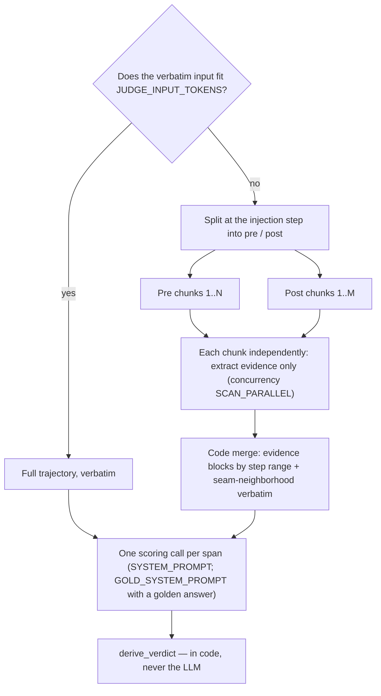
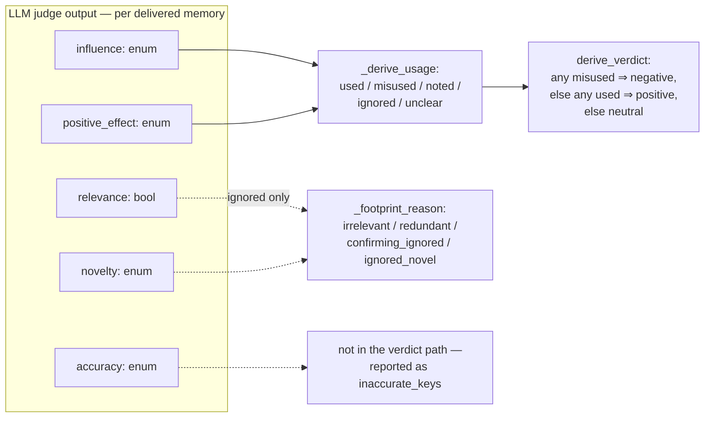

# mem-eval

English | [简体中文](README.zh-CN.md)

Trajectory analysis for memory-system quality. Two read-only tools consume
schema-v6 gate trajectories:

- **memgraph** — visualizes every memory operation and its relationships as a
  self-contained HTML graph.
- **injudge** — scores each recall injection's impact with an LLM rubric and
  emits an `injudge.report/v5` artifact that feeds back into memgraph.

> The methodology in one line: an injection is judged by its *subsequent
> influence* on the agent — never by the final task result.

## Requirements

- Python 3.11+ — the tools need nothing else but tiktoken (injudge's
  input-budget estimate) and tqdm (injudge's progress bars); memgraph is
  fully stdlib.
- For injudge: a judge endpoint, configured in `.env`.
- For tests: pytest + tiktoken + tqdm in a checkout-local uv venv.

## Quick start

```bash
git clone <repo-url> && cd mem-eval
cp .env.example .env   # fill in the judge endpoint (injudge only)

# 1. Visualize memory operations (offline, no .env needed):
python3 -m memgraph <paths> -o memgraph.html --json memgraph.json

# 2. Judge recall injections (makes LLM calls; inspect input first):
python3 -m injudge <paths> --dry-run --limit 3
python3 -m injudge <paths>            # writes output/injudge-report.json + output/summary.json

# 3. See the verdicts in the graph (or rerun injudge with --html):
python3 -m memgraph <paths> --verdicts output/injudge-report.json -o memgraph-verdicts.html
```

Each path is a trajectory dir (containing `trajectory.jsonl`), a
`trajectory.jsonl` file, or a root dir scanned recursively. A path that
matches nothing is a usage error named explicitly, never silently dropped.

## Input contract

Schema-v6 gate trajectories. The traj-recorder writes the memory system's
logical actions as explicit `memory_*` annotation events — `memory_session`,
`memory_role_bind`, `memory_generate_*`, `memory_change`, `memory_search_*`,
`memory_delivery` — and the tools consume exactly those: no label
conventions, no prompt parsing, no payload guessing. A run without
annotations yields zero memory operations plus a validation note — valid
input, not an error.

## memgraph — memory-operation visualization

```bash
python3 -m memgraph <paths> -o memgraph.html --json memgraph.json
```

Extracts every memory-related action from the annotations and renders the
relationships: for each memory, **which (trajectory, step) created it** and
**which (trajectory, step) later recalled it** — including cross-trajectory
reuse when several runs are loaded together. Memory identity is the portable
(`namespace`, `item_id`) pair, with the display key as fallback — the same
key minted by two stores, or carried by two items in one store, is two
memories, never one.

The HTML is fully self-contained and works offline: per-trajectory lanes,
creation→use edges, lifecycle chains, a memory sidebar, op popovers, filters,
and zoom. Trajectories with zero memory operations render as empty lanes.

Options:

- `--json PATH` — also write the machine-readable graph artifact
  (`{tool, trajectories, ops, memories, edges, validation}`).
- `--verdicts PATH` — merge an injudge report before rendering: recall nodes
  are colored by their span's verdict (green positive / red negative / gray
  neutral / amber error), the header gains a tally, and popovers show the
  judge's analysis, per-memory usage, and the span's input regime
  (full/scan, gold, over-budget). The join is by `(run_id, op seq)`;
  unmatched or ambiguous joins are validation notes, never errors.

## injudge — recall-injection verdicts

```bash
python3 -m injudge <paths>     # writes output/injudge-report.json + output/summary.json

# print the judge input per span (gold blocks included; overflow adds an
# INPUT OVERFLOW note with the would-be chunk counts) — reads only the
# budget/chunk knobs from .env, no judge calls, no files written:
python3 -m injudge <paths> --dry-run --limit 3
```

Judges each recall injection's impact — **positive / negative / neutral** —
from its subsequent influence on the trajectory. A tqdm progress display on
stderr shows trajectories and the current trajectory's span completion —
redrawing in place on a TTY, one checkpoint line per finished trajectory
when piped.

### Injection spans

Injections often repeat identical content, so the judged unit is the
**injection span**: a maximal run of consecutive injections with identical
delivered content (the recorder's portable identity; step gaps do not break
a span). Re-deliveries roll up as `restated` — counted, never in verdict
rates. A span with no agent turn after it cannot have a downstream footprint,
so it is rule-judged **neutral** and marked `auto: no_subsequent_turn` — no
judge call.

### The rubric

**One scoring call per span** scores *every delivered memory* on five
signals, given the recorded task statement, the span, and the agent step
stream (every completed agent turn with its reasoning, content, and tool
results — no windows, no caps). What the scoring call reads routes on the
input budget (`JUDGE_INPUT_TOKENS`, estimated with tiktoken `o200k_base`):

- **Fits** → the COMPLETE step stream goes in verbatim. Short trajectories
  are identical to a single full-text judge call.
- **Overflows** → never truncated to fit. The trajectory is read in chunks
  (split at the injection step; the chunks partition the step stream), each
  chunk **extracts evidence only** — never rubric values — and code
  assembles the evidence blocks plus a verbatim seam neighborhood around the
  injection into the scoring user. Code seeds each chunk's extraction with
  `[anchor]` items — one per step where a delivered memory's key or a
  distinctive value word appears verbatim (capped in count and length,
  counted toward the chunk budget); they seed extraction, never replace it. Over-cap evidence and an over-budget
  assembly each get one LLM summary pass; a still-over result keeps the
  original, never silently cut — the evidence-cap case is noted in the
  run's warnings, and only an over-budget assembly is sent as-is marked
  `over_budget`. Extraction runs on its own
  config copy (the `SCAN_*` overrides; concurrency `SCAN_PARALLEL`), and a
  chunk with no usable record fails that span with an `error` verdict naming
  it — never a silent coverage gap.



The five signals, judged per delivered memory:

| Signal | Type | Question |
|---|---|---|
| `relevance` | bool | Is the memory topically related to the task and the agent's current subgoal at the injection point? |
| `accuracy` | enum | `corroborated` (evidence it is right) / `uncontradicted` (no evidence either way) / `contradicted` (evidence it is wrong) |
| `novelty` | enum | `novel` (substance never appeared pre-injection) / `confirming` (settles an open doubt the agent had articulated) / `redundant` (already established) |
| `influence` | enum | `none` / `referenced` (mentioned only) / `acted_on` (shaped a command, edit, or test) / `decisive` (explicitly credited with a pivot) |
| `positive_effect` | enum / null | `improved` / `no_effect` / `harmed`; null unless influence is `acted_on` or `decisive` |

Everything downstream is **derived in code, never asked of the LLM**:



- Per memory: `used` = acted-on ∧ improved; `misused` = acted-on ∧
  (no effect ∨ harmed); `noted` = referenced; `ignored` = no footprint (with
  a reason); `unclear` = gaps.
- Span verdict: any `misused` ⇒ **negative**, else any `used` ⇒
  **positive**, else **neutral**. Mere reference never yields negative.

### Optional golden answer / correctness

The final scoring call accepts two optional attachments — from a trajectory
dir's sidecar files (`golden.txt` / `golden.md`, `correctness.json` next to
`trajectory.jsonl`) or the CLI (`--golden PATH`, `--correctness
resolved|unresolved`; the CLI overrides the same-named sidecar fields, and
one CLI gold over several loaded trajectories warns):

- A **golden-answer body** (the reference solution) switches that call to
  the **gold rubric** (`GOLD_SYSTEM_PROMPT`): same five signals, same
  schema, same derive chain, but `relevance` and `positive_effect`'s
  direction are judged against the gold text. The gold never speaks to
  `accuracy`, `novelty`, or `influence`, and is never sent to extraction.
- A **recorded correctness** (`resolved`/`unresolved`, optional 0–1 score)
  attaches as a `TASK CORRECTNESS` block under whichever prompt the call
  uses — corroboration only; it can never decide a signal by itself.
  `correctness.json` takes either a plain `{"resolved": true|false,
  "score": …}` record or the SWE-bench-style harness report
  (`resolved_ids`/`unresolved_ids` — joined by the trajectory's recorded
  `instance_id`; errored/incomplete instances are harness failures, not
  outcomes, so no correctness attaches).

With neither attached, scoring is exactly the plain rubric. The regime is
recorded on each operation's `input` (`"gold": true`) and counted in
`aggregates.overall.gold_scored`.

### Judge robustness

The judge walks a conformance tier chain — **structured** (constrained
decoding) → **json** (JSON mode) → **prompt** — degrading for free when a
tier's format field is rejected or provably ignored, and memoizing the first
working tier for the rest of the run. Transient failures (429/5xx, transport,
empty content) share the attempt budget with backoff, honoring a declared
`Retry-After`. When the budget is exhausted the span gets an `error` verdict
with the judge's raw text kept — never silently neutral — and the exit code
is 2 if any span errored.

**Delivery cost** is accounted deterministically (never judged): each span's
deliveries × content size, with a chars/4 token estimate, charged to its
verdict class. **Delivery policy** is measured per trajectory and overall:
injection density, restated ratio, and the injected share of the trajectory's
real prompt-token budget.

### Judge endpoint configuration

Configured via `.env` (copy `.env.example`; see it for the full comments):

| Key | Default | Purpose |
|---|---|---|
| `MODEL` | required | Judge model; `--judge-model` overrides |
| `API_KEY`, `BASE_URL` | required | Judge endpoint; `OPENAI_API_KEY` / `OPENAI_BASE_URL` shadow them |
| `API` | `openai-chat` | Wire format: `openai-chat` · `responses` · `anthropic` |
| `TEMPERATURE` | `0.0` | Sampling temperature |
| `MAX_ATTEMPTS` | `5` | Generation tries per span at the working tier; tier discovery is free |
| `OUTPUT_FORMAT` | auto | Pin the tier: `structured` · `json` · `prompt`; unset = auto chain from `structured` with memoized degrade |
| `THINKING` | provider default | `enabled` / `disabled`; maps to provider-native fields |
| `THINKING_EFFORT` | unset | `none` … `max`, provider-native pass-through |
| `THINKING_BUDGET` | — | Anthropic only; required with `API=anthropic` + `THINKING=enabled`, must be < `--judge-max-tokens` |
| `JUDGE_PARALLEL` | `1` | Spans of one trajectory judged in parallel (cap 32); in-flight calls can reach `JUDGE_PARALLEL` × `SCAN_PARALLEL` |
| `JUDGE_INPUT_TOKENS` | `50000` | Scoring-request token cap: below it one full-text call; above, the chunked evidence scan |
| `SCAN_PARALLEL` | `4` | Concurrent extraction calls (cap 32; `1` = serial); scoring is always one call |
| `SCAN_CHUNK_STEPS` | `8` | Max agent steps per extraction chunk |
| `SCAN_CHUNK_TOKENS` | min(`20000`, ½ budget) | Token cap for one extraction-request user body; unset derives from `JUDGE_INPUT_TOKENS`, a set value must be < it |
| `SCAN_NEIGHBORHOOD` | `2` | Verbatim steps kept on each side of the injection step in the scoring input (`0` = only that step) |
| `SCAN_EVIDENCE_TOKENS` | `4096` | Max-token hint for one chunk's evidence items; overrun → one summary pass, never truncation |
| `SCAN_MODEL` · `SCAN_API` · `SCAN_BASE_URL` · `SCAN_API_KEY` | inherit | Extraction endpoint overrides (`SCAN_OPENAI_BASE_URL` / `SCAN_OPENAI_API_KEY` shadow); unset inherits the scoring value |
| `SCAN_THINKING` | `disabled` | The one non-inherited override: extraction burns no reasoning budget unless re-enabled |
| `SCAN_MAX_TOKENS` · `SCAN_TEMPERATURE` · `SCAN_MAX_ATTEMPTS` · `SCAN_THINKING_EFFORT` · `SCAN_THINKING_BUDGET` · `SCAN_OUTPUT_FORMAT` | inherit | The remaining extraction overrides, mirroring the scoring keys |

Other flags: `--timeout`, `--max-attempts`, `--judge-max-tokens` (default
24000 — a cap, not a reservation; reasoning models burn most of it on
reasoning), `--limit N` (positive — 0 or negative fails fast), `--env PATH`, `--golden PATH`,
`--correctness resolved|unresolved`.

### Output

All artifacts land in the output folder (`-o DIR`, default `output/`):

- `injudge-report.json` — the `injudge.report/v5` runtime report, rewritten
  after every trajectory so a crash keeps completed work: per-span verdicts
  with rubric, analysis, evidence, and delivery cost, the per-operation
  `input` record (the budget-gate path `full`/`scan` with its scan counters,
  the gold-regime and over-budget markers), trajectory policy blocks, and
  the aggregates (including `input_paths` and `gold_scored` over gate
  spans). Feed it back to memgraph with `--verdicts`.
- `summary.json` — the `injudge.summary/v2` final statistics set: counts,
  rates, rubric distributions, cost, confidence, and slim per-memory usage
  tallies, per trajectory and overall, with a narrative-free span index
  (verdict / confidence / usage labels). Judging narrative and process logs
  stay in the report artifact.
- `memgraph-verdicts.html` — only with `--html` (default off): the memgraph
  visualization with recall nodes colored by their span's verdict.

### Reading summary.json

`summary.json` is the final statistics set of a run — the numbers for
reading and comparing memory systems. (The judging narrative — rubric notes,
analysis, evidence, `judge_raw`, the validation log — stays in
`injudge-report.json`; a span's `operation_id` points into it.) Counting
rules: rates are over **judged spans only** (denominator = positive +
negative + neutral); `error` and `unjudged` are counts, never denominators;
rule-judged auto-neutral spans count as neutral; restated re-injections roll
into their span and never appear in rates.

Top level: `tool.schema` (artifact version), `generated_at`, `overall` (all
trajectories combined), `trajectories` (per-trajectory blocks with the same
statistics plus a span index). Each trajectory carries `instance_id` /
`model` / `adapter` when recorded. Empty rate / headline / rubric /
confidence / cost shells are omitted when a block has no judged population
(an error-only or zero-injection trajectory keeps the verdict tally).

Per aggregate block (the `overall` and each trajectory):

| Field | Meaning |
|---|---|
| `n_injections` | Recall injections delivered, restated re-deliveries included |
| `n_spans` | Injection spans — the judged unit (maximal runs of identical deliveries) |
| `restated_injections` | Re-deliveries of identical content (counted, never in rates) |
| `positive` / `negative` / `neutral` | Span verdicts: the injection's footprint improved / harmed / did not show in the work |
| `error` / `unjudged` | Spans the judge failed to score / skipped by `--limit` |
| `rates` | Verdict shares over judged spans (omitted when nothing was judged) |
| `headline.judged_spans` | The rate denominator (the whole `headline` is omitted when this is 0) |
| `headline.wasted_token_share` | Injected-token cost of neutral+negative spans as a share of judged spans' cost — budget spent on injections that did not help |
| `rubric.deliveries` | Judge-scored memory deliveries (span × memory key); the whole `rubric` is omitted when this is 0 |
| `rubric.counts` / `rubric.rates` | Per-signal value distributions and projected rates over judged deliveries; null signals never dilute a rate. Rates: `relevance` = relevant share; `accuracy` = uncontradicted-or-better share; `novelty` = not-redundant share; `influence` = any-footprint share; `positive_effect` = improved share over the influential only (it is null by contract otherwise) |
| `rubric.no_footprint_reasons` | Why ignored memories left no footprint: `irrelevant` / `redundant` / `confirming_ignored` / `ignored_novel` (omitted when empty) |
| `rubric.inaccurate_keys` / `irrelevant_keys` | Triage lists `{key, spans}` — memories the judge found contradicted / irrelevant; written only when non-empty |
| `cost` | Deterministic delivery cost (never judged): `content_chars_total`, `approx_tokens_total` (chars/4 estimate), `approx_tokens_by_verdict` charged by span verdict class (omitted when zero) |
| `confidence.mean_by_verdict` / `confidence.buckets` | Judge confidence: per-verdict means (null classes omitted) and the `[0,0.5)` / `[0.5,0.8)` / `[0.8,1.0]` bucket counts, over judged spans (the whole `confidence` is omitted when none were scored) |
| `input_paths` | Overall only: gate spans judged on the full-text vs chunked-scan input (the `JUDGE_INPUT_TOKENS` budget gate) |
| `gold_scored` | Overall only: spans scored under the gold rubric (a golden answer was attached) |
| `over_budget` | Overall only: spans whose scoring input was sent as-is past the `JUDGE_INPUT_TOKENS` budget |
| `n_trajectories` | Overall only: trajectories in the run |
| `memory_usage` | Per-memory usage tallies: `key` + non-zero `tallies`, plus `value_drift: true` when the recorded content changed across spans. Labels: `used` = acted-on ∧ improved; `misused` = acted-on ∧ (no effect ∨ harmed); `noted` = referenced only; `ignored` = no footprint; `unclear` = gaps |
| `low_confidence` | Span ids with confidence < 0.5 (only when non-empty) |
| `policy` | Delivery policy: `n_steps`, `injection_density` (injections per agent step), `restated_ratio`, `est_injected_tokens`, `prompt_tokens_total` (billed usage), `injected_token_share`, `n_searches` |

The signal enums appearing in `rubric.counts` are the ones in the rubric
table above. When several identities share one display key, the summary's
`key` fields (the triage lists and `memory_usage`) carry a
`key#<item-or-namespace>` suffix — the 8-char prefix, or the full base when
prefixes collide — so two memories never conflate; the report always keeps
the full identity. Each trajectory's `spans` is a narrative-free index into
the report:

| Field | Meaning |
|---|---|
| `operation_id` | Span id — look it up in `injudge-report.json` for the full record |
| `verdict` / `confidence` | Span outcome and judge confidence (`confidence` omitted when null) |
| `steps` | `[first, last]` agent step the span's deliveries landed on |
| `n_injections` | Deliveries in the span |
| `usage` | Per-memory usage label (the same labels as `memory_usage`; omitted when empty) |

## Tests

```bash
uv venv .venv && uv pip install pytest tiktoken tqdm   # once, inside the checkout
.venv/bin/python -m pytest tests -q
```

No network — the judge and extraction clients are stubbed; fixtures are
synthetic schema-v6 trajectories built by `tests/annotated_fixtures.py`.

## Project layout

- `util.py` — shared helpers (atomic artifact writes, safe printing)
- `memgraph/` — annotation index, parsing, linking, HTML renderer, verdict
  merge, CLI (`python3 -m memgraph`)
- `injudge/` — step stream, injection spans, tiered judge client, the
  overflow scan (`scan.py`), gold sidecars (`gold.py`), aggregates, report
  writer, CLI (`python3 -m injudge`)
- `prompts/` — every LLM prompt as a file, grouped by tool/purpose folder
  (loaded via `injudge/prompts.py`; never inline prompts in code)
- `tests/` — pytest suite + shared schema-v6 fixture builder
