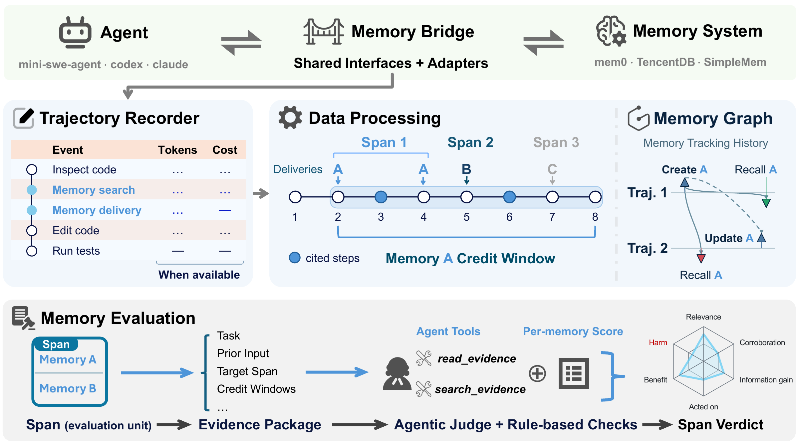

# MemUse

> This repository accompanies the paper: **Delivered, Not Used: Evaluating Agent Memory at Its Point of Use**. <br>
>
> [](https://arxiv.org/abs/2611.01718)

English | [简体中文](README.zh-CN.md)

**Evaluate how an agent uses memory, from the recorded run.** MemUse checks
what each memory delivery showed the agent, which later actions used it, and
what happened after those actions. A successful task can contain harmful memory
use. A failed task can contain useful memory use.

MemUse provides two tools:

| Tool | Use it to | Output |
| --- | --- | --- |
| `memgraph` | Trace memory creation, updates, deletion, and recall across runs. | An HTML graph that opens offline, plus optional JSON. |
| `injudge` | Judge delivered memories against recorded evidence. | Verdicts, summaries, evidence files, and judge transcripts. |

Both tools read existing recordings. They do not change the memory store or
rerun the task. The GitHub repository is named `mem-use`. These examples use a
local checkout named `mem-eval`; the commands remain `memgraph` and `injudge`.



*Overview figure from the MemUse paper. See [how MemUse works](doc/en/README.md#how-memuse-works) for the steps and terms.*

## Requirements

The recording workflow requires both companion projects:

- [memory-bridge](https://github.com/ChangranXU/memory-bridge) connects the agent
  to a memory system and annotates memory operations and episode boundaries.
- [traj-recorder](https://github.com/ChangranXU/traj-recorder) records model
  requests and responses, and checks which memory text reached the model.

Set up these projects first to collect schema-v10 trajectories with explicit
`memory_*` annotations. If you already have these recordings, you can analyze
them directly. Keep the full recording directory, including its call captures.
See the [input requirements](doc/en/input-contract.md).

For local analysis, install Python 3.11+ and [uv](https://docs.astral.sh/uv/).
Paid judge runs also need Node.js 22.19+, npm, and a judge API endpoint.
Graph rendering and offline evidence preparation do not need a judge API key.

## Quick start

Run the commands from this checkout. Replace `path/to/recordings` with a
trajectory directory, a `trajectory.jsonl` file, or a directory of recordings.

### 1. Install Python dependencies

```bash
uv sync
```

### 2. Inspect the memory graph

```bash
uv run -m memgraph path/to/recordings -o memgraph.html --json memgraph.json
```

Open `memgraph.html` in a browser. Select a memory to trace its recorded history.
This command runs offline.

### 3. Check the judge input offline

```bash
uv run -m injudge path/to/recordings --dry-run --limit 3
uv run -m injudge path/to/recordings --prepare-only -o output/prepared/
```

`--dry-run` prints evidence for up to three eligible spans and writes no files.
`--prepare-only` saves episode evidence under `output/prepared/<run-stamp>/`.
Neither command calls the judge or requires Node.js. Review input warnings
before you start a paid run.

### 4. Run the judge

```bash
npm --prefix agent install
cp .env.example .env
```

Edit `.env` and set `MODEL`, `API_KEY`, and `BASE_URL` for your judge endpoint.
See [configuration](doc/en/configuration.md) for API formats and budgets.
The next command makes paid model calls:

```bash
uv run -m injudge path/to/recordings --limit 3 --html -o output/
```

Open `output/<run-stamp>/summary.md` for the results and
`memgraph-verdicts.html` in the same folder for the graph with verdicts.
Remove `--limit 3` to judge all eligible spans. Each run gets a new folder.

## Read the results

The judge rates each delivered entry on **relevance, accuracy, novelty,
influence, and observed effect**. Python checks the evidence and derives the
span verdict. Harmful use takes priority over useful use. Missing evidence stays
explicit in the result.

Start with the summary, then inspect the cited steps for a span. Use the
entry-share profiles to see mixed results within a delivery. Check unknown
labels, errors, and unjudged spans before you compare runs. Text-size estimates
use characters divided by four; recorded billing is reported separately.

No reference answer or task-success label is required. Optional reference data
can support a judgment, but the final task result does not determine it.

## Documentation

| I want to… | Read |
| --- | --- |
| Understand the workflow and terms | [MemUse guide](doc/en/README.md) |
| Load recordings, including resumed runs | [Input requirements](doc/en/input-contract.md) |
| Explore a graph or add existing verdicts | [memgraph guide](doc/en/memgraph.md) |
| Select episodes and run the judge | [injudge guide](doc/en/injudge.md) |
| Understand a verdict or an unknown label | [Rubric and verdict rules](doc/en/verdict-derivation.md) |
| Set model credentials, limits, and concurrency | [Configuration](doc/en/configuration.md) |
| Read report fields, profiles, and costs | [Output reference](doc/en/artifacts.md) |
| Run tests or calibrate the judge | [Development](doc/en/development.md) |

The full guides are available in [English](doc/en/README.md) and
[简体中文](doc/zh-CN/README.md).

## Citation

```bibtex
@misc{xu2026deliveredusedevaluatingagent,
      title={Delivered, Not Used: Evaluating Agent Memory at Its Point of Use},
      author={Changran Xu and Zeju Li and Qiang Xu},
      year={2026},
      eprint={2611.01718},
      archivePrefix={arXiv},
      primaryClass={cs.AI},
      url={https://arxiv.org/abs/2611.01718},
}
```
