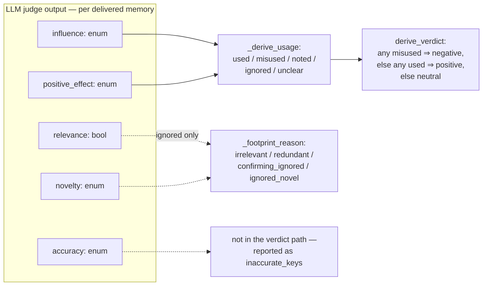

# mem-eval

English | [简体中文](README.zh-CN.md)

Trajectory analysis for memory-system quality. Two read-only tools consume
schema-v6 gate trajectories:

- **memgraph** — visualizes every memory operation and its relationships as a
  self-contained HTML graph.
- **injudge** — scores each recall injection's impact with an LLM rubric and
  emits an `injudge.report/v4` artifact that feeds back into memgraph.

> The methodology in one line: an injection is judged by its *subsequent
> influence* on the agent — never by the final task result.

## Requirements

- Python 3.11+ — the tools are stdlib-only, nothing to install.
- For injudge: a judge endpoint, configured in `.env`.
- For tests: pytest in a checkout-local uv venv.

## Quick start

```bash
git clone <repo-url> && cd mem-eval
cp .env.example .env   # fill in the judge endpoint (injudge only)

# 1. Visualize memory operations (offline, no .env needed):
python3 -m memgraph <paths> -o memgraph.html --json memgraph.json

# 2. Judge recall injections (makes LLM calls; inspect input first):
python3 -m injudge <paths> --dry-run --limit 3
python3 -m injudge <paths> --json injudge-report.json -o report.md

# 3. See the verdicts in the graph:
python3 -m memgraph <paths> --verdicts injudge-report.json -o memgraph-verdicts.html
```

Each path is a trajectory dir (containing `trajectory.jsonl`), a
`trajectory.jsonl` file, or a root dir scanned recursively. A path that
matches nothing is a usage error named explicitly, never silently dropped.

## Input contract

Schema-v6 gate trajectories. The traj-recorder writes the memory system's
logical actions as explicit `memory_*` annotation events — `memory_session`,
`memory_role_bind`, `memory_generate_*`, `memory_change`, `memory_search_*`,
`memory_delivery` — and the tools consume exactly those: no label
conventions, no prompt parsing, no payload guessing. A run without
annotations yields zero memory operations plus a validation note — valid
input, not an error.

## memgraph — memory-operation visualization

```bash
python3 -m memgraph <paths> -o memgraph.html --json memgraph.json
```

Extracts every memory-related action from the annotations and renders the
relationships: for each memory, **which (trajectory, step) created it** and
**which (trajectory, step) later recalled it** — including cross-trajectory
reuse when several runs are loaded together. Memory identity is the portable
(`namespace`, `item_id`) pair, with the display key as fallback — the same
key minted by two stores, or carried by two items in one store, is two
memories, never one.

The HTML is fully self-contained and works offline: per-trajectory lanes,
creation→use edges, lifecycle chains, a memory sidebar, op popovers, filters,
and zoom. Trajectories with zero memory operations render as empty lanes.

Options:

- `--json PATH` — also write the machine-readable graph artifact
  (`{tool, trajectories, ops, memories, edges, validation}`).
- `--verdicts PATH` — merge an injudge report before rendering: recall nodes
  are colored by their span's verdict (green positive / red negative / gray
  neutral / amber error), the header gains a tally, and popovers show the
  judge's analysis and per-memory usage. The join is by `(run_id, op seq)`;
  unmatched or ambiguous joins are validation notes, never errors.

## injudge — recall-injection verdicts

```bash
python3 -m injudge <paths> --json injudge-report.json -o report.md

# print the judge input per span — no .env read, no judge calls, no files written:
python3 -m injudge <paths> --dry-run --limit 3
```

Judges each recall injection's impact — **positive / negative / neutral** —
from its subsequent influence on the trajectory.

### Injection spans

Injections often repeat identical content, so the judged unit is the
**injection span**: a maximal run of consecutive injections with identical
delivered content (the recorder's portable identity; step gaps do not break
a span). Re-deliveries roll up as `restated` — counted, never in verdict
rates. A span with no agent turn after it cannot have a downstream footprint,
so it is rule-judged **neutral** and marked `auto: no_subsequent_turn` — no
judge call.

### The rubric

**One LLM judge call per span** scores *every delivered memory* on five
signals, given the recorded task statement, the span, and the complete agent
step stream (every completed agent turn with its reasoning, content, and tool
results — no windows, no caps):

| Signal | Type | Question |
|---|---|---|
| `relevance` | bool | Is the memory topically related to the task and the agent's current subgoal at the injection point? |
| `accuracy` | enum | `corroborated` (evidence it is right) / `uncontradicted` (no evidence either way) / `contradicted` (evidence it is wrong) |
| `novelty` | enum | `novel` (substance never appeared pre-injection) / `confirming` (settles an open doubt the agent had articulated) / `redundant` (already established) |
| `influence` | enum | `none` / `referenced` (mentioned only) / `acted_on` (shaped a command, edit, or test) / `decisive` (explicitly credited with a pivot) |
| `positive_effect` | enum / null | `improved` / `no_effect` / `harmed`; null unless influence is `acted_on` or `decisive` |

Everything downstream is **derived in code, never asked of the LLM**:



- Per memory: `used` = acted-on ∧ improved; `misused` = acted-on ∧
  (no effect ∨ harmed); `noted` = referenced; `ignored` = no footprint (with
  a reason); `unclear` = gaps.
- Span verdict: any `misused` ⇒ **negative**, else any `used` ⇒
  **positive**, else **neutral**. Mere reference never yields negative.

### Judge robustness

The judge walks a conformance tier chain — **structured** (constrained
decoding) → **json** (JSON mode) → **prompt** — degrading for free when a
tier's format field is rejected or provably ignored, and memoizing the first
working tier for the rest of the run. Transient failures (429/5xx, transport,
empty content) share the attempt budget with backoff, honoring a declared
`Retry-After`. When the budget is exhausted the span gets an `error` verdict
with the judge's raw text kept — never silently neutral — and the exit code
is 2 if any span errored.

**Delivery cost** is accounted deterministically (never judged): each span's
deliveries × content size, with a chars/4 token estimate, charged to its
verdict class. **Delivery policy** is measured per trajectory and overall:
injection density, restated ratio, and the injected share of the trajectory's
real prompt-token budget.

### Judge endpoint configuration

Configured via `.env` (copy `.env.example`; see it for the full comments):

| Key | Default | Purpose |
|---|---|---|
| `MODEL` | required | Judge model; `--judge-model` overrides |
| `API_KEY`, `BASE_URL` | required | Judge endpoint; `OPENAI_API_KEY` / `OPENAI_BASE_URL` shadow them |
| `API` | `openai-chat` | Wire format: `openai-chat` · `responses` · `anthropic` |
| `TEMPERATURE` | `0.0` | Sampling temperature |
| `MAX_ATTEMPTS` | `5` | Generation tries per span at the working tier; tier discovery is free |
| `OUTPUT_FORMAT` | auto | Pin the tier: `structured` · `json` · `prompt`; unset = auto chain from `structured` with memoized degrade |
| `THINKING` | provider default | `enabled` / `disabled`; maps to provider-native fields |
| `THINKING_EFFORT` | unset | `none` … `max`, provider-native pass-through |
| `THINKING_BUDGET` | — | Anthropic only; required with `API=anthropic` + `THINKING=enabled`, must be < `--judge-max-tokens` |

Other flags: `--timeout`, `--max-attempts`, `--judge-max-tokens` (default
24000 — a cap, not a reservation; reasoning models burn most of it on
reasoning), `--limit N`, `--env PATH`.

### Output

The `injudge.report/v4` JSON artifact (default `injudge-report.json`,
rewritten after every trajectory so a crash keeps completed work) carries
per-span verdicts with rubric, analysis, evidence, and delivery cost, plus
trajectory policy blocks and the aggregates. `-o` renders a markdown report.
Feed the artifact back to memgraph with `--verdicts` to see the verdicts in
the visualization.

## Tests

```bash
uv venv .venv && uv pip install pytest   # once, inside the checkout
.venv/bin/python -m pytest tests -q
```

No network — the judge is stubbed; fixtures are synthetic schema-v6
trajectories built by `tests/annotated_fixtures.py`.

## Project layout

- `util.py` — shared helpers (atomic artifact writes, safe printing)
- `memgraph/` — annotation index, parsing, linking, HTML renderer, verdict
  merge, CLI (`python3 -m memgraph`)
- `injudge/` — step stream, injection spans, tiered judge client,
  aggregates, report writer, CLI (`python3 -m injudge`)
- `tests/` — pytest suite + shared schema-v6 fixture builder
