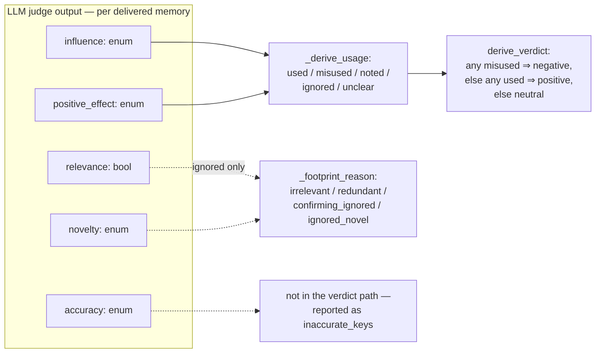

# mem-eval

Trajectory analysis for memory-system quality evaluation. Two tools consume
schema-v6 gate trajectories: **memgraph** visualizes every memory operation
and its relationships, and **injudge** scores each recall injection's impact
with an LLM rubric. Both are read-only over their inputs.

The methodology in one line: an injection is judged by its *subsequent
influence* on the agent — never by the final task result.

## Input contract

Schema-v6 gate trajectories. The traj-recorder writes the memory system's
logical actions as explicit `memory_*` annotation events (`memory_session` /
`memory_role_bind` / `memory_generate_*` / `memory_change` /
`memory_search_*` / `memory_delivery`) — the tools consume exactly those: no
label conventions, no prompt prefixes, no payload guessing.

A run without annotations yields zero memory operations plus a validation
note — valid input, not an error. Each input path may be a trajectory dir
(containing `trajectory.jsonl`), a `trajectory.jsonl` file, or a root dir
scanned recursively. A path that matches nothing (a typo, a wrong-named
file, an empty tree) is a usage error named explicitly, never silently
dropped.

## Setup

Requires Python 3.11+; the tools themselves are stdlib-only. Clone the repo
and run the tools as modules from the checkout root:

```bash
git clone <repo-url>
cd <checkout> && cp .env.example .env   # fill in the judge endpoint (injudge only)
```

Tests need pytest in a checkout-local uv environment (never the system
python or another checkout's venv):

```bash
uv venv .venv && uv pip install pytest   # once, inside the checkout
```

## memgraph — memory-operation visualization

Extracts every memory-related action from the trajectories and renders the
relationships: for each memory, **which (trajectory, step) created it** and
**which (trajectory, step) later recalled it** — including cross-trajectory
reuse when several runs are loaded together. Memory identity is the
(store `namespace`, `key`) pair: the same key minted by two different
stores is two memories, never one.

```bash
python3 -m memgraph <trajectory paths> -o memgraph.html --json memgraph.json
```

The graph is annotation-driven: lanes come from `memory_role_bind` (falling
back to the operation events' own lanes when bindings are missing),
extraction ops from generation events (approvals, rejections, deletions —
the removal change actions delete/archive/expire),
and recall ops from `memory_delivery` (delivered refs, linked search,
placement cost). Agent step = count of completed main-lane turns (an
extraction observed before the first turn completes is step 0); attribution
prefers the bound annotation call refs, cross-checked against the
adapter-declared step (a declared step outside the observed 1..N agent
steps is rejected), with documented fallbacks to the declared step and
the most recently classified agent turn (a delivery is committed after the
carrying call's response recorded, so the consuming turn has already
classified; the next agent turn covers a not-yet-classified first turn).

The HTML is fully self-contained and works offline: per-trajectory lanes,
creation→use edges, lifecycle chains, a memory sidebar, op popovers,
filters, and zoom. Trajectories with zero memory operations render as empty
lanes. The lifecycle chains follow one rule set: a key re-created after a
deletion revives (a revival whose creation was never observed is promoted
to the first observed creation), and a candidate re-stating an identical
value under an unchanged review status is a duplicate — its supersedes edge
is marked uncertain.

Options:

- `--json PATH` — also write the machine-readable graph artifact
  (`{trajectories, ops, memories, edges, validation}`).
- `--verdicts PATH` — merge an injudge.report/v4 artifact before rendering: recall nodes
  are colored by their span's verdict (green positive / red negative / gray
  neutral / amber error), the header gains a tally, and popovers show the
  judge's analysis and per-memory usage. The join is by `(run_id, op seq)`;
  unmatched injections — either join direction, or an injection naming a
  span the report does not define — are validation notes, never errors, and
  an ambiguous join key — a run_id shared by several loaded trajectories, or
  one `(run_id, seq)` claimed by several report injections or by several
  recall ops — annotates neither side, with a warning, never one verdict
  onto the other. On the report side, a run_id covering several report
  trajectories merges their seq maps.

## injudge — recall-injection verdicts

Judges each recall injection's impact — **positive / negative / neutral** —
from its subsequent influence on the trajectory.

Injections repeat identical content, so the judged unit is the **injection
span**: a maximal run of consecutive injections with identical delivered
content (the recorder's portable identity; step gaps do not break a span —
and a memory no portable identity distinguishes, e.g. an operation-local
version id over undigested redacted content, falls back to its delivered
(namespace, key, value) — the namespace keeps two stores' same-keyed
deliveries apart, while the triple degenerates to (namespace, key) for
redacted content, whose unrecorded value leaves distinct redacted contents
under one (namespace, key)
indistinguishable by construction). Re-deliveries roll
up as `restated` — counted, never in verdict rates. A delivery carries no
step only when no agent turn ever classified in the run (a memory-only or
pre-first-response recording), so it cannot break consecutiveness: it merges
into the newest matching-content span as a restated injection, and only when
no earlier span matches does it form its own span. Such an all-step-less
span needs no judge call: it is rule-judged
**neutral** — no downstream footprint can exist — and marked
`auto: no_subsequent_turn`, with placeholder null signals excluded from the
rubric stats. The recall pills in the memgraph HTML are a purely *visual*
grouping (identical key sets at strictly consecutive steps — stricter on
steps, coarser on content than a span, so a pill can cover several judged
spans) — verdicts always follow the judged span, never the pill.

**One LLM judge call per span** scores *every delivered memory* on five
signals, given the recorded task statement (`memory_session`'s exact task,
when the run carries one), the span, plus the complete agent step stream
(every completed agent turn with its reasoning, content, and tool results —
no windows, no caps):

| Signal | Type | Question |
|---|---|---|
| `relevance` | bool | Is the memory topically related to the task and the agent's current subgoal at the injection point? |
| `accuracy` | enum | `corroborated` (evidence it is right) / `uncontradicted` (no evidence either way) / `contradicted` (evidence it is wrong) |
| `novelty` | enum | `novel` (substance never appeared pre-injection) / `confirming` (agent had articulated it as open — suspicion, hypothesis, hesitation — and the memory settles it) / `redundant` (already established, no open doubt ⇒ the delivery was redundant/late) |
| `influence` | enum | `none` / `referenced` (mentioned only) / `acted_on` (shaped a command, edit, or test — or an observably anchored skip: announced intent dropped, or explicit credit) / `decisive` (explicitly credited with a pivot) |
| `positive_effect` | enum / null | `improved` / `no_effect` / `harmed`; null unless influence is `acted_on`/`decisive`. Saved effort needs an observable anchor (announced intent or explicit credit) — an absent action alone is never evidence |

Everything downstream is **derived in code, never asked of the LLM**. Per
memory: `used` = acted-on ∧ improved; `misused` = acted-on ∧ (no_effect ∨
harmed); `noted` = referenced; `ignored` = no footprint (with a reason:
`irrelevant` / `redundant` / `confirming_ignored` / `ignored_novel`);
`unclear` = gaps. The span
verdict: any `misused` ⇒ **negative**, else any `used` ⇒ **positive**, else
**neutral**. Mere reference never yields negative.



An invalid judge answer never becomes a verdict on its own: a 400/422
rejecting the tier's format field, or out-of-contract output that proves the
field was ignored (any violation the strict parse checks at the structured
tier, except the int digit-limit refusal — a >4300-digit literal is valid,
schema-legal JSON; invalid JSON at the json tier — JSON mode guarantees
valid JSON, never schema conformance), walks the conformance tier chain —
**structured**
(constrained decoding) → **json** (JSON mode; no such tier on anthropic) →
**prompt** — without
consuming the attempt budget (both are the same endpoint property discovered
on the request or the output side: this tier does not work here), and the
first tier producing a conforming answer is memoized for later spans. A
valid-but-wrong-shape answer at the json tier is a model error, not a tier
discovery (so is an integer literal past Python's int digit limit at every
tier — valid JSON per RFC 8259, which sets no limit): like any retry at the
final tier it consumes the budget and
appends the invalid answer plus a corrective note, so corrective retries
never repeat an identical request. A 400/422 whose NON-EMPTY body repeats unchanged at
the FINAL (format-less) tier — with no answered request in between —
is tier-independent — a config fault (an
over-limit max-tokens, an unsupported thinking field) or the span's own
content, never a format rejection — and fails the span on the endpoint's
message instead of walking on. (The repeat is judged only there: a gateway
rejecting every format field with one generic error body repeats it across
the format tiers too, and only the format-less tier tells that from a
tier-independent fault.) An empty rejection body is silence, not an
unchanged rejection: it never triggers the fail-fast and gets the full
tier walk. Any other non-429 4xx (auth, unknown URL, payload too large) is
an endpoint/config fault, not a format refusal: it fails the span
immediately, without the walk. Transient failures (429/5xx, transport, empty-content draws) share
the budget and back off between tries, honoring a server-declared
`Retry-After` (delta-seconds or HTTP-date, capped at 120 s) when present.
When the attempt budget is exhausted, the span gets an `error` verdict
with the judge's raw text kept — never silently neutral — and the exit code
is 2 if any span errored. A rubric covering none of the span's memories is an
`error` immediately (a model-quality signal, not a format problem).

**Delivery cost** is accounted deterministically (never judged): each span's
deliveries × content size, with a chars/4 token estimate, charged to its
verdict class. **Delivery policy** is measured per trajectory and overall:
injection density, restated ratio, and the injected share of the trajectory's
real prompt-token budget (every lane's billed usage records — the memory
lane's extraction calls are real spend of running the memory system). The
aggregates pre-register the headline numbers: positive/negative span rates
and the wasted-token share.

```bash
python3 -m injudge <trajectory paths> --json injudge.json -o injudge.md

# inspect the judge input (span + whole step stream), no judge calls:
python3 -m injudge <trajectory paths> --dry-run --limit 3
```

Tuning flags: `--timeout`, `--max-attempts`, `--judge-max-tokens` (default
24000 — a cap, not a reservation; reasoning models burn most of it on
`reasoning_content`), `--limit N`, `--env PATH`, `--judge-model`.

### Judge endpoint configuration

Configured via `.env` (copy `.env.example`; see it for the full comments):

| Key | Default | Purpose |
|---|---|---|
| `MODEL` | required | Judge model; `--judge-model` overrides |
| `API_KEY`, `BASE_URL` | required | Judge endpoint; `OPENAI_API_KEY` / `OPENAI_BASE_URL` shadow them |
| `API` | `openai-chat` | Wire format: `openai-chat` · `responses` · `anthropic` |
| `TEMPERATURE` | `0.0` | Sampling temperature |
| `MAX_ATTEMPTS` | `5` | Generation tries per span at the working tier; transport failures and out-of-contract answers share it — discovering the working tier (a 400/422 or an ignored format field) is free |
| `OUTPUT_FORMAT` | unset (auto) | Pin the conformance tier: `structured` · `json` · `prompt`. Unset = auto chain from `structured`, degrading on rejection or proven-ignored format fields (the first tier producing a conforming answer is memoized per run). Pinned + a request rejection (400/422) = the span fails with an `error` verdict naming the pin — recorded, the run continues |
| `THINKING` | provider default | `enabled` / `disabled`; disabled is a true off (suppresses the effort field) |
| `THINKING_EFFORT` | unset | `none` … `max`, provider-native |
| `THINKING_BUDGET` | — | Anthropic only; required with `API=anthropic` + `THINKING=enabled`, must be < `--judge-max-tokens` |

Thinking controls map to provider-native fields: `thinking.type` +
`reasoning_effort` on openai-chat, `reasoning.effort` on responses (`none`
turns thinking off), `thinking` + `output_config.effort` on anthropic
(enabled thinking drops `temperature`). The formats follow DeepSeek's
reference implementation.

Every tier enforces the same canonical output contract (`VERDICT_SCHEMA` in
`injudge/judge.py`, array form — one `memories` entry per delivered key);
only the enforcement mechanism differs per tier. Parsing is strict: exact
enums and types, no synonym/bool/string coercions, no fence or embedded-JSON
extraction. The semantic checks a schema can't express stay in code:
coverage, the positive_effect↔influence pairing, and the confidence range.

Empty-content responses (a reasoning model burning its budget on
`reasoning_content`) are retried like transient failures — and on
openai-chat a complete verdict drafted into `reasoning_content` is recovered
instead, at any conformance tier, and noted per span in validation (the
other APIs carry no such channel).

### Output

The `injudge.report/v4` JSON artifact (default `injudge-report.json`,
rewritten after every trajectory so a crash keeps completed work) carries
per-span verdicts with rubric, analysis, evidence, and delivery cost, plus
trajectory policy blocks and the aggregates. `-o` renders a markdown report.
Trajectories with zero injections yield an empty verdict set — valid input.

Feed the artifact back to memgraph to see the verdicts in the visualization:

```bash
python3 -m memgraph <trajectory paths> --verdicts injudge.json -o memgraph-verdicts.html
```

## Tests

```bash
# from the checkout root, under any directory name (tests/conftest.py
# puts the checkout root on sys.path)
.venv/bin/python -m pytest tests -q
```

## Project layout

- `util.py` — shared helpers: atomic_write (crash-safe artifact writes), tmp_sibling, utf8_safe, print_validation
- `memgraph/annotations.py` — schema-v6 memory-annotation index + MemoryRef mapping
- `memgraph/model.py` — Trajectory / MemoryOp / MemoryUnit / Edge dataclasses
- `memgraph/parse_trajectory.py` — trajectory.jsonl → ops (annotation-driven)
- `memgraph/graph.py` — discovery, cross-trajectory linking, validation
- `memgraph/html.py` — self-contained HTML renderer
- `memgraph/verdicts.py` — merge injudge verdicts onto recall ops
- `memgraph/__main__.py` — CLI
- `injudge/model.py` — AgentStep / ToolExec / InjectionSpan dataclasses
- `injudge/steps.py` — agent-lane step stream (turn-joined; late tool closes by tool_call_id) + all-lane billed prompt-token accounting
- `injudge/spans.py` — recall ops → injection spans (identical content)
- `injudge/judge.py` — .env config, tiered urllib client, prompt, verdict parsing
- `injudge/aggregate.py` — verdict counts/rates, per-memory usage roll-ups
- `injudge/report.py` — injudge.report/v4 artifact, markdown, stdout
- `injudge/__main__.py` — CLI
- `tests/annotated_fixtures.py` — shared schema-v6 synthetic-trajectory builder
- `tests/test_memgraph.py` — synthetic-fixture tests (graph, linking, verdicts)
- `tests/test_annotations.py` — synthetic-fixture tests (annotation parse)
- `tests/test_injudge.py` — synthetic-fixture tests (mocked judge, no network)
