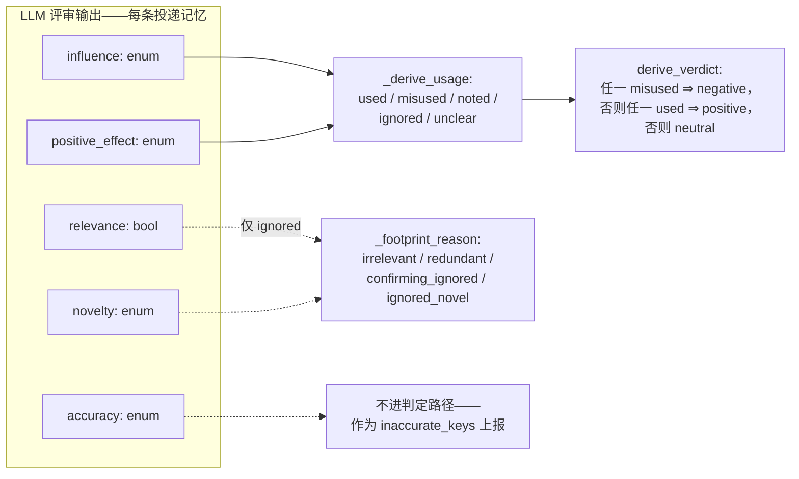

# mem-eval

[English](README.md) | 简体中文

面向记忆系统质量的轨迹分析工具。两个只读工具解析 schema-v6 gate 轨迹：

- **memgraph** — 把每次记忆操作及其关系渲染成一张自包含的 HTML 图。
- **injudge** — 用 LLM 评分规则判定每次召回注入的影响，产出可回灌给
  memgraph 的 `injudge.report/v4` 产物。

> 方法论一句话：注入由它对 agent 的**后续影响**来评判——绝不看最终任务结果。

## 环境要求

- Python 3.11+——工具仅用标准库，无需安装任何依赖。
- injudge：需要评审端点，在 `.env` 中配置。
- 测试：需要 checkout 本地 uv 虚拟环境中的 pytest。

## 快速开始

```bash
git clone <repo-url> && cd mem-eval
cp .env.example .env   # 填写评审端点（仅 injudge 需要）

# 1. 可视化记忆操作（离线，无需 .env）：
python3 -m memgraph <paths> -o memgraph.html --json memgraph.json

# 2. 评审召回注入（会产生 LLM 调用；先检查输入）：
python3 -m injudge <paths> --dry-run --limit 3
python3 -m injudge <paths> --json injudge-report.json -o report.md

# 3. 在图中查看判定结果：
python3 -m memgraph <paths> --verdicts injudge-report.json -o memgraph-verdicts.html
```

每个路径可以是轨迹目录（含 `trajectory.jsonl`）、`trajectory.jsonl` 文件
本身，或递归扫描的根目录。匹配不到任何内容的路径会明确报用法错误，
绝不悄悄跳过。

## 输入约定

Schema-v6 gate 轨迹。录制器把记忆系统的逻辑动作写成显式的 `memory_*`
注解事件——`memory_session`、`memory_role_bind`、`memory_generate_*`、
`memory_change`、`memory_search_*`、`memory_delivery`——工具只消费这些
事件：不认标签约定、不解析提示词、不猜测载荷。没有注解的轨迹得到零
记忆操作加一条 validation 说明——这是合法输入，不是错误。

## memgraph — 记忆操作可视化

```bash
python3 -m memgraph <paths> -o memgraph.html --json memgraph.json
```

从注解中提取每个记忆相关动作并渲染其关系：每条记忆**由哪个（轨迹，
步骤）创建**、随后**被哪个（轨迹，步骤）召回**——多条轨迹一起加载时
还能看到跨轨迹复用。记忆身份取可移植的 (`namespace`, `item_id`) 对，
缺省回退到显示键——不同 store 铸造的同名键、或同一 store 中不同 item
持有的同名键，是两条记忆，绝不误并。

HTML 完全自包含、可离线打开：逐轨迹泳道、创建→使用边、生命周期链、
记忆侧栏、操作弹层、过滤与缩放。零记忆操作的轨迹渲染为空泳道。

选项：

- `--json PATH` — 同时输出机器可读的图产物
  （`{tool, trajectories, ops, memories, edges, validation}`）。
- `--verdicts PATH` — 渲染前先合并 injudge 报告：召回节点按其区间的
  判定着色（positive 绿 / negative 红 / neutral 灰 / error 琥珀），
  页眉加上计数，弹层展示评审分析与每条记忆的使用情况。按
  `(run_id, op seq)` 连接；未匹配或歧义连接记为 validation 说明，
  不是错误。

## injudge — 召回注入判定

```bash
python3 -m injudge <paths> --json injudge-report.json -o report.md

# 按区间打印评审输入——不读 .env、不发起评审调用、不写文件：
python3 -m injudge <paths> --dry-run --limit 3
```

以**后续影响**为依据，把每次召回注入判为 **positive / negative /
neutral**。

### 注入区间（span）

注入常常重复相同内容，所以评审单元是**注入区间**：投递内容完全相同的
连续注入的最大段（取录制器的可移植身份；步骤间隔不切段）。重复投递
计为 `restated`——计数，但不进判定率。其后没有任何 agent 回合的区间
不可能存在下游影响，直接按规则判 **neutral** 并标记
`auto: no_subsequent_turn`——不花评审调用。

### 评分信号

**每个区间一次 LLM 调用**，对**每条投递记忆**打五个信号——输入为录制
的任务陈述、该区间、以及完整的 agent 步骤流（所有已完成回合的推理、
内容与工具结果——无窗口、无截断）：

| 信号 | 类型 | 问题 |
|---|---|---|
| `relevance` | bool | 注入点上，记忆与任务及 agent 当前子目标是否主题相关？ |
| `accuracy` | enum | `corroborated`（有证据为真）/ `uncontradicted`（无从判断）/ `contradicted`（有证据为假） |
| `novelty` | enum | `novel`（注入前从未出现的新内容）/ `confirming`（敲定 agent 明确表达过的疑点）/ `redundant`（早已确立） |
| `influence` | enum | `none` / `referenced`（仅被提及）/ `acted_on`（影响了命令、编辑或测试）/ `decisive`（被明确归功的转向） |
| `positive_effect` | enum / null | `improved` / `no_effect` / `harmed`；仅当 influence 为 `acted_on` 或 `decisive` 时非空 |

一切下游结论都**在代码里推导，绝不问 LLM**：



- 每条记忆：`used` = acted-on ∧ improved；`misused` = acted-on ∧
  （no effect ∨ harmed）；`noted` = 仅被提及；`ignored` = 无痕迹
  （附原因）；`unclear` = 信息不足。
- 区间判定：任一 `misused` ⇒ **negative**；否则任一 `used` ⇒
  **positive**；否则 **neutral**。仅被提及绝不会得到 negative。

### 评审稳健性

评审客户端按合规层级链 **structured**（受限解码）→ **json**
（JSON 模式）→ **prompt** 自动降级：某层级的格式字段被拒绝或被证明
忽略时，降级不消耗预算，并全程记忆首个可用层级。瞬时故障（429/5xx、
传输错误、空内容）共享尝试预算并退避，尊重服务端声明的
`Retry-After`。预算耗尽时该区间记为 `error` 判定并保留评审原始输出
——绝不悄悄判 neutral；只要有区间出错，退出码为 2。

**投递成本**按确定性规则核算（不交给 LLM）：每区间的投递数 × 内容
大小，按 chars/4 估算 token，计入其判定类别。**投递策略**按轨迹与
整体统计：注入密度、重述比例、注入占轨迹真实 prompt token 预算的份额。

### 评审端点配置（.env）

复制 `.env.example` 为 `.env` 并填写（完整注释见该文件）：

| 键 | 默认值 | 用途 |
|---|---|---|
| `MODEL` | 必填 | 评审模型；`--judge-model` 可覆盖 |
| `API_KEY` / `BASE_URL` | 必填 | 评审端点；`OPENAI_API_KEY` / `OPENAI_BASE_URL` 可遮蔽 |
| `API` | `openai-chat` | 线格式：`openai-chat` · `responses` · `anthropic` |
| `TEMPERATURE` | `0.0` | 采样温度 |
| `MAX_ATTEMPTS` | `5` | 每区间在工作层级的生成尝试预算；层级发现免费 |
| `OUTPUT_FORMAT` | 自动 | 固定合规层级 `structured` / `json` / `prompt`；不设则从 `structured` 自动降级并记忆可用层级 |
| `THINKING` | 提供方默认 | `enabled` / `disabled`；映射到提供方原生字段 |
| `THINKING_EFFORT` | 不设 | `none` … `max`，按提供方原生透传 |
| `THINKING_BUDGET` | — | 仅 anthropic；`API=anthropic` 且 `THINKING=enabled` 时必填，须小于 `--judge-max-tokens` |

其余命令行参数：`--timeout`、`--max-attempts`、`--judge-max-tokens`
（默认 24000——是上限不是预留；推理模型会把它的大部分花在 reasoning
上）、`--limit N`、`--env PATH`。

### 产物

`injudge.report/v4` JSON 产物（默认 `injudge-report.json`，每条轨迹完成
即重写，崩溃也保留已完成部分）包含逐区间的判定与评分信号、分析、证据、
投递成本，以及轨迹投递策略与汇总指标；`-o` 另出 markdown 报告。用
memgraph 的 `--verdicts` 回灌该产物，即可在可视化中看到判定。

## 测试

```bash
uv venv .venv && uv pip install pytest   # 首次，在 checkout 内执行
.venv/bin/python -m pytest tests -q
```

测试不走网络——评审客户端打桩；夹具为 `tests/annotated_fixtures.py`
合成的 schema-v6 轨迹。

## 项目结构

- `util.py` — 共享工具（原子写产物、安全打印）
- `memgraph/` — 注解索引、解析、链接、HTML 渲染、判定合并、CLI
  （`python3 -m memgraph`）
- `injudge/` — 步骤流、注入区间、分级评审客户端、聚合、报告、CLI
  （`python3 -m injudge`）
- `tests/` — pytest 测试套件 + 共享的 schema-v6 合成轨迹构造器
