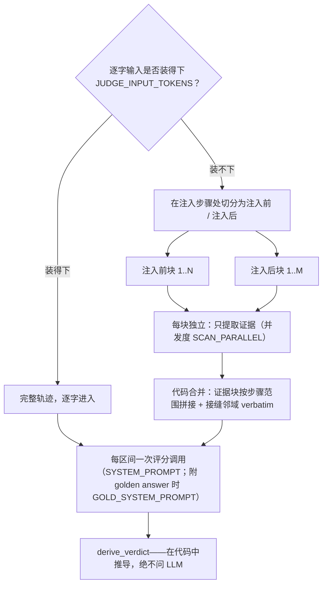
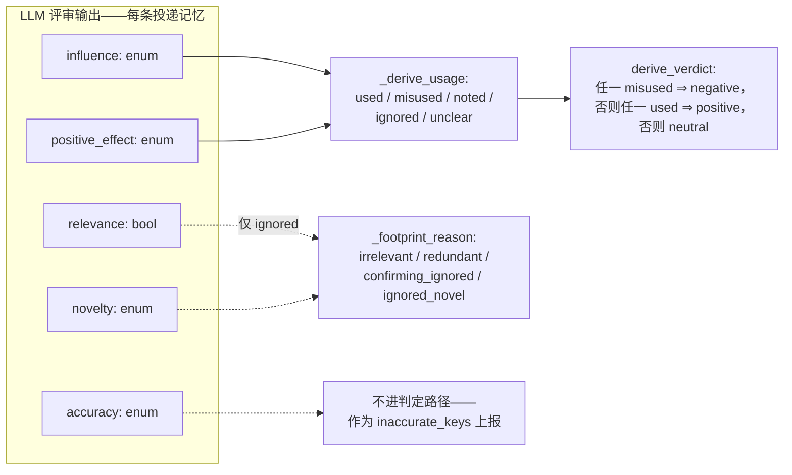

# mem-eval

[English](README.md) | 简体中文

面向记忆系统质量的轨迹分析工具。两个只读工具解析 schema-v6 gate 轨迹：

- **memgraph** — 把每次记忆操作及其关系渲染成一张自包含的 HTML 图。
- **injudge** — 用 LLM 评分规则判定每次召回注入的影响，产出可回灌给
  memgraph 的 `injudge.report/v5` 产物。

> 方法论一句话：注入由它对 agent 的**后续影响**来评判——绝不看最终任务结果。

## 环境要求

- Python 3.11+——除 tiktoken（injudge 的输入预算估算）与 tqdm（injudge 的
  进度条）外无其他依赖；memgraph 完全只用标准库。
- injudge：需要评审端点，在 `.env` 中配置。
- 测试：需要 checkout 本地 uv 虚拟环境中的 pytest、tiktoken 与 tqdm。

## 快速开始

```bash
git clone <repo-url> && cd mem-eval
cp .env.example .env   # 填写评审端点（仅 injudge 需要）

# 1. 可视化记忆操作（离线，无需 .env）：
python3 -m memgraph <paths> -o memgraph.html --json memgraph.json

# 2. 评审召回注入（会产生 LLM 调用；先检查输入）：
python3 -m injudge <paths> --dry-run --limit 3
python3 -m injudge <paths>            # 输出 output/injudge-report.json 与 output/summary.json

# 3. 在图中查看判定结果（或用 injudge --html 一并产出）：
python3 -m memgraph <paths> --verdicts output/injudge-report.json -o memgraph-verdicts.html
```

每个路径可以是轨迹目录（含 `trajectory.jsonl`）、`trajectory.jsonl` 文件
本身，或递归扫描的根目录。匹配不到任何内容的路径会明确报用法错误，
绝不悄悄跳过。

## 输入约定

Schema-v6 gate 轨迹。录制器把记忆系统的逻辑动作写成显式的 `memory_*`
注解事件——`memory_session`、`memory_role_bind`、`memory_generate_*`、
`memory_change`、`memory_search_*`、`memory_delivery`——工具只消费这些
事件：不认标签约定、不解析提示词、不猜测载荷。没有注解的轨迹得到零
记忆操作加一条 validation 说明——这是合法输入，不是错误。

## memgraph — 记忆操作可视化

```bash
python3 -m memgraph <paths> -o memgraph.html --json memgraph.json
```

从注解中提取每个记忆相关动作并渲染其关系：每条记忆**由哪个（轨迹，
步骤）创建**、随后**被哪个（轨迹，步骤）召回**——多条轨迹一起加载时
还能看到跨轨迹复用。记忆身份取可移植的 (`namespace`, `item_id`) 对，
缺省回退到显示键——不同 store 铸造的同名键、或同一 store 中不同 item
持有的同名键，是两条记忆，绝不误并。

HTML 完全自包含、可离线打开：逐轨迹泳道、创建→使用边、生命周期链、
记忆侧栏、操作弹层、过滤与缩放。零记忆操作的轨迹渲染为空泳道。

选项：

- `--json PATH` — 同时输出机器可读的图产物
  （`{tool, trajectories, ops, memories, edges, validation}`）。
- `--verdicts PATH` — 渲染前先合并 injudge 报告：召回节点按其区间的
  判定着色（positive 绿 / negative 红 / neutral 灰 / error 琥珀），
  页眉加上计数，弹层展示评审分析、每条记忆的使用情况以及该区间的输入
  路径（full/scan、gold、over-budget）。按
  `(run_id, op seq)` 连接；未匹配或歧义连接记为 validation 说明，
  不是错误。

## injudge — 召回注入判定

```bash
python3 -m injudge <paths>     # 输出 output/injudge-report.json 与 output/summary.json

# 按区间打印评审输入（含 gold 块；超出预算时附 INPUT OVERFLOW 说明与
# 预计分块数）——只读 .env 中的预算/分块键，不发起评审调用、不写文件：
python3 -m injudge <paths> --dry-run --limit 3
```

以**后续影响**为依据，把每次召回注入判为 **positive / negative /
neutral**。运行时 stderr 上有 tqdm 进度条：轨迹条 + 当前轨迹的区间条
（`[2/4 traj] pydata__xarray-3095`），终端上原地刷新；管道输出时每完成
一条轨迹打一行检查点。

### 注入区间（span）

注入常常重复相同内容，所以评审单元是**注入区间**：投递内容完全相同的
连续注入的最大段（取录制器的可移植身份；步骤间隔不切段）。重复投递
计为 `restated`——计数，但不进判定率。其后没有任何 agent 回合的区间
不可能存在下游影响，直接按规则判 **neutral** 并标记
`auto: no_subsequent_turn`——不花评审调用。

### 评分信号

**每个区间一次评分调用**，对**每条投递记忆**打五个信号——输入为录制
的任务陈述、该区间、以及 agent 步骤流（所有已完成回合的推理、内容与
工具结果——无窗口、无截断）。评分调用读什么由输入预算
（`JUDGE_INPUT_TOKENS`，用 tiktoken `o200k_base` 估算）路由：

- **装得下** → 完整步骤流逐字进入。短轨迹与单次全文评审调用完全一致。
- **装不下** → 绝不截断硬塞。轨迹按块读取（在注入步骤处切分；各块
  划分整个步骤流），每块**只提取证据**——绝不打评分信号——由代码把
  证据块连同注入点前后的 verbatim 邻域组装进评分输入。代码还会为每块的
  提取预填 `[anchor]` 条目——某步骤逐字出现投递记忆的键或有区分度的
  值词时记一条（数量与长度均有上限，计入块预算）——它们只为提取提供
  种子，绝不取而代之。证据超上限或
  组装后仍超预算时，各做一次 LLM 摘要压缩；仍超则保留原文，绝不悄悄
  裁剪——证据超上限的情形记入运行警告，只有超预算的组装体才原样发送
  并标记 `over_budget`。提取运行在独立的配置副本上
  （`SCAN_*` 覆盖键；并发度 `SCAN_PARALLEL`）；某块拿不到可用结果时，
  该区间记为指明该块的 `error` 判定——绝不留下静默的覆盖缺口。



五个信号，逐条投递记忆评判：

| 信号 | 类型 | 问题 |
|---|---|---|
| `relevance` | bool | 注入点上，记忆与任务及 agent 当前子目标是否主题相关？ |
| `accuracy` | enum | `corroborated`（有证据为真）/ `uncontradicted`（无从判断）/ `contradicted`（有证据为假） |
| `novelty` | enum | `novel`（注入前从未出现的新内容）/ `confirming`（敲定 agent 明确表达过的疑点）/ `redundant`（早已确立） |
| `influence` | enum | `none` / `referenced`（仅被提及）/ `acted_on`（影响了命令、编辑或测试）/ `decisive`（被明确归功的转向） |
| `positive_effect` | enum / null | `improved` / `no_effect` / `harmed`；仅当 influence 为 `acted_on` 或 `decisive` 时非空 |

一切下游结论都**在代码里推导，绝不问 LLM**：



- 每条记忆：`used` = acted-on ∧ improved；`misused` = acted-on ∧
  （no effect ∨ harmed）；`noted` = 仅被提及；`ignored` = 无痕迹
  （附原因）；`unclear` = 信息不足。
- 区间判定：任一 `misused` ⇒ **negative**；否则任一 `used` ⇒
  **positive**；否则 **neutral**。仅被提及绝不会得到 negative。

### 可选的 golden answer / correctness

最终评分调用可携带两类可选附件——来自轨迹目录的边车文件
（`trajectory.jsonl` 旁的 `golden.txt` / `golden.md`、
`correctness.json`）或命令行（`--golden PATH`、
`--correctness resolved|unresolved`；命令行覆盖同名边车字段，且对多条
已加载轨迹共用一个 CLI gold 会给出警告）：

- **golden answer 正文**（参考解答）把该次调用切换到 **gold 评分规则**
  （`GOLD_SYSTEM_PROMPT`）：同样的五个信号、同样的 schema、同样的推导
  链，但 `relevance` 与 `positive_effect` 的方向相对 gold 文本评判。
  gold 不影响 `accuracy`、`novelty`、`influence`，也绝不进入提取调用。
- **已记录的 correctness**（`resolved`/`unresolved`，可选 0–1 分数）
  以 `TASK CORRECTNESS` 块附加在该次调用所用提示词之下——仅作佐证，
  绝不能单独决定任何信号。`correctness.json` 接受两种格式：简单的
  `{"resolved": true|false, "score": …}` 记录，或 SWE-bench 风格的
  评测报告（`resolved_ids`/`unresolved_ids`——按轨迹记录的
  `instance_id` 连接；error/incomplete 实例属于 harness 故障而非结果，
  不附加 correctness）。

两者都没有时，评分与朴素规则完全一致。该规则体系记录在每个操作的
`input` 上（`"gold": true`），并计入 `aggregates.overall.gold_scored`。

### 评审稳健性

评审客户端按合规层级链 **structured**（受限解码）→ **json**
（JSON 模式）→ **prompt** 自动降级：某层级的格式字段被拒绝或被证明
忽略时，降级不消耗预算，并全程记忆首个可用层级。瞬时故障（429/5xx、
传输错误、空内容）共享尝试预算并退避，尊重服务端声明的
`Retry-After`。预算耗尽时该区间记为 `error` 判定并保留评审原始输出
——绝不悄悄判 neutral；只要有区间出错，退出码为 2。

**投递成本**按确定性规则核算（不交给 LLM）：每区间的投递数 × 内容
大小，按 chars/4 估算 token，计入其判定类别。**投递策略**按轨迹与
整体统计：注入密度、重述比例、注入占轨迹真实 prompt token 预算的份额。

### 评审端点配置（.env）

复制 `.env.example` 为 `.env` 并填写（完整注释见该文件）：

| 键 | 默认值 | 用途 |
|---|---|---|
| `MODEL` | 必填 | 评审模型；`--judge-model` 可覆盖 |
| `API_KEY` / `BASE_URL` | 必填 | 评审端点；`OPENAI_API_KEY` / `OPENAI_BASE_URL` 可遮蔽 |
| `API` | `openai-chat` | 线格式：`openai-chat` · `responses` · `anthropic` |
| `TEMPERATURE` | `0.0` | 采样温度 |
| `MAX_ATTEMPTS` | `5` | 每区间在工作层级的生成尝试预算；层级发现免费 |
| `OUTPUT_FORMAT` | 自动 | 固定合规层级 `structured` / `json` / `prompt`；不设则从 `structured` 自动降级并记忆可用层级 |
| `THINKING` | 提供方默认 | `enabled` / `disabled`；映射到提供方原生字段 |
| `THINKING_EFFORT` | 不设 | `none` … `max`，按提供方原生透传 |
| `THINKING_BUDGET` | — | 仅 anthropic；`API=anthropic` 且 `THINKING=enabled` 时必填，须小于 `--judge-max-tokens` |
| `JUDGE_PARALLEL` | `1` | 同一轨迹内并行评判的区间数（上限 32）；在飞调用数可达 `JUDGE_PARALLEL` × `SCAN_PARALLEL` |
| `JUDGE_INPUT_TOKENS` | `50000` | 评分请求的 token 上限：低于它单次全文调用；超过则走分块证据扫描 |
| `SCAN_PARALLEL` | `4` | 提取并发数（上限 32；`1` 为全串行）；评分始终为单次调用 |
| `SCAN_CHUNK_STEPS` | `8` | 每个提取块的最大 agent 步数 |
| `SCAN_CHUNK_TOKENS` | min(`20000`, 预算的一半) | 单个提取请求 user 体的 token 上限；不设时从 `JUDGE_INPUT_TOKENS` 派生，显式设置时须小于它 |
| `SCAN_NEIGHBORHOOD` | `2` | 评分输入中注入步骤两侧各保留的 verbatim 步数（`0` = 仅注入步本身） |
| `SCAN_EVIDENCE_TOKENS` | `4096` | 单块返回证据项的 token 提示上限；超限时做一次摘要压缩，绝不截断 |
| `SCAN_MODEL` · `SCAN_API` · `SCAN_BASE_URL` · `SCAN_API_KEY` | 继承 | 提取端点覆盖键（`SCAN_OPENAI_BASE_URL` / `SCAN_OPENAI_API_KEY` 可遮蔽）；不设则继承评分值 |
| `SCAN_THINKING` | `disabled` | 唯一不继承的覆盖键：提取默认不烧推理预算，显式 enabled 才开启 |
| `SCAN_MAX_TOKENS` · `SCAN_TEMPERATURE` · `SCAN_MAX_ATTEMPTS` · `SCAN_THINKING_EFFORT` · `SCAN_THINKING_BUDGET` · `SCAN_OUTPUT_FORMAT` | 继承 | 其余提取覆盖键，与评分键一一对应 |

其余命令行参数：`--timeout`、`--max-attempts`、`--judge-max-tokens`
（默认 24000——是上限不是预留；推理模型会把它的大部分花在 reasoning
上）、`--limit N`（必须为正整数——0 或负数直接报错）、`--env PATH`、`--golden PATH`、
`--correctness resolved|unresolved`。

### 产物

所有产物写入输出目录（`-o DIR`，默认 `output/`）：

- `injudge-report.json` — `injudge.report/v5` 运行时报告，每条轨迹完成
  即重写，崩溃也保留已完成部分：逐区间的判定与评分信号、分析、证据、
  投递成本，每个操作的 `input` 记录（预算门路径 `full`/`scan` 及其
  扫描计数、gold 规则体系与超预算原样发送标记）、轨迹投递策略与汇总
  指标（含 gate 区间上的 `input_paths` 与 `gold_scored` 计数）。可用
  memgraph 的 `--verdicts` 回灌。
- `summary.json` — `injudge.summary/v2` 最终统计集合：计数、比率、评分信号
  分布、成本、置信度、精简的逐记忆使用统计（按轨迹与整体），外加无叙述
  的区间索引（判定 / 置信度 / 使用标签）。评判叙述与过程日志只保留在
  report 产物中。
- `memgraph-verdicts.html` — 仅在 `--html` 时产出（默认关闭）：召回节点
  按区间判定着色的 memgraph 可视化。

### 读懂 summary.json

`summary.json` 是一次运行的最终统计集合——供阅读和比较记忆系统的数字。
（评判叙述——评分 note、分析、证据、`judge_raw`、validation 日志——只保留在
`injudge-report.json` 里；区间的 `operation_id` 即指向它的索引。）计数规则：
比率只覆盖**已评判区间**（分母 = positive + negative + neutral）；`error` 与
`unjudged` 只计数、永不进分母；规则判定的 auto-neutral 区间计为 neutral；
重述的重复投递并入其区间、从不出现在比率中。

顶层：`tool.schema`（产物版本）、`generated_at`、`overall`（全部轨迹合并）、
`trajectories`（逐轨迹块，含同样的统计外加区间索引）。每条轨迹在有记录时
带上 `instance_id` / `model` / `adapter`。没有已评判样本的块会省略空的
rate / headline / rubric / confidence / cost 壳（仅 error 或零注入的轨迹
仍保留判定计数）。

每个聚合块（`overall` 与每条轨迹）：

| 字段 | 含义 |
|---|---|
| `n_injections` | 投递的召回注入数，含重述的重复投递 |
| `n_spans` | 注入区间数——评审单元（相同投递的最大连续段） |
| `restated_injections` | 相同内容的重复投递（计数，但不进比率） |
| `positive` / `negative` / `neutral` | 区间判定：注入的足迹改善 / 损害 / 未体现在工作中 |
| `error` / `unjudged` | 评审失败的区间 / 被 `--limit` 截掉的区间 |
| `rates` | 已评判区间上的判定占比（无评判时省略） |
| `headline.judged_spans` | 比率的分母（为 0 时整个 `headline` 省略） |
| `headline.wasted_token_share` | neutral+negative 区间的注入 token 成本占已评判区间成本的比例——花在没有帮助的注入上的预算份额 |
| `rubric.deliveries` | 被打分的记忆投递数（区间 × 记忆 key）；为 0 时整个 `rubric` 省略 |
| `rubric.counts` / `rubric.rates` | 已评判投递上各信号的取值分布与投影比率；null 信号永不稀释比率。比率口径：`relevance` = 相关占比；`accuracy` = 未被证伪及以上占比；`novelty` = 非冗余占比；`influence` = 有任何足迹的占比；`positive_effect` = 仅在有影响的投递中 improved 的占比（无影响时按契约为 null） |
| `rubric.no_footprint_reasons` | 被忽略记忆未留足迹的原因：`irrelevant` / `redundant` / `confirming_ignored` / `ignored_novel`（空时省略） |
| `rubric.inaccurate_keys` / `irrelevant_keys` | 排查清单 `{key, spans}`——评审认定被证伪 / 不相关的记忆；仅在非空时写出 |
| `cost` | 确定性的投递成本（不经评审）：`content_chars_total`、`approx_tokens_total`（chars/4 估算）、按判定类别归集的 `approx_tokens_by_verdict`（为零时省略） |
| `confidence.mean_by_verdict` / `confidence.buckets` | 评审置信度：按判定类别的均值（省略 null 类）与 `[0,0.5)` / `[0.5,0.8)` / `[0.8,1.0]` 分桶计数，覆盖已评判区间（没有任何评分时整个 `confidence` 省略） |
| `input_paths` | 仅 overall：预算门（`JUDGE_INPUT_TOKENS`）后走全文 / 分块扫描输入的 gate 区间数 |
| `gold_scored` | 仅 overall：在 gold 评分规则下评判的区间数（附了 golden answer） |
| `over_budget` | 仅 overall：评分输入超过 `JUDGE_INPUT_TOKENS` 预算仍原样发送的区间数 |
| `n_trajectories` | 仅 overall：本次运行的轨迹数 |
| `memory_usage` | 逐记忆使用统计：`key` + 非零 `tallies`；记录内容跨区间变化时加 `value_drift: true`。标签：`used` = 被采纳且改善；`misused` = 被采纳但无效果或有害；`noted` = 仅被提及；`ignored` = 无足迹；`unclear` = 信息不足 |
| `low_confidence` | 置信度 < 0.5 的区间 id（仅在非空时写出） |
| `policy` | 投递策略：`n_steps`、`injection_density`（每 agent 步的注入数）、`restated_ratio`、`est_injected_tokens`、`prompt_tokens_total`（计费用量）、`injected_token_share`、`n_searches` |

`rubric.counts` 中出现的信号枚举值即上文评分信号表中的值。当多个身份共用
同一显示键时，summary 的 `key` 字段（排查清单与 `memory_usage`）会带上
`key#<item 或 namespace>` 后缀——取 8 字符前缀，前缀冲突时取完整 base——
两条记忆绝不会被并成一条；report 始终保留完整身份。每条轨迹的
`spans` 是指向 report 的无叙述索引：

| 字段 | 含义 |
|---|---|
| `operation_id` | 区间 id——在 `injudge-report.json` 中可查完整记录 |
| `verdict` / `confidence` | 区间判定与评审置信度（`confidence` 为 null 时省略） |
| `steps` | 该区间投递落在的 `[首个, 末个]` agent 步 |
| `n_injections` | 区间内的投递数 |
| `usage` | 逐记忆的使用标签（与 `memory_usage` 同一套标签；空时省略） |

## 测试

```bash
uv venv .venv && uv pip install pytest tiktoken tqdm   # 首次，在 checkout 内执行
.venv/bin/python -m pytest tests -q
```

测试不走网络——评审与提取客户端都打桩；夹具为
`tests/annotated_fixtures.py` 合成的 schema-v6 轨迹。

## 项目结构

- `util.py` — 共享工具（原子写产物、安全打印）
- `memgraph/` — 注解索引、解析、链接、HTML 渲染、判定合并、CLI
  （`python3 -m memgraph`）
- `injudge/` — 步骤流、注入区间、分级评审客户端、超预算扫描
  （`scan.py`）、gold 边车（`gold.py`）、聚合、报告、CLI
  （`python3 -m injudge`）
- `prompts/` — 所有 LLM 提示词文件，按工具/用途分目录（经
  `injudge/prompts.py` 加载；代码中绝不内联提示词）
- `tests/` — pytest 测试套件 + 共享的 schema-v6 合成轨迹构造器
