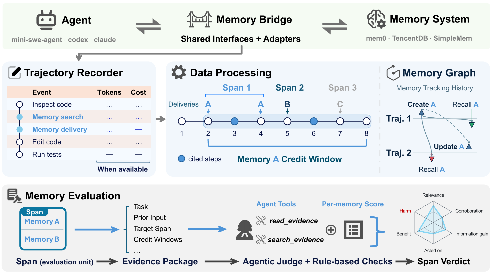

# MemUse

> 本仓库提供以下论文的实现：**Delivered, Not Used: Evaluating Agent Memory at Its Point of Use**。<br>
>
> [](https://arxiv.org/abs/2611.01718)

[English](README.md) | 简体中文

MemUse 从录制的 agent 行为评估记忆是否相关、可信、提供新信息，以及是否影响行动并带来收益或伤害。它评估记忆对后续行为的可观察影响；任务最终成功与否不能直接决定记忆结论。

GitHub 仓库名为 `mem-use`。文档示例使用本地目录名 `mem-eval`，提供两个只读命令：

- **memgraph**：把记忆创建、更新、删除和召回渲染为可离线打开的 HTML 图。
- **injudge**：按 episode 内的召回区间评审，输出逐条信号、区间结论和汇总；结果可叠加到图上。



*图源：MemUse 论文概览图。流程与文档入口见[中文文档](doc/zh-CN/README.md)。*

## 先准备录制

使用前必须按以下两个项目的说明配置记忆接入和轨迹录制：

- [memory-bridge](https://github.com/ChangranXU/memory-bridge)：接入记忆系统并提供投递、作用域和来源信息。
- [traj-recorder](https://github.com/ChangranXU/traj-recorder)：录制 schema-v10 gate 轨迹和显式 `memory_*` 注解。

MemUse 分析已有录制，不会替你运行任务或接入记忆系统。输入需要 `trajectory.jsonl` 及其录制目录；请保留 `run.json` 和 `calls/` 等辅助文件，以便核验消费输入和用量。没有记忆注解的轨迹会得到零记忆操作，无法靠提示词补推。

本地需要 Python 3.11+ 和 [uv](https://docs.astral.sh/uv/)。实际评审和 TypeScript 测试还需要 Node.js ≥ 22.19；画图、`--dry-run` 和 `--prepare-only` 不需要 Node 或评审凭证。

## 快速开始

在本仓库根目录运行，将示例中的 `path/to/recordings` 替换为实际录制路径。它可以是轨迹目录、`trajectory.jsonl` 文件或递归扫描的根目录，也可提供多个路径。

```bash
uv sync

# 离线画图
uv run -m memgraph path/to/recordings -o memgraph.html --json memgraph.json

# 离线检查 episode 与评审证据
uv run -m injudge path/to/recordings --prepare-only -o output/
uv run -m injudge path/to/recordings --dry-run --limit 3
```

确认输入可用后，安装评审依赖并配置端点：

```bash
npm --prefix agent install
cp .env.example .env
```

在 `.env` 中填写 `MODEL`、`API_KEY`、`BASE_URL`，然后运行评审（会调用所配置的模型并产生费用）：

```bash
uv run -m injudge path/to/recordings --html -o output/
```

每次运行写入独立的 `output/<run-stamp>/`。先读 `summary.md`，再按需查看 `injudge-report.json`、证据和评审对话。`--html` 同时生成判定叠加图。已有报告也可单独用于画图。将下例中的 `RUN` 替换为实际运行文件夹名：

```bash
uv run -m memgraph path/to/recordings --verdicts output/RUN/injudge-report.json -o memgraph-verdicts.html
```

## 如何读结果

同一 episode 内处理方式相同、可见性连续的重复投递会合并为区间。评审模型为每个暴露条目返回五个信号：`relevance`、`accuracy`、`novelty`、`influence`、`positive_effect`；Python 验证证据后推导结论。

汇总同时保留六个条目占比：相关、得到证实、信息增益、影响行动、收益和伤害，以及未知项与覆盖率。它们不合成为单一总分。区间结论用于筛选待复核记录：有害使用优先为 negative，其次为 positive，再是调查不足或效果未知的 unresolved，其余为 neutral。完整调查后仍无法区分来源的归因歧义单独记为 ambiguous，归入 neutral。

空投递、不可观察的消费者、评审失败和未评审区间单独计数。仍在输入中的副本若没有合格动作步骤，会自动判为 neutral，不调用评审，也不获得条目画像。详见[判定推导](doc/zh-CN/verdict-derivation.md)和[产物](doc/zh-CN/artifacts.md)。

## 文档与测试

[中文文档](doc/zh-CN/README.md) · [English documentation](doc/en/README.md)

- [输入约定](doc/zh-CN/input-contract.md)：录制要求、记忆身份和缺失证据。
- [memgraph](doc/zh-CN/memgraph.md) · [injudge](doc/zh-CN/injudge.md)：命令和工作流。
- [配置](doc/zh-CN/configuration.md)：端点、预算和全部参数。
- [产物](doc/zh-CN/artifacts.md)：文件、字段、分母和覆盖率。
- [开发](doc/zh-CN/development.md)：离线测试和真实评审校准。

```bash
uv run pytest tests -q
```

测试不访问网络；评审判断质量需另做真实模型校准，不能由预制答案测试证明。

## 引用

```bibtex
@misc{xu2026deliveredusedevaluatingagent,
      title={Delivered, Not Used: Evaluating Agent Memory at Its Point of Use},
      author={Changran Xu and Zeju Li and Qiang Xu},
      year={2026},
      eprint={2611.01718},
      archivePrefix={arXiv},
      primaryClass={cs.AI},
      url={https://arxiv.org/abs/2611.01718},
}
```
