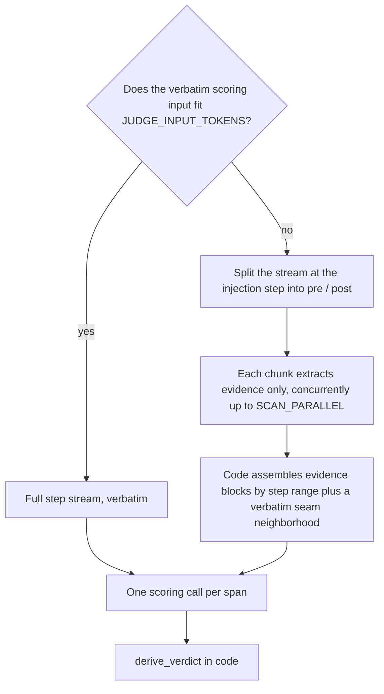

# injudge

```bash
python3 -m injudge <paths>     # writes output/injudge-report.json + output/summary.json

# Print the judge input per span (gold blocks included). Overflowing spans
# add an INPUT OVERFLOW note with the would-be chunk counts. Reads only the
# budget/chunk knobs from .env; no credentials, no judge calls, no files:
python3 -m injudge <paths> --dry-run --limit 3
```

injudge classifies each recall injection as **positive**, **negative**, or **neutral** from its footprint in the turns that follow. stderr shows tqdm progress: a trajectories bar plus the current trajectory's span bar on a TTY, and one checkpoint line per finished trajectory when piped.

The LLM scores five signals per delivered memory. The span verdict is derived in code from those signals; see [Verdict derivation](verdict-derivation.md).

## Injection spans

Identical content is often re-injected, so the judged unit is the **injection span**: a maximal run of consecutive recall ops whose delivered set has the same portable identity. Step gaps do not break a span (they are recorded in `step_gaps` and shown to the judge). A content change does.

Re-deliveries roll up as `restated`. They count toward delivery cost and `n_injections`; they do not appear in verdict rates.

A span with no attributed agent step (`step_first` is `None`) has no downstream footprint. It is rule-judged **neutral** with `auto: no_subsequent_turn`. No judge call is made.

Span construction, including the fingerprint fallback for undigested content, is specified in [Memory identity](input-contract.md#memory-identity).

## Scoring input

One scoring call per span. The request contains the recorded task statement (when present), the span, and the agent step stream: every completed agent turn with its reasoning, content, and tool results.

The request is routed on `JUDGE_INPUT_TOKENS`, measured with tiktoken `o200k_base` over the scoring system prompt plus the scoring user:



**Fits.** The complete step stream goes in verbatim. Short trajectories are a single full-text scoring call.

**Overflows.** The stream is not truncated to fit. It is partitioned at the span's first injection step into pre-injection and post-injection sides; every step lands in exactly one chunk. Chunk size is bounded by `SCAN_CHUNK_STEPS` and `SCAN_CHUNK_TOKENS`. Each chunk runs an **extraction** call that returns evidence items only — never rubric values, never a verdict.

Code then builds the scoring user from:

1. Evidence blocks grouped by step range.
2. A verbatim **seam neighborhood** of `SCAN_NEIGHBORHOOD` steps on each side of the injection (`0` keeps only the injection step).

Extraction is seeded with `[anchor]` items: one per step where a delivered memory's key or a distinctive value word appears verbatim. Terms are capped in count and length and counted toward the chunk budget. Anchors seed extraction; they do not replace it.

Over-cap evidence and an over-budget assembled user each get one LLM summary pass. A still-over result keeps the original text. An evidence overrun is noted in warnings. An over-budget assembly is sent as-is and marked `over_budget` on the operation's `input` record.

A chunk with no usable record fails that span with an `error` verdict that names the chunk. There is no silent coverage gap. Extraction runs on a copy of the scoring config with the `SCAN_*` overrides; a degradation on extraction does not leak onto scoring.


Extraction is per span: each span's split and prompt differ, so *N* overflowing spans pay *N* full extraction passes. Golden-answer and correctness attachments are added to the scoring call only. They are never sent to extraction.


The five signals the scoring call returns are defined below. Everything computed from them is documented in [Verdict derivation](verdict-derivation.md).

## Rubric signals

Each delivered memory is scored independently. Notes cite step and seq numbers from the stream.

| Signal | Type | Question |
|---|---|---|
| `relevance` | bool | Is the memory topically related to the task and to the agent's current subgoal at the injection point? Judged from the steps before the span's first step. |
| `accuracy` | enum | `corroborated` (observable evidence it is right) / `uncontradicted` (no evidence either way) / `contradicted` (observable evidence it is wrong). |
| `novelty` | enum | `novel` (substance never appeared pre-injection) / `confirming` (settles an open doubt the agent had articulated) / `redundant` (already established, no open doubt). |
| `influence` | enum | `none` / `referenced` (mentioned only) / `acted_on` (shaped a later command, edit, or test) / `decisive` (explicitly credited with a pivot). Footprint is subsequent behavior, from the span's first step onward. |
| `positive_effect` | enum or null | `improved` / `no_effect` / `harmed`. Non-null only when influence is `acted_on` or `decisive`. |

`positive_effect = no_effect` counts against the memory system: context and attention were spent without improving the work. A skip inferred only from an action's absence is `influence = none`; absence alone is not evidence.

The final task result, when it is discernible, may raise or lower confidence. It cannot decide a signal by itself.

## Golden answer and correctness

The scoring call accepts two optional attachments. Each may come from a sidecar next to `trajectory.jsonl` or from the CLI. CLI values override the same-named sidecar fields. One CLI gold over several loaded trajectories warns.

| Attachment | Source | Effect |
|---|---|---|
| Golden-answer body | `golden.txt` (wins over `golden.md` when both are usable), or `--golden PATH` | Switches that call to the **gold rubric** (`GOLD_SYSTEM_PROMPT`). Same five signals, same schema, same derive chain. `relevance` and the direction of `positive_effect` are judged against the gold text. Gold does not speak to `accuracy`, `novelty`, or `influence`. |
| Recorded correctness | `correctness.json`, or `--correctness resolved\|unresolved` | Attaches as a `TASK CORRECTNESS` block under whichever prompt the call uses. Corroboration only; it cannot decide a signal, and it does not select the gold rubric. |

`correctness.json` accepts a plain `{"resolved": true|false, "score": …}` record or a SWE-bench-style harness report (`resolved_ids` / `unresolved_ids`). The harness report is joined by the trajectory's recorded `instance_id`. Errored or incomplete instances are harness failures, not outcomes, so no correctness attaches.

With neither attached, scoring uses the plain rubric. The regime is recorded on each gated operation's `input` (`"gold": true`) and counted in `aggregates.overall.gold_scored`.

## Judge client

The client walks a conformance tier chain — **structured** (constrained decoding) → **json** (JSON mode) → **prompt**. Anthropic has no json tier. A rejected or proven-ignored format field degrades for free; the first working tier is memoized for the rest of the run. Pin a tier with `OUTPUT_FORMAT`.

Transient failures (429/5xx, transport, empty content) share `MAX_ATTEMPTS` with backoff and honor a declared `Retry-After`. An answer cut mid-JSON at the output-token budget becomes an `error` verdict naming the truncation: no free degrade, no same-budget retry.

When the budget is exhausted, the span is `error` and the judge's raw text is kept. Failures are not coerced to neutral. The process exits 2 if any span errored.

Endpoint credentials are sent only to the judge endpoint. They never appear in artifacts, reports, logs, or error messages. Endpoint output that echoes the request is masked before any of its text is kept.

## Delivery cost and policy

Delivery cost is accounted deterministically. Each span's cost is the sum of recorded placement sizes over all of its deliveries, including restated ones, with a `chars / 4` token estimate. That total is charged to the span's verdict class. Redacted placements that record no size count as 0 tokens and produce a warning.

Delivery policy is measured per trajectory and overall: injection density, restated ratio, and the injected share of the trajectory's billed prompt-token budget (every lane, including memory-lane extraction calls).

How these numbers roll into `summary.json` is specified in [Artifacts](artifacts.md#how-the-numbers-are-derived).
