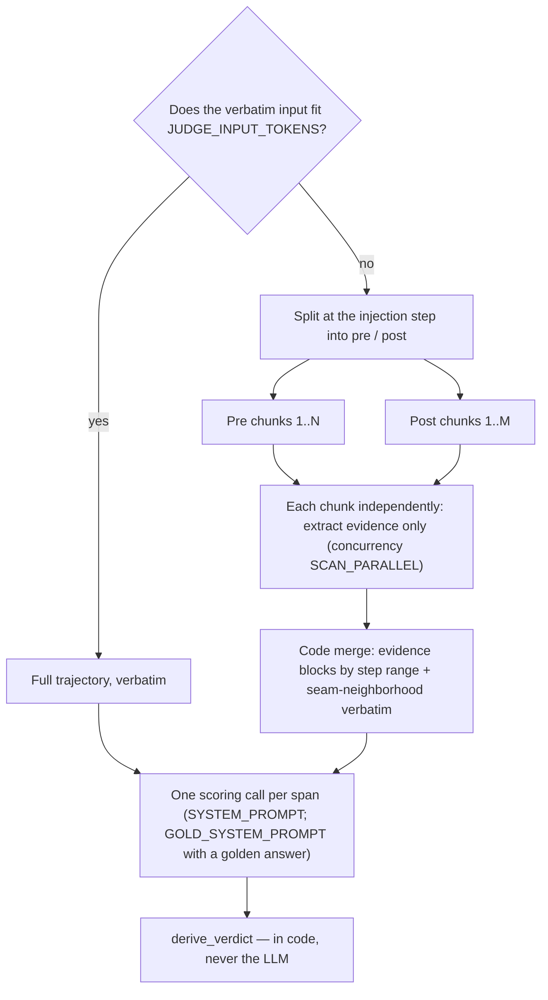
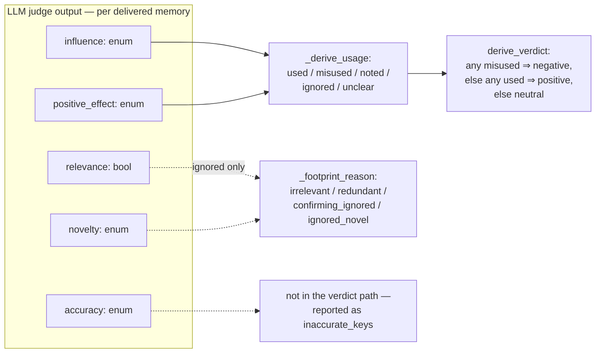

# injudge — recall-injection verdicts

```bash
python3 -m injudge <paths>     # writes output/injudge-report.json + output/summary.json

# print the judge input per span (gold blocks included; overflow adds an
# INPUT OVERFLOW note with the would-be chunk counts) — reads only the
# budget/chunk knobs from .env, no judge calls, no files written:
python3 -m injudge <paths> --dry-run --limit 3
```

Judges each recall injection's impact — **positive / negative / neutral** —
from its subsequent influence on the trajectory. A tqdm progress display on
stderr shows trajectories and the current trajectory's span completion —
redrawing in place on a TTY, one checkpoint line per finished trajectory
when piped.

## Injection spans

Injections often repeat identical content, so the judged unit is the
**injection span**: a maximal run of consecutive injections with identical
delivered content (the recorder's portable identity; step gaps do not break
a span). Re-deliveries roll up as `restated` — counted, never in verdict
rates. A span with no agent turn after it cannot have a downstream footprint,
so it is rule-judged **neutral** and marked `auto: no_subsequent_turn` — no
judge call.

## The rubric

**One scoring call per span** scores *every delivered memory* on five
signals, given the recorded task statement, the span, and the agent step
stream (every completed agent turn with its reasoning, content, and tool
results — no windows, no caps). What the scoring call reads routes on the
input budget (`JUDGE_INPUT_TOKENS`, estimated with tiktoken `o200k_base`):

- **Fits** → the COMPLETE step stream goes in verbatim. Short trajectories
  are identical to a single full-text judge call.
- **Overflows** → never truncated to fit. The trajectory is read in chunks
  (split at the injection step; the chunks partition the step stream), each
  chunk **extracts evidence only** — never rubric values — and code
  assembles the evidence blocks plus a verbatim seam neighborhood around the
  injection into the scoring user. Code seeds each chunk's extraction with
  `[anchor]` items — one per step where a delivered memory's key or a
  distinctive value word appears verbatim (capped in count and length,
  counted toward the chunk budget); they seed extraction, never replace it.
  Over-cap evidence and an over-budget assembly each get one LLM summary
  pass; a still-over result keeps the original, never silently cut — the
  evidence-cap case is noted in the run's warnings, and only an over-budget
  assembly is sent as-is marked `over_budget`. Extraction runs on its own
  config copy (the `SCAN_*` overrides; concurrency `SCAN_PARALLEL`), and a
  chunk with no usable record fails that span with an `error` verdict naming
  it — never a silent coverage gap.



The five signals, judged per delivered memory:

| Signal | Type | Question |
|---|---|---|
| `relevance` | bool | Is the memory topically related to the task and the agent's current subgoal at the injection point? |
| `accuracy` | enum | `corroborated` (evidence it is right) / `uncontradicted` (no evidence either way) / `contradicted` (evidence it is wrong) |
| `novelty` | enum | `novel` (substance never appeared pre-injection) / `confirming` (settles an open doubt the agent had articulated) / `redundant` (already established) |
| `influence` | enum | `none` / `referenced` (mentioned only) / `acted_on` (shaped a command, edit, or test) / `decisive` (explicitly credited with a pivot) |
| `positive_effect` | enum / null | `improved` / `no_effect` / `harmed`; null unless influence is `acted_on` or `decisive` |

Everything downstream is **derived in code, never asked of the LLM**:



- Per memory: `used` = acted-on ∧ improved; `misused` = acted-on ∧
  (no effect ∨ harmed); `noted` = referenced; `ignored` = no footprint (with
  a reason); `unclear` = gaps.
- Span verdict: any `misused` ⇒ **negative**, else any `used` ⇒
  **positive**, else **neutral**. Mere reference never yields negative.

## Optional golden answer / correctness

The final scoring call accepts two optional attachments — from a trajectory
dir's sidecar files (`golden.txt` / `golden.md`, `correctness.json` next to
`trajectory.jsonl`) or the CLI (`--golden PATH`, `--correctness
resolved|unresolved`; the CLI overrides the same-named sidecar fields, and
one CLI gold over several loaded trajectories warns):

- A **golden-answer body** (the reference solution) switches that call to
  the **gold rubric** (`GOLD_SYSTEM_PROMPT`): same five signals, same
  schema, same derive chain, but `relevance` and `positive_effect`'s
  direction are judged against the gold text. The gold never speaks to
  `accuracy`, `novelty`, or `influence`, and is never sent to extraction.
- A **recorded correctness** (`resolved`/`unresolved`, optional 0–1 score)
  attaches as a `TASK CORRECTNESS` block under whichever prompt the call
  uses — corroboration only; it can never decide a signal by itself.
  `correctness.json` takes either a plain `{"resolved": true|false,
  "score": …}` record or the SWE-bench-style harness report
  (`resolved_ids`/`unresolved_ids` — joined by the trajectory's recorded
  `instance_id`; errored/incomplete instances are harness failures, not
  outcomes, so no correctness attaches).

With neither attached, scoring is exactly the plain rubric. The regime is
recorded on each operation's `input` (`"gold": true`) and counted in
`aggregates.overall.gold_scored`.

## Judge robustness

The judge walks a conformance tier chain — **structured** (constrained
decoding) → **json** (JSON mode) → **prompt**; anthropic has no json tier —
degrading for free when a
tier's format field is rejected or provably ignored, and memoizing the first
working tier for the rest of the run. Transient failures (429/5xx, transport,
empty content) share the attempt budget with backoff, honoring a declared
`Retry-After`. When the budget is exhausted the span gets an `error` verdict
with the judge's raw text kept — never silently neutral — and the exit code
is 2 if any span errored.

**Delivery cost** is accounted deterministically (never judged): each span's
deliveries × content size, with a chars/4 token estimate, charged to its
verdict class. **Delivery policy** is measured per trajectory and overall:
injection density, restated ratio, and the injected share of the trajectory's
real prompt-token budget.
