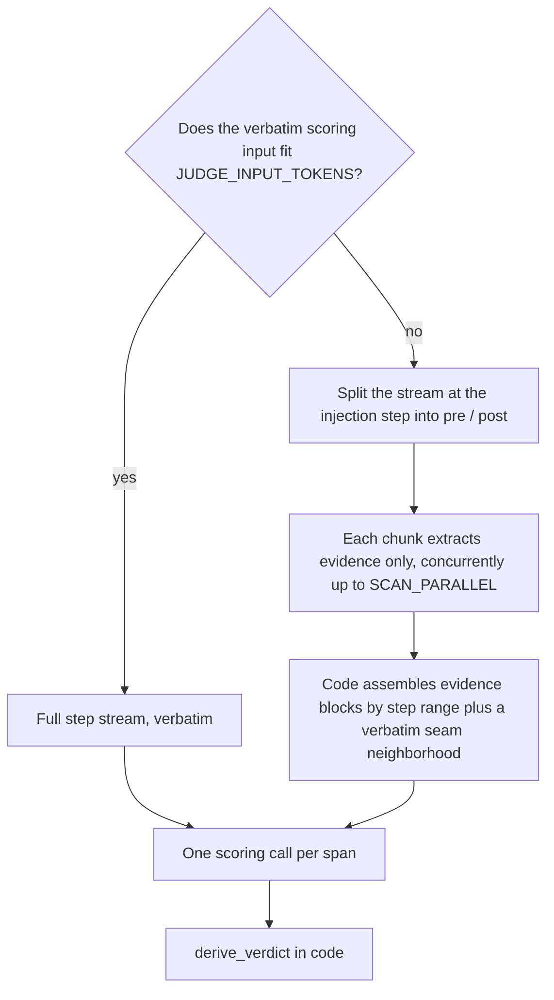

# Scoring Input


One scoring call per span. The request carries the recorded task statement (when present), the span, and the agent step stream — every completed agent turn with its reasoning, content, and tool results.


Routing is decided by `JUDGE_INPUT_TOKENS`, measured with tiktoken `o200k_base` over the scoring system prompt plus the scoring user:

## Fits the Budget

The complete step stream goes in verbatim. Short trajectories are a single full-text scoring call.

## Overflows the Budget

The stream is never truncated to fit. Instead:

1. **Partition.** The stream is split at the span's first injection step into pre- and post-injection sides; every step lands in exactly one chunk. Chunk size is bounded by `SCAN_CHUNK_STEPS` and `SCAN_CHUNK_TOKENS`.
2. **Extract.** Each chunk runs an **extraction** call that returns evidence items only — never rubric values, never a verdict. Extraction is seeded with `[anchor]` items: one per step where a delivered memory's key or a distinctive value word appears verbatim. Anchors are capped in count and length, counted toward the chunk budget, and seed extraction rather than replace it.
3. **Assemble.** Code assembles the scoring user from evidence blocks grouped by step range, plus a verbatim **seam neighborhood** of `SCAN_NEIGHBORHOOD` steps on each side of the injection (`0` keeps only the injection step).

### Guardrails

- Over-cap evidence and an over-budget assembled user each get one LLM summary pass; a still-over result keeps the original text. An evidence overrun is noted in warnings; an over-budget assembly is sent as-is and marked `over_budget` on the operation's `input` record.
- A chunk with no usable record fails that span with an `error` verdict naming the chunk. There is no silent coverage gap.
- Extraction runs on a copy of the scoring config with the `SCAN_*` overrides, so a tier degradation learned during extraction never leaks onto scoring.


Extraction is per span: each span's split and prompt differ, so *N* overflowing spans pay *N* full extraction passes. Golden-answer and correctness attachments (see [injudge](injudge.md#golden-answer-and-correctness)) are added to the scoring call only; they are never sent to extraction.


The chunk knobs (`SCAN_*`) are documented in [Configuration](configuration.md#scan-overflow-path). What the LLM returns for this input is defined in [Rubric and verdict derivation](verdict-derivation.md#rubric-signals).
