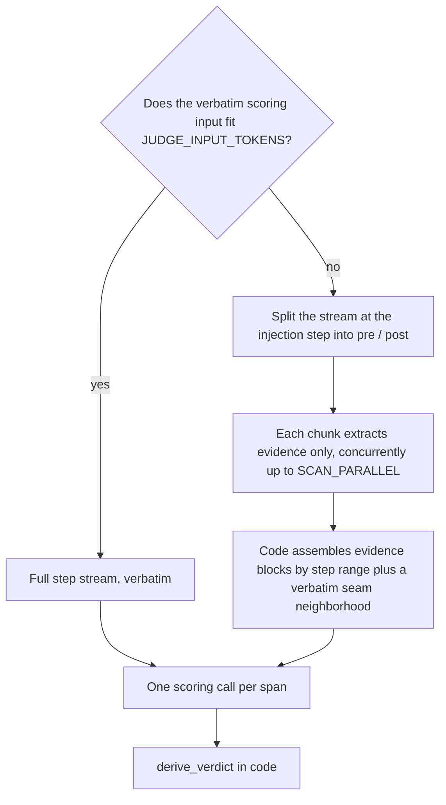

# Scoring Input


One scoring call per span. The request carries the recorded task statement (when present), the span, and the agent step stream — every completed agent turn with its reasoning, content, and tool results.


The span header tells the judge the span's position among the trajectory's spans, all recorded search queries that produced the injection, and how the injection was presented when recorded (the placement kind plus its full resolved text; unavailable or redacted content stays absent). Each delivered ENTRY is labelled with a stable span-local id (`[m1]`, `[m2]`, …) — the answer keys its rubric entries by those ids, so two entries sharing a display key are scored independently (annotation-only `memory_type` and confidence fields are withheld; text actually shown in the placement is preserved) — and, where the recording allows it, an exposure marker: the placement is compared against the canonical value adapter-free; a value the placement carried only in part is shown to the judge as the exposed prefix only (`EXPOSED CLIP`), a value carried whole but only up to whitespace-run or markdown-escape normalization is marked `EXPOSURE NORMALIZED` (treated as fully shown), and a value that cannot be matched at all is marked `EXPOSURE UNVERIFIED` with the canonical value withheld from the judge input (a warning alone is no information boundary — hidden content could still prime the explanation; the scan path's lexical anchor seeding skips it too). The normalized compare is prose-safe only: a value carrying quotes, backslashes, or line structure compares verbatim only, since collapsing whitespace or stripping escapes inside strings, regexes, or indentation-sensitive content changes semantics rather than presentation. The header also names the keys delivered in any earlier span and the keys whose value changed since their last earlier delivery — the novelty baseline beyond the task statement (a gap re-delivery, absent from the immediately previous span, is still not new content).

Each delivered entry's judged footprint window runs from the span's first step to that entry's next re-delivery — a re-delivery supersedes, so a memory delivered in two spans is never credited in both; the header lists each entry's window separately, and an entry never re-delivered is unbounded. The one exception is named rather than implied: a later span delivering one of these entries at the span's own last delivery step (a same-step collision — two memory blocks placed in one call, or a declared step collision) closes that entry's still-open window at that step inclusive AND opens the colliding span's window for the same entry only after it (the recording carries no causal order within one step, so the shared step is credited exactly once under a first-carrier rule); the collision is noted in the run's validation log. Windows are per entry (span-local id), never per display key: identities sharing one key keep their own bounds.

Routing is decided by `JUDGE_INPUT_TOKENS`, measured with tiktoken `o200k_base` over the scoring system prompt plus the scoring user:

The step stream is not every message in the original conversation. Queries may come from memory/side lanes, keys are metadata, and earlier-span labels alone do not reconstruct co-resident content. The prompts require uncertainty (`null`) when missing baseline or extracted evidence prevents a signal from being established. Later outcomes can substantiate an in-window action or decision but cannot create a new out-of-window action anchor.

## Fits the Budget

The complete step stream goes in verbatim. Short trajectories are a single full-text scoring call.

## Overflows the Budget

The stream is never truncated to fit. Instead:

1. **Partition.** Split the entire stream at the first injection step into pre/post sides. Every step appears in exactly one chunk, including later outcomes after all attribution windows close. Windows still restrict action credit; they do not hide subsequent confirmation or contradiction. By default, only `SCAN_CHUNK_TOKENS` sizes chunks; a positive `SCAN_CHUNK_STEPS` adds an explicit step cap. An oversized single step is sent intact, never clipped.
2. **Extract.** Each chunk runs an **extraction** call that returns evidence items only — never rubric values, never a verdict. Extraction is seeded with `[anchor]` lexical hits: one per step where a delivered memory's key or a distinctive value word appears verbatim inside that entry's footprint window — a hit past the window is the re-delivering span's evidence and is never pre-filled here, a clipped entry seeds from its exposed prefix only (the unshown suffix was never in front of the agent), a term appearing in more than a quarter of the trajectory's steps is dropped (domain vocabulary, not a footprint pointer), and identifier-shaped words are preferred under the anchor cap. Anchors seed the extraction requests only: they never enter the scoring evidence pack, so a bare lexical hit is never handed to the scoring judge as a finding.
3. **Assemble.** Group evidence by step range and add a verbatim **seam neighborhood** of `SCAN_NEIGHBORHOOD` steps on each side of the injection (`0` keeps the injection step). The neighborhood is additional context, not a cutoff for the evidence scan.

### Guardrails

- A full-text send the endpoint rejects as too long (413, or a signed length/context-window 400/422 — the tiktoken estimate can undercount for the real judge tokenizer) falls back to this scan path once instead of erroring the span, marked `length_fallback` on the operation's `input` record and noted in warnings.
- Extracted evidence has no per-chunk size limit or second summary pass. Only an over-budget assembled scoring request earns one evidence-compression pass. If compression fails or the result still does not fit, retain the original and mark `over_budget`; never silently cut evidence. The task, placement, memory entries, neighborhood and gold are not summarized.
- A chunk with no usable record fails that span with an `error` verdict naming the chunk. There is no silent coverage gap.
- Extraction runs on a copy of the scoring config with the `SCAN_*` overrides, so a tier degradation learned during extraction never leaks onto scoring.


Extraction is per span: each span's split and prompt differ, so *N* overflowing spans pay *N* full extraction passes. Golden-answer and correctness attachments (see [injudge](injudge.md#golden-answer-and-correctness)) are added to the scoring call only; they are never sent to extraction.


The chunk knobs (`SCAN_*`) are documented in [Configuration](configuration.md#scan-overflow-path). What the LLM returns for this input is defined in [Rubric and verdict derivation](verdict-derivation.md#rubric-signals).

## Cap Audit

| Component | Decision | Reason |
|---|---|---|
| Placement preview (formerly 2,000 characters) | Remove | Full framing reaches scoring and extraction; full-text comparison also prevents merging treatments whose instructions differ only in the tail. |
| Query preview / query count (300 characters / eight queries) | Remove | Preserve all retrieval provenance; it is not presumed main-agent knowledge. |
| Task, exposed memory values, reasoning, assistant content, all tool arguments/results, gold | Keep uncapped | The whole request is measured at the input gate. |
| Agent-side clipped/redacted exposure | Keep | Never reveal a canonical suffix the agent did not see; this is provenance, not an evaluator budget. |
| Per-entry attribution windows | Keep | Bound action credit, not the observation horizon. Full and scan both observe the complete stream. |
| Scoring input allowance | 800,000 tokens by default | Configurable routing threshold with output/tokenizer headroom; no silent truncate-to-fit. |
| Chunk tokens / step count | Half the input budget / no default step cap | Scale with the configured window; avoid fragmenting short connected actions just to satisfy an eight-step cutoff. |
| Lexical seeds (64 terms, 200 characters/term, frequency ≤25%) | Keep | Bound optional search hints, not source text. Extraction still reads every step and the full exposed targets; hints never become scoring evidence by themselves. |
| Verbatim scan neighborhood (two steps each side) | Keep | Additional raw context; evidence extraction covers all other steps. |
| Per-chunk evidence limit and compression | Remove | Do not discard or re-summarize evidence that fits the final request. |
| Final evidence compression | Keep only on actual assembly overflow | One pass; failed/oversized compression preserves the original and records the over-budget send. |
| Output cap / timeout | 65,536 tokens / 300 seconds | Leave reasoning headroom; an incomplete budget-truncated answer remains an error, never an accepted partial verdict. |
| Diagnostic excerpts / JSON-parser probes / retries / concurrency | Keep | These limit logs, output recovery, retry cost or scheduling, not the judge's source evidence. |

These changes repair information loss and inconsistent evidence views; they do not establish causal identification or prove extraction is lossless. Structured source-linked extraction and a reconstructed time-indexed context would be separate pipeline changes, not assumed capabilities here. No experiments or validation studies are added.
