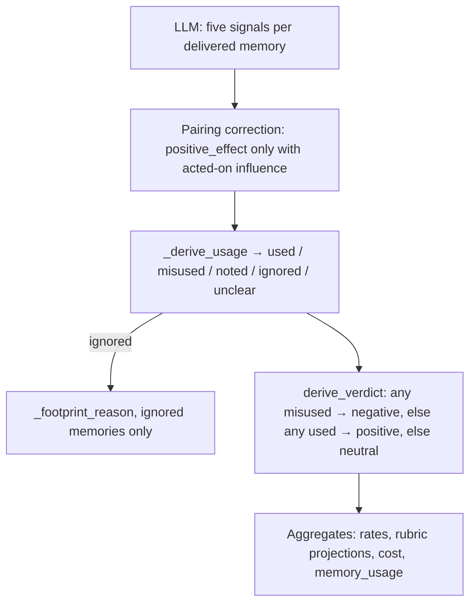

# Rubric and Verdict Derivation


The LLM scores five signals per delivered memory. It never chooses a span verdict. injudge derives usage labels, footprint reasons, and the span verdict in code (`injudge/judge.py`).


How those labels are counted into rates and tallies is in [Artifacts](artifacts.md#how-the-numbers-are-derived).



## Rubric Signals

Each delivered ENTRY is scored independently under its span-local id (`m1`, `m2`, … in delivery order): two entries may share a display key — distinct stored memories, or two versions in one delivery — and they are never collapsed into one judgment. Notes cite step and seq numbers from the stream. Where the recording shows it, each entry also carries an **exposure marker** stating what of its value the placement actually showed the agent; the judge scores that exposure, never an unseen suffix.

| Signal | Type | Question |
|---|---|---|
| `relevance` | bool | Is the memory topically related to the recorded task and current subgoal? Use input available before the target delivery and earlier eligible episode steps. Relevance is independent of accuracy, novelty, and use: a wrong proposed remedy, redundant memory, or unused memory can be relevant, and a transferable technique or useful subgoal counts even when it names another library or bug. |
| `accuracy` | enum | `corroborated` (observable evidence it is right) / `uncontradicted` (no evidence either way) / `contradicted` (observable evidence it is wrong). |
| `novelty` | enum or null | `novel` (the pre-delivery baseline supports new substance) / `confirming` (settles an open doubt) / `redundant` (already established) / `null` (visibility cannot be established). The baseline includes recorded task/user input and earlier available steps but excludes the target placement and later updates. An earlier delivery alone does not prove continued visibility after a rewrite. Substance, not wording, decides: a mixed memory is `redundant` only when every material claim was already established, and the note names the known and the new claims. |
| `influence` | enum | `none` / `referenced` (mentioned only) / `acted_on` (an eligible action uses the exposed memory rather than an already available source) / `decisive` (it demonstrably changes the plan). The footprint starts at the target span's first step and ends at that entry's next same-episode delivery or the episode's last eligible global step. Task/system text, earlier reasoning, and unrelated tool results are independent sources; a search query is retrieval metadata, and gold is evaluator-only. Echoing a direction already established before delivery is not changed action, although a redundant reminder can still change an action. A prior direction needs a pre-delivery source: a plan first stated at or after the span's first step cannot show it predated exposure. Notes name the delivery step and the source behind each action; overlap with both memory and task is reported as ambiguous attribution, and unsupported use is "influence not established", never a claim of no effect. A source is credited only with elements it actually contains, and an uncited action matching only common practice (focused tests, minimal fixes) is ambiguous attribution, not memory use. `acted_on`/`decisive` require original global step **anchors** inside both the episode and entry window. |
| `positive_effect` | enum or null | `improved` / `no_effect` / `harmed`, judged by observable downstream events inside the memory's window (`improved`: a downstream event ties the benefit to the memory-shaped action; `no_effect`: the action produced no observable downstream change; `harmed`: a wrong location, false lead, reverted correct work). Non-null only when influence is `acted_on` or `decisive`. Accuracy never decides this signal: a memory carrying a false claim can still have set off the diagnostic that found the fix. |


`positive_effect = no_effect` counts against the memory system: context and attention were spent without improving the work. A skip inferred only from an action's absence is `influence = none`; absence alone is not evidence.


The verdict rule is deliberately asymmetric: ignored garbage is **neutral** (no footprint), and only acted-on influence with no effect — or harm — is **negative**. A zero negative rate therefore never reads as "harmless" on its own: reporting always binds it to the wasted-token share, itself a span-level proxy (a neutral span's referenced memories count as wasted; a positive span's ignored memories count as productive), and states the caveat on every reported share (see [Artifacts](artifacts.md#verdict-rates)). Spans whose deliveries cannot be attributed to an agent step (no classified agent turn, or a missing/unclassified consumer) are rule-judged without an LLM call and reported as **unassessable** — observation missingness, not a measured null — outside every directional denominator.

Novelty rates describe new substance relative to the recorded pre-delivery
baseline, not knowledge new to the agent. Common advice can therefore be
`novel` while its uncited use remains unattributable (`influence=none`). A
missing or incomplete baseline still calls for `null`, not automatic novelty.
Novelty includes all material claims, even task-irrelevant ones; relevance
cannot turn previously unavailable substance into redundancy.
If the evidence instead establishes a memory-shaped reversal of an earlier
habit or plan, common advice can be `decisive` without an explicit citation.

The final task result, when discernible, may raise or lower confidence. It cannot decide a signal by itself.

## Division of Labor

| Produced by the LLM | Derived in code |
|---|---|
| Per-memory `relevance`, `accuracy`, `novelty`, `influence`, `positive_effect` (value + note) | Per-memory `usage` (`used` / `misused` / `noted` / `ignored` / `unclear`) |
| Span-level `analysis`, `evidence[]`, `confidence` | Per-ignored-memory `reason` (`irrelevant` / `redundant` / `confirming_ignored` / `ignored_novel` / `ignored_unknown_novelty`) |
| | Span `verdict` (`positive` / `negative` / `neutral`) |
| | Delivery cost, policy metrics, and all `summary.json` rates |

`accuracy` is reported (`inaccurate_keys`) and does not enter the verdict path. `relevance` and `novelty` enter the verdict path only as the reason an ignored memory left no footprint.

## Assembly

Two layers of semantic checking apply, both in code:

**Inside the attempt loop** (`_verdict_semantics`, called by `judge_span` on every final answer after `_strict_parse`) — these checks are span-relative (the judge cannot know this span's ids or windows a priori), so a violation takes the bounded corrective retry; exhaustion is an `error` verdict, never a silently partial one:

1. **Exact id coverage.** The answer carries exactly one entry per delivered entry's span-local id — a missing entry is an unanswered judgment, an unknown one is noise, and neither stands.
2. **Action anchors.** An `acted_on`/`decisive` claim cites at least one original global step in the parent episode, inside that entry's footprint window (from the span's first step to its next same-episode re-delivery − 1, or the episode's last eligible step). An anchor outside the episode or before the span is rejected: earlier evidence may support a novelty or accuracy **note**, never an influence anchor. `anchors` stay empty when influence is `none`. A same-step delivery collision credits the shared step only to the earlier carrier; the later span's entry window opens after it.
3. **Orthogonal signals.** Novelty, accuracy, influence, and effect are judged independently: no cross-signal combination is a contract violation. A reminder (`redundant` + `acted_on`), a partially false memory that triggered the fix (`contradicted` + `improved`), and a genuinely shared footprint (two entries carrying the same substance, credited with a "shared" note) are all reportable states the rubric must not suppress.

The judge may anchor an in-window decision when later execution substantiates
it; an unexecuted plan earns no action credit. Source claims must distinguish
quoted task requirements from common practice and discoveries after exposure.
Expressed uncertainty takes priority for `confirming` even when supporting facts
were already visible. These judgments remain the agent's responsibility; the
validator checks anchor membership and shape, not the truth of the notes.

**At assembly** (`_assemble_verdict`), on the validated object:

4. **Pairing.** `positive_effect` applies only when `influence` is `acted_on` or `decisive`. A null effect in that case is the rubric's sanctioned uncertainty route (the direction could not be determined on the evidence): usage derives `unclear` and the occurrence is logged, but it is not a pairing correction. An effect set while influence is `none` or `referenced` is coerced to `null` (warned, counted as a pairing correction).
5. **Usage, reason, verdict.** `_derive_usage` labels each entry; `_footprint_reason` runs only for `ignored`; `derive_verdict` reads the usage labels. Confidence is clamped to `[0, 1]`.

A span that delivers no memories at all is not an error: it derives neutral with a warning, since there is nothing to score.

Display-only fields (`analysis`, evidence claims) are copied and credential-masked. A malformed evidence list is dropped with a warning; it does not fail the span.

After assembly, advisory prose checks add validation warnings without changing
labels, rewriting text, or triggering retries. They flag `independent`,
`independently`, `unassisted`, `unaided`, or exclusive-source wording such as
`from code alone` in a `none` entry's notes (or in the span analysis when any
entry is `none`), and analysis longer than 60 whitespace-delimited words.
Task-source checks apply only to influence notes, novelty notes, and analysis:
they flag locally task-attributed quotations absent from `task.md` after
whitespace, backtick, and case normalization, and recognizable task-requirement
claims without a matching quotation containing at least one fragment of three
or more words. Neither separate short quotes nor ellipsis-separated fragments
can pool words to satisfy that minimum. Ellipsis quotes (`...` or `…`) match
only when every nonempty fragment occurs in task order. A qualifying quote
prevents the unquoted warning even if its citation prefix is unrecognized.
Relevance notes may describe the task
without attributing an action to it and are excluded from these checks.
These are lexical review cues: negated independence can also trigger,
and a span-wide claim cannot be assigned to one entry mechanically. The quote
check recognizes preceding task/source labels and common quote delimiters;
it cannot catch every attribution style or a real quotation
used to justify a requirement it does not imply. It checks presence in the
file, not the quote's availability before delivery. An unrelated longer quote
can still suppress a warning, and quoted adjectives can still cause false
alarms. Replaying known reports is not a measure of coverage on new notes.
Human review is still needed.

## Usage Labels

`_derive_usage` reads `influence` and `positive_effect` after pairing:

| `influence` | `positive_effect` | `usage` | Meaning |
|---|---|---|---|
| `acted_on` or `decisive` | `improved` | `used` | The memory shaped later behavior and improved the work. |
| `acted_on` or `decisive` | `no_effect` or `harmed` | `misused` | The memory shaped later behavior without improving it, or led the agent astray. |
| `acted_on` or `decisive` | `null` | `unclear` | Acted-on influence without an effect judgment. |
| `referenced` | (ignored; typically `null`) | `noted` | Mentioned only. Actions did not change because of it. |
| `none` | (ignored; typically `null`) | `ignored` | No observable footprint. |
| `null` / unknown | any | `unclear` | Influence itself unknown. |

The evidence string on a usage entry is the first non-empty note among `positive_effect`, `influence`, and `novelty`.

## Footprint Reasons

`_footprint_reason` runs only for `ignored` memories. Unknown novelty is kept separate from `ignored_novel`: missing baseline evidence cannot establish a novelty tier. Only `novelty` and `positive_effect` allow null; all other signals keep their existing bool/enum contract. Unknown novelty never decides influence, usage, or the span verdict.

| `relevance` | `novelty` | `reason` |
|---|---|---|
| `false` | any | `irrelevant` |
| `true` | `redundant` | `redundant` |
| `true` | `confirming` | `confirming_ignored` — settled an open suspicion, never credited |
| `true` | `novel` | `ignored_novel` |
| `true` | `null` | `ignored_unknown_novelty` |

These reasons populate `rubric.no_footprint_reasons`. They do not change the span verdict: an ignored memory is already outside `used` / `misused`.

## Span Verdict

`derive_verdict` reads the derived usage labels. Harm dominates:

1. Any memory `misused` → **negative**.
2. Else any memory `used` → **positive**.
3. Else → **neutral**.

`noted`, `ignored`, and `unclear` never produce negative on their own. Mere reference is therefore never a negative span.

```python
usages = [entry["usage"] for entry in memory_usage.values()]
if "misused" in usages:
    return "negative"
if "used" in usages:
    return "positive"
return "neutral"
```

### Worked Examples

Each row is one span. Memories not listed are absent.

| Memories | Derived usage | Span verdict | Why |
|---|---|---|---|
| A: `acted_on` + `improved`; B: `none` | A `used`, B `ignored` | **positive** | At least one used, none misused. |
| A: `acted_on` + `no_effect` | A `misused` | **negative** | Used but did not improve: context spent for nothing. |
| A: `acted_on` + `harmed` | A `misused` | **negative** | Active harm. |
| A: `decisive` + `improved`; B: `acted_on` + `harmed` | A `used`, B `misused` | **negative** | Harm dominates help. |
| A: `referenced` | A `noted` | **neutral** | Mention without action. |
| A: `acted_on` + `null` | A `unclear` | **neutral** | Influence without an effect judgment; not counted as used or misused. |
| A: `none`, `relevance=false` | A `ignored` (`irrelevant`) | **neutral** | No footprint. |
| No subsequent agent turn (`auto`) | placeholder `unclear` | **neutral** | Rule-judged; no LLM call. See below. |

## Rule-Judged and Failed Spans

| Case | `verdict` | Judge call | Rubric / usage in aggregates |
|---|---|---|---|
| No attributed agent step | `neutral`, `auto: no_subsequent_turn` | none | Placeholder null rubric and `unclear` usage. Excluded from rubric rates, usage tallies, and confidence. Tallies as **unassessable** in aggregates — out of every directional rate and the wasted-token share. |
| `--limit` cutoff or `--dry-run` | `unjudged` | none | Count only. Not a rate denominator. |
| Coverage/anchor violation after exhausted attempts, contract failure | `error` | attempted | Count only. Raw text kept. Not coerced to neutral. |

How these labels become the rates, costs, and tallies in `summary.json` is documented in [Artifacts](artifacts.md#how-the-numbers-are-derived).
