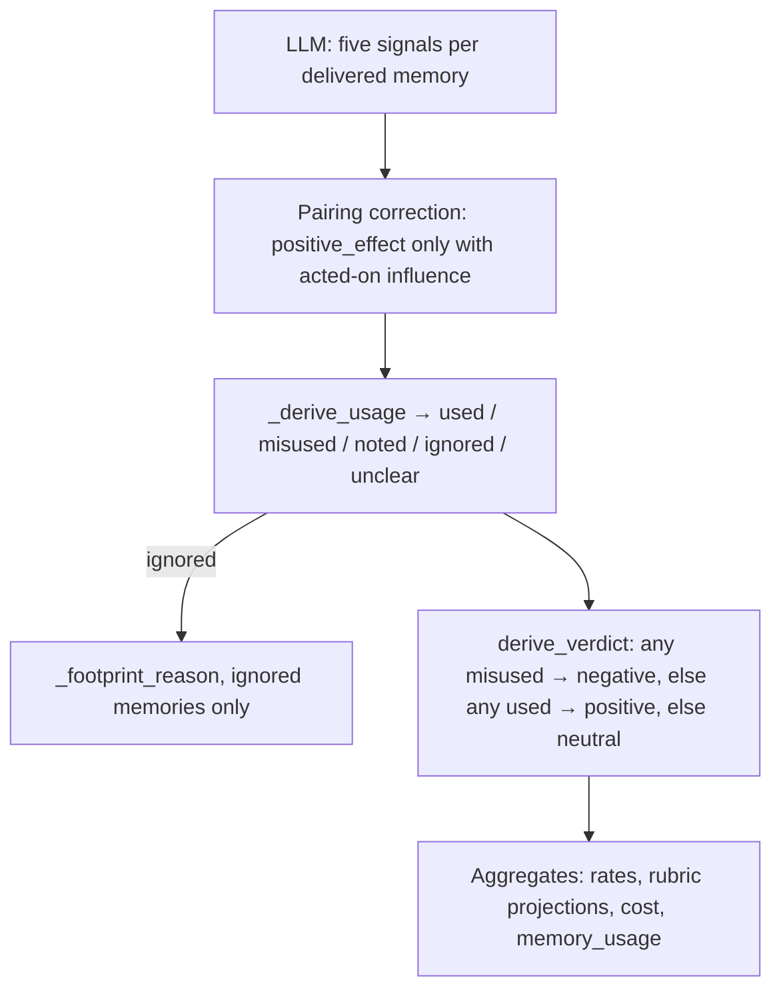

# Verdict derivation

The LLM scores five signals per delivered memory. It does not choose a span verdict. injudge derives usage labels, footprint reasons, the span verdict, and every aggregate that depends on them in code (`injudge/judge.py`, `injudge/aggregate.py`).

This page is the mapping. Signal definitions live in [injudge](injudge.md#rubric-signals).



## Division of labor

| Produced by the LLM | Derived in code |
|---|---|
| Per-memory `relevance`, `accuracy`, `novelty`, `influence`, `positive_effect` (value + note) | Per-memory `usage` (`used` / `misused` / `noted` / `ignored` / `unclear`) |
| Span-level `analysis`, `evidence[]`, `confidence` | Per-ignored-memory `reason` (`irrelevant` / `redundant` / `confirming_ignored` / `ignored_novel`) |
| | Span `verdict` (`positive` / `negative` / `neutral`) |
| | Delivery cost, policy metrics, and all `summary.json` rates |

`accuracy` is reported (`inaccurate_keys`) and does not enter the verdict path. `relevance` and `novelty` enter the verdict path only as the reason an ignored memory left no footprint.

## Assembly

`_assemble_verdict` turns a shape-valid judge object into the internal record. Semantic checks that a JSON schema cannot express happen here:

1. **One entry per key.** Several versions of one key in a single delivery collapse to one rubric row (warned). Memories with no key are excluded from the rubric and from usage; their delivery cost still counts.
2. **Coverage.** A span key absent from the judge array gets nulled signals and a warning. Zero coverage of the span's keyed memories is an immediate `error` verdict — a model-quality signal, not a derived neutral. Unknown keys in the judge array are dropped.
3. **Pairing.** `positive_effect` applies only when `influence` is `acted_on` or `decisive`. A missing effect in that case leaves usage `unclear` (warned). An effect set while influence is `none` or `referenced` is coerced to `null` (warned).
4. **Usage, reason, verdict.** `_derive_usage` labels each memory; `_footprint_reason` runs only for `ignored`; `derive_verdict` reads the usage labels. Confidence is clamped to `[0, 1]`.

Display-only fields (`analysis`, evidence claims) are copied and credential-masked. A malformed evidence list is dropped with a warning; it does not fail the span.

## Usage labels

`_derive_usage` reads `influence` and `positive_effect` after pairing:

| `influence` | `positive_effect` | `usage` | Meaning |
|---|---|---|---|
| `acted_on` or `decisive` | `improved` | `used` | The memory shaped later behavior and improved the work. |
| `acted_on` or `decisive` | `no_effect` or `harmed` | `misused` | The memory shaped later behavior without improving it, or led the agent astray. |
| `acted_on` or `decisive` | `null` | `unclear` | Acted-on influence without an effect judgment. |
| `referenced` | (ignored; typically `null`) | `noted` | Mentioned only. Actions did not change because of it. |
| `none` | (ignored; typically `null`) | `ignored` | No observable footprint. |
| `null` / unknown | any | `unclear` | Influence itself unknown. |

The evidence string on a usage entry is the first non-empty note among `positive_effect`, `influence`, and `novelty`.

## Footprint reasons

`_footprint_reason` runs only for `ignored` memories. Strict parsing guarantees `novelty` is an enum in that case (nulled coverage-gap entries derive `unclear`, not `ignored`).

| `relevance` | `novelty` | `reason` |
|---|---|---|
| `false` | any | `irrelevant` |
| `true` | `redundant` | `redundant` |
| `true` | `confirming` | `confirming_ignored` — settled an open suspicion, never credited |
| `true` | `novel` | `ignored_novel` |

These reasons populate `rubric.no_footprint_reasons`. They do not change the span verdict: an ignored memory is already outside `used` / `misused`.

## Span verdict

`derive_verdict` reads the derived usage labels. Harm dominates:

1. Any memory `misused` → **negative**.
2. Else any memory `used` → **positive**.
3. Else → **neutral**.

`noted`, `ignored`, and `unclear` never produce negative on their own. Mere reference is therefore never a negative span.

```python
usages = [entry["usage"] for entry in memory_usage.values()]
if "misused" in usages:
    return "negative"
if "used" in usages:
    return "positive"
return "neutral"
```

### Worked examples

Each row is one span. Memories not listed are absent.

| Memories | Derived usage | Span verdict | Why |
|---|---|---|---|
| A: `acted_on` + `improved`; B: `none` | A `used`, B `ignored` | **positive** | At least one used, none misused. |
| A: `acted_on` + `no_effect` | A `misused` | **negative** | Used but did not improve: context spent for nothing. |
| A: `acted_on` + `harmed` | A `misused` | **negative** | Active harm. |
| A: `decisive` + `improved`; B: `acted_on` + `harmed` | A `used`, B `misused` | **negative** | Harm dominates help. |
| A: `referenced` | A `noted` | **neutral** | Mention without action. |
| A: `acted_on` + `null` | A `unclear` | **neutral** | Influence without an effect judgment; not counted as used or misused. |
| A: `none`, `relevance=false` | A `ignored` (`irrelevant`) | **neutral** | No footprint. |
| No subsequent agent turn (`auto`) | placeholder `unclear` | **neutral** | Rule-judged; no LLM call. See below. |

## Rule-judged and failed spans

| Case | `verdict` | Judge call | Rubric / usage in aggregates |
|---|---|---|---|
| No attributed agent step | `neutral`, `auto: no_subsequent_turn` | none | Placeholder null rubric and `unclear` usage. Excluded from rubric rates, usage tallies, and confidence. Counts as judged **neutral** in verdict rates. |
| `--limit` cutoff or `--dry-run` | `unjudged` | none | Count only. Not a rate denominator. |
| Coverage gap, contract failure, or exhausted attempts | `error` | attempted | Count only. Raw text kept. Not coerced to neutral. |

## From labels to aggregates

`injudge/aggregate.py` rolls operation records into per-trajectory and overall blocks. The same functions feed both `injudge-report.json` and `summary.json`.

**Verdict rates.** Denominator is judged spans: `positive + negative + neutral`. Auto-neutral spans are in that denominator. `error` and `unjudged` are counts. Restated re-injections never appear in rates; they already rolled into their span.

$$
\mathrm{rates}[v] = \frac{\mathrm{count}[v]}{\mathrm{positive} + \mathrm{negative} + \mathrm{neutral}}
$$

**Rubric rates.** Population is judge-scored deliveries (`span × key`) on LLM-judged spans only (auto-neutral excluded). An all-null coverage-gap row is skipped. Null signal values do not enter a rate's denominator.

| Rate | Numerator | Denominator |
|---|---|---|
| `relevance` | `true` | `true` + `false` |
| `accuracy` | `corroborated` + `uncontradicted` | those + `contradicted` |
| `novelty` | `novel` + `confirming` | those + `redundant` |
| `influence` | `referenced` + `acted_on` + `decisive` | those + `none` |
| `positive_effect` | `improved` | `improved` + `no_effect` + `harmed` |

`positive_effect` is rated only over deliveries that have an effect judgment. That is the contract: the signal is null unless influence is acted-on.

**Triage lists.** `inaccurate_keys` collects identities whose `accuracy` was `contradicted`. `irrelevant_keys` collects identities whose `relevance` was `false`. Each entry carries the span ids that produced it. A key delivered under several `(namespace, item)` identities in one op is tallied under each of them.

**Per-memory usage.** Tallies merge by `(namespace, item)` over LLM-judged spans only. A joint judgment on a multi-item delivery counts under each identity. `value_drift` is true when both the first and last *recorded* values exist and differ; a redacted (unrecorded) end is not drift.

**Cost.** Each span's `approx_tokens_total` (`content_chars_total // 4`, restated deliveries included) is charged to its verdict class. Headline `wasted_token_share` is `(negative + neutral tokens) / judged-class tokens`. Error and unjudged tokens are counted in `cost` and excluded from that denominator.

**Confidence.** Means and buckets (`[0, 0.5)`, `[0.5, 0.8)`, `[0.8, 1.0]`) cover LLM-judged spans only. Confidence never weights counts. Spans with confidence `< 0.5` are listed in `low_confidence`.

**Input regimes** (`overall` only) count gated spans that carry an `input` record: `input_paths.full` / `scan`, `gold_scored`, `over_budget`. Auto-neutral and unjudged spans omit `input`, so they do not appear in those tallies.

Field-level documentation of the written artifacts is in [Artifacts](artifacts.md).
