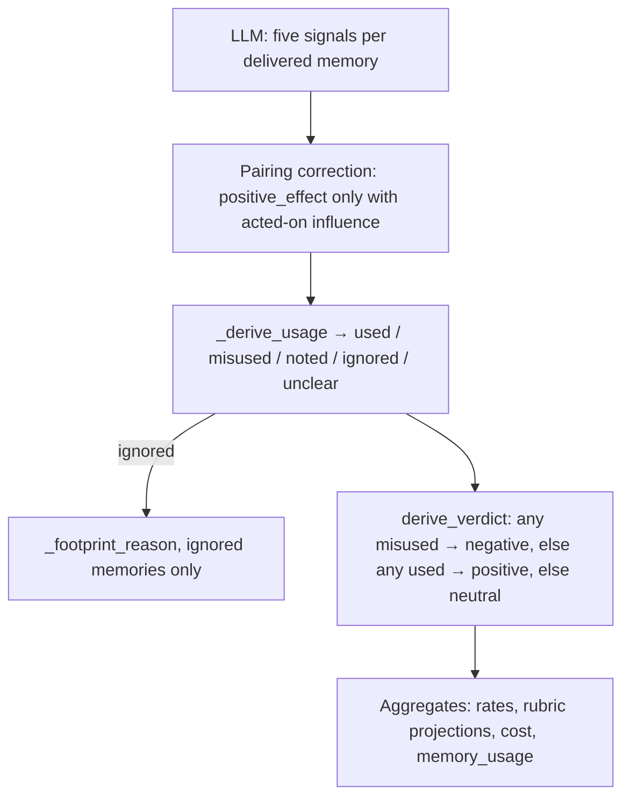

# Rubric and Verdict Derivation


The LLM scores five signals per delivered memory. It never chooses a span verdict. injudge derives usage labels, footprint reasons, and the span verdict in code (`injudge/judge.py`).


How those labels are counted into rates and tallies is in [Artifacts](artifacts.md#how-the-numbers-are-derived).



## Rubric Signals

Each delivered memory is scored independently. Notes cite step and seq numbers from the stream.

| Signal | Type | Question |
|---|---|---|
| `relevance` | bool | Is the memory topically related to the task and to the agent's current subgoal at the injection point? Judged from the steps before the span's first step. |
| `accuracy` | enum | `corroborated` (observable evidence it is right) / `uncontradicted` (no evidence either way) / `contradicted` (observable evidence it is wrong). |
| `novelty` | enum | `novel` (substance appeared neither in the task statement nor the pre-injection steps) / `confirming` (settles an open doubt the agent had articulated) / `redundant` (already established, no open doubt). The task statement and the agent's initial context count as already-in-conversation, exactly like the agent's own pre-injection turns. |
| `influence` | enum | `none` / `referenced` (mentioned only) / `acted_on` (shaped a later command, edit, or test) / `decisive` (explicitly credited with a pivot). Footprint is subsequent behavior: from the span's first step onward, bounded where that memory is next re-delivered (a re-delivery supersedes; never re-delivered = unbounded; another memory's re-delivery bounds only its own window). The echo rule: a direction the agent had already announced, reasoned out, or applied before the span cannot be credited to a memory delivered afterward — even when the resulting action lands inside the window. |
| `positive_effect` | enum or null | `improved` / `no_effect` / `harmed`. Non-null only when influence is `acted_on` or `decisive`. |


`positive_effect = no_effect` counts against the memory system: context and attention were spent without improving the work. A skip inferred only from an action's absence is `influence = none`; absence alone is not evidence.


The verdict rule is deliberately asymmetric: ignored garbage is **neutral** (no footprint), and only acted-on influence with no effect — or harm — is **negative**. A zero negative rate therefore never reads as "harmless" on its own: reporting always binds it to the wasted-token share, itself a span-level proxy (a neutral span's referenced memories count as wasted; a positive span's ignored memories count as productive), and states a caveat when the share is high (see [Artifacts](artifacts.md#verdict-rates)).

The final task result, when discernible, may raise or lower confidence. It cannot decide a signal by itself.

## Division of Labor

| Produced by the LLM | Derived in code |
|---|---|
| Per-memory `relevance`, `accuracy`, `novelty`, `influence`, `positive_effect` (value + note) | Per-memory `usage` (`used` / `misused` / `noted` / `ignored` / `unclear`) |
| Span-level `analysis`, `evidence[]`, `confidence` | Per-ignored-memory `reason` (`irrelevant` / `redundant` / `confirming_ignored` / `ignored_novel`) |
| | Span `verdict` (`positive` / `negative` / `neutral`) |
| | Delivery cost, policy metrics, and all `summary.json` rates |

`accuracy` is reported (`inaccurate_keys`) and does not enter the verdict path. `relevance` and `novelty` enter the verdict path only as the reason an ignored memory left no footprint.

## Assembly

`_assemble_verdict` turns a shape-valid judge object into the internal record. Semantic checks that a JSON schema cannot express happen here:

1. **One entry per key.** Several versions of one key in a single delivery collapse to one rubric row (warned). Memories with no key are excluded from the rubric and from usage; their delivery cost still counts.
2. **Coverage.** A span key absent from the judge array gets nulled signals and a warning. Zero coverage of the span's keyed memories is an immediate `error` verdict — a model-quality signal, not a derived neutral. Unknown keys in the judge array are dropped. A span that delivers no keyed memories at all is not an error: it derives neutral with a warning, since there is nothing to score.
3. **Pairing.** `positive_effect` applies only when `influence` is `acted_on` or `decisive`. A missing effect in that case leaves usage `unclear` (warned). An effect set while influence is `none` or `referenced` is coerced to `null` (warned).
4. **Usage, reason, verdict.** `_derive_usage` labels each memory; `_footprint_reason` runs only for `ignored`; `derive_verdict` reads the usage labels. Confidence is clamped to `[0, 1]`.

Display-only fields (`analysis`, evidence claims) are copied and credential-masked. A malformed evidence list is dropped with a warning; it does not fail the span.

## Usage Labels

`_derive_usage` reads `influence` and `positive_effect` after pairing:

| `influence` | `positive_effect` | `usage` | Meaning |
|---|---|---|---|
| `acted_on` or `decisive` | `improved` | `used` | The memory shaped later behavior and improved the work. |
| `acted_on` or `decisive` | `no_effect` or `harmed` | `misused` | The memory shaped later behavior without improving it, or led the agent astray. |
| `acted_on` or `decisive` | `null` | `unclear` | Acted-on influence without an effect judgment. |
| `referenced` | (ignored; typically `null`) | `noted` | Mentioned only. Actions did not change because of it. |
| `none` | (ignored; typically `null`) | `ignored` | No observable footprint. |
| `null` / unknown | any | `unclear` | Influence itself unknown. |

The evidence string on a usage entry is the first non-empty note among `positive_effect`, `influence`, and `novelty`.

## Footprint Reasons

`_footprint_reason` runs only for `ignored` memories. Strict parsing guarantees `novelty` is an enum in that case (nulled coverage-gap entries derive `unclear`, not `ignored`).

| `relevance` | `novelty` | `reason` |
|---|---|---|
| `false` | any | `irrelevant` |
| `true` | `redundant` | `redundant` |
| `true` | `confirming` | `confirming_ignored` — settled an open suspicion, never credited |
| `true` | `novel` | `ignored_novel` |

These reasons populate `rubric.no_footprint_reasons`. They do not change the span verdict: an ignored memory is already outside `used` / `misused`.

## Span Verdict

`derive_verdict` reads the derived usage labels. Harm dominates:

1. Any memory `misused` → **negative**.
2. Else any memory `used` → **positive**.
3. Else → **neutral**.

`noted`, `ignored`, and `unclear` never produce negative on their own. Mere reference is therefore never a negative span.

```python
usages = [entry["usage"] for entry in memory_usage.values()]
if "misused" in usages:
    return "negative"
if "used" in usages:
    return "positive"
return "neutral"
```

### Worked Examples

Each row is one span. Memories not listed are absent.

| Memories | Derived usage | Span verdict | Why |
|---|---|---|---|
| A: `acted_on` + `improved`; B: `none` | A `used`, B `ignored` | **positive** | At least one used, none misused. |
| A: `acted_on` + `no_effect` | A `misused` | **negative** | Used but did not improve: context spent for nothing. |
| A: `acted_on` + `harmed` | A `misused` | **negative** | Active harm. |
| A: `decisive` + `improved`; B: `acted_on` + `harmed` | A `used`, B `misused` | **negative** | Harm dominates help. |
| A: `referenced` | A `noted` | **neutral** | Mention without action. |
| A: `acted_on` + `null` | A `unclear` | **neutral** | Influence without an effect judgment; not counted as used or misused. |
| A: `none`, `relevance=false` | A `ignored` (`irrelevant`) | **neutral** | No footprint. |
| No subsequent agent turn (`auto`) | placeholder `unclear` | **neutral** | Rule-judged; no LLM call. See below. |

## Rule-Judged and Failed Spans

| Case | `verdict` | Judge call | Rubric / usage in aggregates |
|---|---|---|---|
| No attributed agent step | `neutral`, `auto: no_subsequent_turn` | none | Placeholder null rubric and `unclear` usage. Excluded from rubric rates, usage tallies, and confidence. Counts as judged **neutral** in verdict rates. |
| `--limit` cutoff or `--dry-run` | `unjudged` | none | Count only. Not a rate denominator. |
| Coverage gap, contract failure, or exhausted attempts | `error` | attempted | Count only. Raw text kept. Not coerced to neutral. |

How these labels become the rates, costs, and tallies in `summary.json` is documented in [Artifacts](artifacts.md#how-the-numbers-are-derived).
