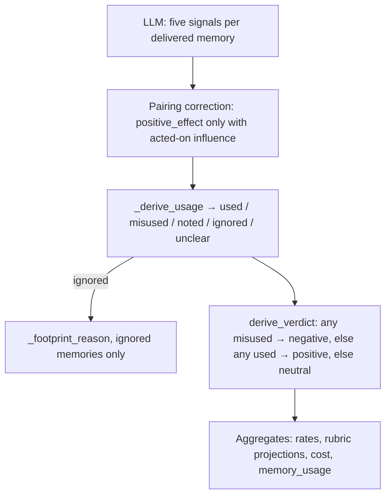

# Rubric and Verdict Derivation


The LLM scores five signals per delivered memory. It never chooses a span verdict. injudge derives usage labels, footprint reasons, and the span verdict in code (`injudge/judge.py`).


How those labels are counted into rates and tallies is in [Artifacts](artifacts.md#how-the-numbers-are-derived).



## Rubric Signals

Each delivered ENTRY is scored independently under its span-local id (`m1`, `m2`, … in delivery order): two entries may share a display key — distinct stored memories, or two versions in one delivery — and they are never collapsed into one judgment. Notes cite step and seq numbers from the stream. Where the recording shows it, each entry also carries an **exposure marker** stating what of its value the placement actually showed the agent; the judge scores that exposure, never an unseen suffix.

| Signal | Type | Question |
|---|---|---|
| `relevance` | bool | Is the memory topically related to the task and to the agent's current subgoal at the injection point? Judged from the steps before the span's first step. |
| `accuracy` | enum | `corroborated` (observable evidence it is right) / `uncontradicted` (no evidence either way) / `contradicted` (observable evidence it is wrong). |
| `novelty` | enum | `novel` (substance appeared neither in the task statement nor the pre-injection steps) / `confirming` (settles an open doubt the agent had articulated) / `redundant` (already established, no open doubt). The task statement counts as already-in-conversation, exactly like the agent's own pre-injection turns. |
| `influence` | enum | `none` / `referenced` (mentioned only) / `acted_on` (a post-injection command, edit, or test uses content the memory carries and the agent could not have derived from what it had already seen, or the agent explicitly cites the memory) / `decisive` (the memory changed the direction of the agent's plan — a demonstrable course change). Footprint is subsequent behavior: from the span's first step onward, bounded where that memory is next re-delivered (a re-delivery supersedes; never re-delivered = unbounded; another memory's re-delivery bounds only its own window). The echo rule: a direction the agent had already announced, reasoned out, or applied before the span cannot be credited to a memory delivered afterward — even when the resulting action lands inside the window. Two further bindings: context is not memory content, where a source's time and role decide — the task statement and the pre-injection steps are what the agent already had, the search query is retrieval metadata the main agent may never have seen (it can originate in a memory or side lane, so a query alone establishes nothing), while the golden answer is evaluator-only verification it never saw and the post-injection steps are exactly where the footprint is judged — and `acted_on`/`decisive` require a CHANGED action, not continuation of an already-established plan. A `redundant` memory CAN still be acted on when the delivery itself changed the action (a reminder restoring a dropped direction, or execution detail the plan lacked): novelty and influence are orthogonal. An acted-on or decisive claim must carry **anchors** — the agent-step numbers where the footprint appears, inside that entry's window; the span's delivery step counts when the shaped action happened in that very response. |
| `positive_effect` | enum or null | `improved` / `no_effect` / `harmed`, judged by observable downstream events inside the memory's window (`improved`: a downstream event ties the benefit to the memory-shaped action; `no_effect`: the action produced no observable downstream change; `harmed`: a wrong location, false lead, reverted correct work). Non-null only when influence is `acted_on` or `decisive`. Accuracy never decides this signal: a memory carrying a false claim can still have set off the diagnostic that found the fix. |


`positive_effect = no_effect` counts against the memory system: context and attention were spent without improving the work. A skip inferred only from an action's absence is `influence = none`; absence alone is not evidence.


The verdict rule is deliberately asymmetric: ignored garbage is **neutral** (no footprint), and only acted-on influence with no effect — or harm — is **negative**. A zero negative rate therefore never reads as "harmless" on its own: reporting always binds it to the wasted-token share, itself a span-level proxy (a neutral span's referenced memories count as wasted; a positive span's ignored memories count as productive), and states the caveat on every reported share (see [Artifacts](artifacts.md#verdict-rates)). Spans with no observable downstream at all (no agent turn classified in the run) are rule-judged without an LLM call and reported as **unassessable** — observation missingness, not a measured null — outside every directional denominator.

The final task result, when discernible, may raise or lower confidence. It cannot decide a signal by itself.

## Division of Labor

| Produced by the LLM | Derived in code |
|---|---|
| Per-memory `relevance`, `accuracy`, `novelty`, `influence`, `positive_effect` (value + note) | Per-memory `usage` (`used` / `misused` / `noted` / `ignored` / `unclear`) |
| Span-level `analysis`, `evidence[]`, `confidence` | Per-ignored-memory `reason` (`irrelevant` / `redundant` / `confirming_ignored` / `ignored_novel`) |
| | Span `verdict` (`positive` / `negative` / `neutral`) |
| | Delivery cost, policy metrics, and all `summary.json` rates |

`accuracy` is reported (`inaccurate_keys`) and does not enter the verdict path. `relevance` and `novelty` enter the verdict path only as the reason an ignored memory left no footprint.

## Assembly

Two layers of semantic checking apply, both in code:

**Inside the attempt loop** (`_verdict_semantics`, called by `judge_span` on every final answer after `_strict_parse`) — these checks are span-relative (the judge cannot know this span's ids or windows a priori), so a violation takes the bounded corrective retry; exhaustion is an `error` verdict, never a silently partial one:

1. **Exact id coverage.** The answer carries exactly one entry per delivered entry's span-local id — a missing entry is an unanswered judgment, an unknown one is noise, and neither stands.
2. **Action anchors.** An `acted_on`/`decisive` claim cites at least one anchor step, and every cited anchor lies inside that entry's footprint window (from the span's first step to its next re-delivery − 1, or to the step stream's final step when it is never re-delivered — a step past the stream's end is a hallucination, not evidence). An anchor before the span's first step is rejected like any other out-of-window anchor, on every entry: pre-injection evidence may back a novelty or accuracy **note**, but never an anchor — anchors are influence evidence. `anchors` stay empty when influence is `none` (no footprint, so nothing to cite); a same-step delivery collision (a later span delivering the same memory at this span's last delivery step) opens the later span's window for that entry only after the shared step, which the earlier span keeps — the recording carries no causal order within one step, so the step is credited exactly once under a first-carrier rule.
3. **Orthogonal signals.** Novelty, accuracy, influence, and effect are judged independently: no cross-signal combination is a contract violation. A reminder (`redundant` + `acted_on`), a partially false memory that triggered the fix (`contradicted` + `improved`), and a genuinely shared footprint (two entries carrying the same substance, credited with a "shared" note) are all reportable states the rubric must not suppress.

**At assembly** (`_assemble_verdict`), on the validated object:

4. **Pairing.** `positive_effect` applies only when `influence` is `acted_on` or `decisive`. A null effect in that case is the rubric's sanctioned uncertainty route (the direction could not be determined on the evidence): usage derives `unclear` and the occurrence is logged, but it is not a pairing correction. An effect set while influence is `none` or `referenced` is coerced to `null` (warned, counted as a pairing correction).
5. **Usage, reason, verdict.** `_derive_usage` labels each entry; `_footprint_reason` runs only for `ignored`; `derive_verdict` reads the usage labels. Confidence is clamped to `[0, 1]`.

A span that delivers no memories at all is not an error: it derives neutral with a warning, since there is nothing to score.

Display-only fields (`analysis`, evidence claims) are copied and credential-masked. A malformed evidence list is dropped with a warning; it does not fail the span.

## Usage Labels

`_derive_usage` reads `influence` and `positive_effect` after pairing:

| `influence` | `positive_effect` | `usage` | Meaning |
|---|---|---|---|
| `acted_on` or `decisive` | `improved` | `used` | The memory shaped later behavior and improved the work. |
| `acted_on` or `decisive` | `no_effect` or `harmed` | `misused` | The memory shaped later behavior without improving it, or led the agent astray. |
| `acted_on` or `decisive` | `null` | `unclear` | Acted-on influence without an effect judgment. |
| `referenced` | (ignored; typically `null`) | `noted` | Mentioned only. Actions did not change because of it. |
| `none` | (ignored; typically `null`) | `ignored` | No observable footprint. |
| `null` / unknown | any | `unclear` | Influence itself unknown. |

The evidence string on a usage entry is the first non-empty note among `positive_effect`, `influence`, and `novelty`.

## Footprint Reasons

`_footprint_reason` runs only for `ignored` memories. Strict parsing guarantees `novelty` is an enum in that case (nulled coverage-gap entries derive `unclear`, not `ignored`).

| `relevance` | `novelty` | `reason` |
|---|---|---|
| `false` | any | `irrelevant` |
| `true` | `redundant` | `redundant` |
| `true` | `confirming` | `confirming_ignored` — settled an open suspicion, never credited |
| `true` | `novel` | `ignored_novel` |

These reasons populate `rubric.no_footprint_reasons`. They do not change the span verdict: an ignored memory is already outside `used` / `misused`.

## Span Verdict

`derive_verdict` reads the derived usage labels. Harm dominates:

1. Any memory `misused` → **negative**.
2. Else any memory `used` → **positive**.
3. Else → **neutral**.

`noted`, `ignored`, and `unclear` never produce negative on their own. Mere reference is therefore never a negative span.

```python
usages = [entry["usage"] for entry in memory_usage.values()]
if "misused" in usages:
    return "negative"
if "used" in usages:
    return "positive"
return "neutral"
```

### Worked Examples

Each row is one span. Memories not listed are absent.

| Memories | Derived usage | Span verdict | Why |
|---|---|---|---|
| A: `acted_on` + `improved`; B: `none` | A `used`, B `ignored` | **positive** | At least one used, none misused. |
| A: `acted_on` + `no_effect` | A `misused` | **negative** | Used but did not improve: context spent for nothing. |
| A: `acted_on` + `harmed` | A `misused` | **negative** | Active harm. |
| A: `decisive` + `improved`; B: `acted_on` + `harmed` | A `used`, B `misused` | **negative** | Harm dominates help. |
| A: `referenced` | A `noted` | **neutral** | Mention without action. |
| A: `acted_on` + `null` | A `unclear` | **neutral** | Influence without an effect judgment; not counted as used or misused. |
| A: `none`, `relevance=false` | A `ignored` (`irrelevant`) | **neutral** | No footprint. |
| No subsequent agent turn (`auto`) | placeholder `unclear` | **neutral** | Rule-judged; no LLM call. See below. |

## Rule-Judged and Failed Spans

| Case | `verdict` | Judge call | Rubric / usage in aggregates |
|---|---|---|---|
| No attributed agent step | `neutral`, `auto: no_subsequent_turn` | none | Placeholder null rubric and `unclear` usage. Excluded from rubric rates, usage tallies, and confidence. Tallies as **unassessable** in aggregates — out of every directional rate and the wasted-token share. |
| `--limit` cutoff or `--dry-run` | `unjudged` | none | Count only. Not a rate denominator. |
| Coverage/anchor violation after exhausted attempts, contract failure | `error` | attempted | Count only. Raw text kept. Not coerced to neutral. |

How these labels become the rates, costs, and tallies in `summary.json` is documented in [Artifacts](artifacts.md#how-the-numbers-are-derived).
