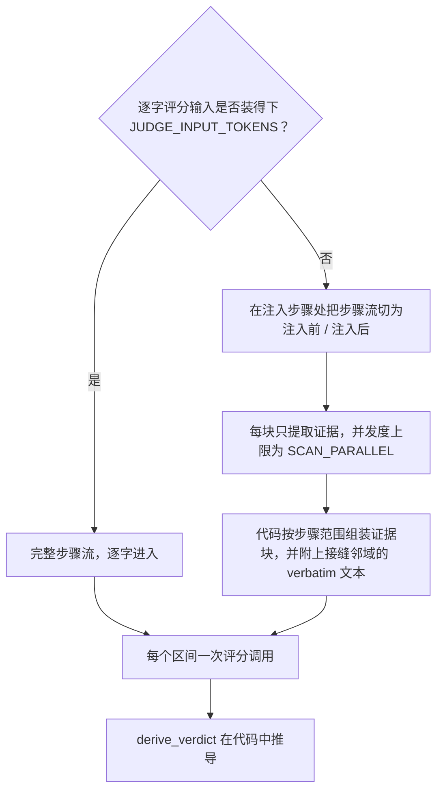

# injudge

```bash
python3 -m injudge <paths>     # 写出 output/injudge-report.json 与 output/summary.json

# 按区间打印评审输入（含 gold 块）。超预算的区间会附上 INPUT OVERFLOW
# 说明与预计分块数。只读 .env 中的预算/分块键；不读凭证、不发起调用、不写文件：
python3 -m injudge <paths> --dry-run --limit 3
```

injudge 根据召回注入在后续回合中的足迹，将其判为 **positive**、**negative** 或 **neutral**。stderr 上有 tqdm 进度：终端上是轨迹条加当前轨迹的区间条；管道输出时每完成一条轨迹打一行检查点。

LLM 为每条投递记忆打五个信号。区间判定由代码从这些信号推导；见 [判定推导](verdict-derivation.md)。

## 注入区间

相同内容常常被重复注入，因此评审单元是**注入区间（span）**：投递集合具有相同可移植身份的连续召回操作的最大段。步骤间隔不切段（记入 `step_gaps` 并展示给评审）。内容变化才会切段。

重复投递归并为 `restated`。它们计入投递成本与 `n_injections`，不出现在判定率中。

没有可归属 agent 步骤的区间（`step_first` 为 `None`）不可能存在下游足迹。按规则判 **neutral**，并标记 `auto: no_subsequent_turn`。不发起评审调用。

区间如何构造（含未摘要内容的指纹回退）见 [记忆身份](input-contract.md#记忆身份)。

## 评分输入

每个区间一次评分调用。请求包含已录制的任务陈述（若有）、该区间，以及 agent 步骤流：每个已完成回合的推理、内容与工具结果。

请求按 `JUDGE_INPUT_TOKENS` 路由，用 tiktoken `o200k_base` 在评分 system 提示词与评分 user 上计量：



**装得下。** 完整步骤流逐字进入。短轨迹就是一次全文评分调用。

**装不下。** 步骤流不会被截断硬塞。它在区间首次注入步骤处划分为注入前与注入后两侧；每一步恰好落入一块。块大小受 `SCAN_CHUNK_STEPS` 与 `SCAN_CHUNK_TOKENS` 约束。每块发起一次**提取**调用，只返回证据项——不打评分信号，不给判定。

代码随后用以下两部分组装评分 user：

1. 按步骤范围分组的证据块。
2. 注入点两侧各 `SCAN_NEIGHBORHOOD` 步的 verbatim **接缝邻域**（`0` 表示只保留注入步本身）。

提取会预填 `[anchor]` 条目：某步骤逐字出现投递记忆的键或有区分度的值词时记一条。词条在数量与长度上均有上限，并计入块预算。锚点只为提取提供种子，不取而代之。

证据超上限或组装后仍超预算时，各做一次 LLM 摘要压缩。仍超则保留原文。证据超上限记入警告。超预算的组装体原样发送，并在该操作的 `input` 记录上标记 `over_budget`。

某块拿不到可用结果时，该区间记为指明该块的 `error` 判定。不会留下静默的覆盖缺口。提取运行在带 `SCAN_*` 覆盖的评分配置副本上；提取侧的层级降级不会泄漏到评分配置。


提取按区间计费：每个区间的切分与提示词都不同，因此 *N* 个超预算区间要付 *N* 次完整提取。golden answer 与 correctness 附件只加在评分调用上，绝不进入提取。


评分调用返回的五个信号定义见下。由它们计算出的一切见 [判定推导](verdict-derivation.md)。

## 评分信号

每条投递记忆独立打分。note 引用步骤流中的 step 与 seq。

| 信号 | 类型 | 问题 |
|---|---|---|
| `relevance` | bool | 注入点上，记忆是否与任务及 agent 当前子目标主题相关？依据区间首步之前的步骤判断。 |
| `accuracy` | enum | `corroborated`（有可观察证据为真）/ `uncontradicted`（无从判断）/ `contradicted`（有可观察证据为假）。 |
| `novelty` | enum | `novel`（注入前从未出现）/ `confirming`（敲定 agent 明确表达过的疑点）/ `redundant`（早已确立，无疑点）。 |
| `influence` | enum | `none` / `referenced`（仅被提及）/ `acted_on`（影响了后续命令、编辑或测试）/ `decisive`（被明确归功的转向）。足迹是后续行为，从区间首步起算。 |
| `positive_effect` | enum 或 null | `improved` / `no_effect` / `harmed`。仅当 influence 为 `acted_on` 或 `decisive` 时非空。 |

`positive_effect = no_effect` 对记忆系统不利：上下文与注意力被占用，工作并未改善。仅从某动作缺失推断出的跳过，记为 `influence = none`；缺失本身不是证据。

最终任务结果若可辨认，可以抬高或压低置信度，但不能单独决定任何信号。

## Golden answer 与 correctness

评分调用可携带两类可选附件。各自可以来自 `trajectory.jsonl` 旁的边车文件，或来自命令行。命令行覆盖同名边车字段。对多条已加载轨迹共用一个 CLI gold 会给出警告。

| 附件 | 来源 | 作用 |
|---|---|---|
| Golden answer 正文 | `golden.txt`（与可用的 `golden.md` 同时存在时优先），或 `--golden PATH` | 把该次调用切换到 **gold 评分规则**（`GOLD_SYSTEM_PROMPT`）。同样的五个信号、同样的 schema、同样的推导链。`relevance` 与 `positive_effect` 的方向相对 gold 文本评判。gold 不评判 `accuracy`、`novelty`、`influence`。 |
| 已记录的 correctness | `correctness.json`，或 `--correctness resolved\|unresolved` | 以 `TASK CORRECTNESS` 块附加在该次调用所用提示词之下。仅作佐证：不能决定任何信号，也不会选用 gold 规则。 |

`correctness.json` 接受简单的 `{"resolved": true|false, "score": …}` 记录，或 SWE-bench 风格的评测报告（`resolved_ids` / `unresolved_ids`）。评测报告按轨迹记录的 `instance_id` 连接。error / incomplete 实例属于 harness 故障而非结果，不附加 correctness。

两者都没有时，评分使用朴素规则。该规则体系记录在每个经过预算门的操作的 `input` 上（`"gold": true`），并计入 `aggregates.overall.gold_scored`。

## 评审客户端

客户端按合规层级链行走：**structured**（受限解码）→ **json**（JSON 模式）→ **prompt**。anthropic 没有 json 层级。格式字段被拒绝或被证明忽略时，降级不消耗预算；首个可用层级会记忆到本次运行结束。用 `OUTPUT_FORMAT` 可固定层级。

瞬时故障（429/5xx、传输错误、空内容）与 `MAX_ATTEMPTS` 共享预算并退避，尊重服务端声明的 `Retry-After`。输出 token 预算在 JSON 中途切断的回答记为指明截断的 `error` 判定：不免费降级，不以同一预算重试。

预算耗尽时，该区间为 `error`，并保留评审原始文本。失败不会被改写成 neutral。只要有区间出错，进程退出码为 2。

端点凭证只发往评审端点，绝不出现在产物、报告、日志或错误信息中。回显了请求的端点输出会在任何文本被保留前先打码。

## 投递成本与策略

投递成本按确定性规则核算。每个区间的成本是其全部投递（含重述）的已录制放置内容大小之和，再按 `chars / 4` 估算 token，计入该区间的判定类别。未记录大小的 redact 放置计 0 token，并产生警告。

投递策略按轨迹与整体统计：注入密度、重述比例，以及注入占轨迹已计费 prompt token 预算的份额（覆盖所有泳道，包括记忆泳道的提取调用）。

这些数字如何滚入 `summary.json`，见 [产物](artifacts.md#数字如何推导)。
