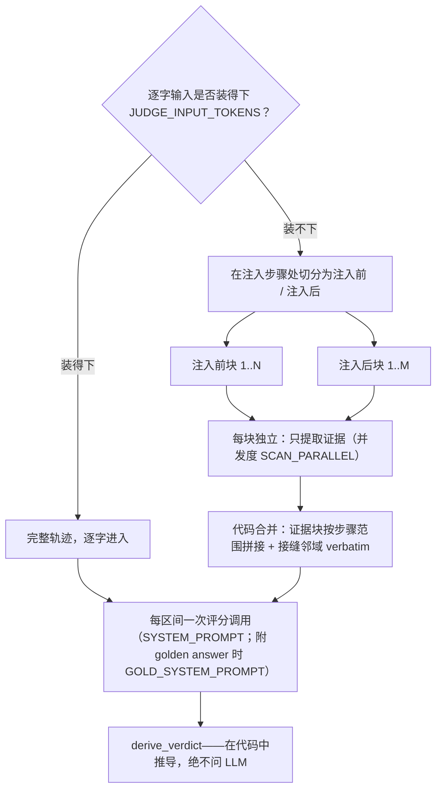
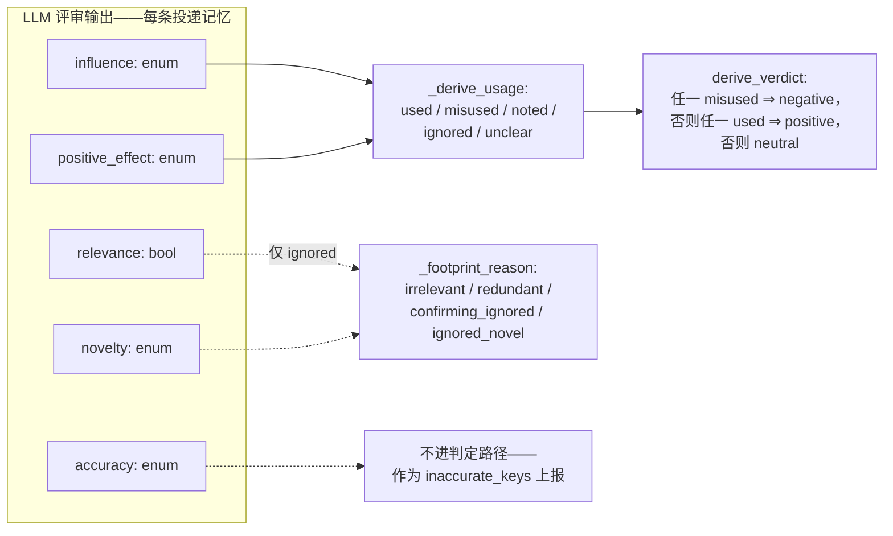

# injudge — 召回注入判定

```bash
python3 -m injudge <paths>     # 输出 output/injudge-report.json 与 output/summary.json

# 按区间打印评审输入（含 gold 块；超出预算时附 INPUT OVERFLOW 说明与
# 预计分块数）——只读 .env 中的预算/分块键，不发起评审调用、不写文件：
python3 -m injudge <paths> --dry-run --limit 3
```

以**后续影响**为依据，把每次召回注入判为 **positive / negative /
neutral**。运行时 stderr 上有 tqdm 进度条：轨迹条 + 当前轨迹的区间条，
终端上原地刷新；管道输出时每完成一条轨迹打一行检查点。

## 注入区间（span）

注入常常重复相同内容，所以评审单元是**注入区间**：投递内容完全相同的
连续注入的最大段（取录制器的可移植身份；步骤间隔不切段）。重复投递
计为 `restated`——计数，但不进判定率。其后没有任何 agent 回合的区间
不可能存在下游影响，直接按规则判 **neutral** 并标记
`auto: no_subsequent_turn`——不花评审调用。

## 评分信号

**每个区间一次评分调用**，对**每条投递记忆**打五个信号——输入为录制
的任务陈述、该区间、以及 agent 步骤流（所有已完成回合的推理、内容与
工具结果——无窗口、无截断）。评分调用读什么由输入预算
（`JUDGE_INPUT_TOKENS`，用 tiktoken `o200k_base` 估算）路由：

- **装得下** → 完整步骤流逐字进入。短轨迹与单次全文评审调用完全一致。
- **装不下** → 绝不截断硬塞。轨迹按块读取（在注入步骤处切分；各块
  划分整个步骤流），每块**只提取证据**——绝不打评分信号——由代码把
  证据块连同注入点前后的 verbatim 邻域组装进评分输入。代码还会为每块的
  提取预填 `[anchor]` 条目——某步骤逐字出现投递记忆的键或有区分度的
  值词时记一条（数量与长度均有上限，计入块预算）——它们只为提取提供
  种子，绝不取而代之。证据超上限或组装后仍超预算时，各做一次 LLM 摘要
  压缩；仍超则保留原文，绝不悄悄裁剪——证据超上限的情形记入运行警告，
  只有超预算的组装体才原样发送并标记 `over_budget`。提取运行在独立的
  配置副本上（`SCAN_*` 覆盖键；并发度 `SCAN_PARALLEL`）；某块拿不到
  可用结果时，该区间记为指明该块的 `error` 判定——绝不留下静默的覆盖
  缺口。



五个信号，逐条投递记忆评判：

| 信号 | 类型 | 问题 |
|---|---|---|
| `relevance` | bool | 注入点上，记忆与任务及 agent 当前子目标是否主题相关？ |
| `accuracy` | enum | `corroborated`（有证据为真）/ `uncontradicted`（无从判断）/ `contradicted`（有证据为假） |
| `novelty` | enum | `novel`（注入前从未出现的新内容）/ `confirming`（敲定 agent 明确表达过的疑点）/ `redundant`（早已确立） |
| `influence` | enum | `none` / `referenced`（仅被提及）/ `acted_on`（影响了命令、编辑或测试）/ `decisive`（被明确归功的转向） |
| `positive_effect` | enum / null | `improved` / `no_effect` / `harmed`；仅当 influence 为 `acted_on` 或 `decisive` 时非空 |

一切下游结论都**在代码里推导，绝不问 LLM**：



- 每条记忆：`used` = acted-on ∧ improved；`misused` = acted-on ∧
  （no effect ∨ harmed）；`noted` = 仅被提及；`ignored` = 无痕迹
  （附原因）；`unclear` = 信息不足。
- 区间判定：任一 `misused` ⇒ **negative**；否则任一 `used` ⇒
  **positive**；否则 **neutral**。仅被提及绝不会得到 negative。

## 可选的 golden answer / correctness

最终评分调用可携带两类可选附件——来自轨迹目录的边车文件
（`trajectory.jsonl` 旁的 `golden.txt` / `golden.md`、
`correctness.json`）或命令行（`--golden PATH`、
`--correctness resolved|unresolved`；命令行覆盖同名边车字段，且对多条
已加载轨迹共用一个 CLI gold 会给出警告）：

- **golden answer 正文**（参考解答）把该次调用切换到 **gold 评分规则**
  （`GOLD_SYSTEM_PROMPT`）：同样的五个信号、同样的 schema、同样的推导
  链，但 `relevance` 与 `positive_effect` 的方向相对 gold 文本评判。
  gold 不影响 `accuracy`、`novelty`、`influence`，也绝不进入提取调用。
- **已记录的 correctness**（`resolved`/`unresolved`，可选 0–1 分数）
  以 `TASK CORRECTNESS` 块附加在该次调用所用提示词之下——仅作佐证，
  绝不能单独决定任何信号。`correctness.json` 接受两种格式：简单的
  `{"resolved": true|false, "score": …}` 记录，或 SWE-bench 风格的
  评测报告（`resolved_ids`/`unresolved_ids`——按轨迹记录的
  `instance_id` 连接；error/incomplete 实例属于 harness 故障而非结果，
  不附加 correctness）。

两者都没有时，评分与朴素规则完全一致。该规则体系记录在每个操作的
`input` 上（`"gold": true`），并计入 `aggregates.overall.gold_scored`。

## 评审稳健性

评审客户端按合规层级链 **structured**（受限解码）→ **json**
（JSON 模式）→ **prompt**（anthropic 无 json 层级）自动降级：某层级的
格式字段被拒绝或被证明忽略时，降级不消耗预算，并全程记忆首个可用层级。瞬时故障（429/5xx、
传输错误、空内容）共享尝试预算并退避，尊重服务端声明的
`Retry-After`。预算耗尽时该区间记为 `error` 判定并保留评审原始输出
——绝不悄悄判 neutral；只要有区间出错，退出码为 2。

**投递成本**按确定性规则核算（不交给 LLM）：每区间的投递数 × 内容
大小，按 chars/4 估算 token，计入其判定类别。**投递策略**按轨迹与
整体统计：注入密度、重述比例、注入占轨迹真实 prompt token 预算的份额。
