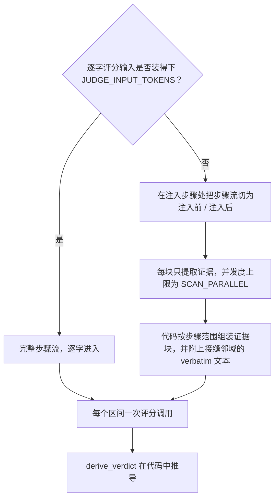

# 评分输入


每个区间一次评分调用。请求携带已录制的任务陈述（若有）、该区间，以及 agent 步骤流——每个已完成回合的推理、内容与工具结果。


区间头部会告诉评审：该区间在轨迹全部区间中的位置、产生这次注入的全部已记录搜索查询，以及注入的呈现方式（录制到的 placement 类型，外加完整投递原文；redact 的放置不录制内容）。每个投递条目都带一个稳定的区间本地 id（`[m1]`、`[m2]`……）——答案按这些 id 组织 rubric 条目，共用一个显示键的两个条目会被独立评分（仅注解携带的 `memory_type` 与 confidence 不额外进入评审输入；投递原文中实际出现的内容保持不变）；录制允许时还带曝光标记：placement 与规范值做无关适配器的比对，placement 只载入前缀的值仅把已曝光前缀展示给评审（`EXPOSED CLIP`），整体载入但仅在空白符折叠 / markdown 转义剥离后才匹配的值标记 `EXPOSURE NORMALIZED`（按全量可见对待），无法匹配的值标记 `EXPOSURE UNVERIFIED`，并把规范值从评审输入中隐去（仅有警告不是信息边界——隐藏内容仍可能引导解释；扫描路径的词法锚点播种同样跳过它）。归一化比对仅适用于散文式安全取值：含引号、反斜杠或换行结构的值只做逐字比对——在字符串、正则或缩进敏感内容里折叠空白、剥离转义改变的是语义而非呈现。头部还会列出在任意早前区间投递过的键与自其上一次早前投递以来取值发生变化的键——任务陈述之外的新颖性基线（隔区间重投递——上一直邻区间中缺席——同样不算新内容）。

每个投递条目的足迹评判窗口各自从区间首步到该条目下一次被重投递处——重投递即取代，同一条记忆在两个区间投递不会被重复归功；头部逐条目列出各窗口，从未被重投递的条目窗口无上界。唯一的例外会被明确记录：更晚的区间在该区间自己的末次投递步投递了同一批条目之一（同一步投递冲突——一次调用放置两个记忆块，或声明步骤冲突）时，该条目仍开放的窗口在该步处（含）闭合，且冲突区间对同一条目的窗口自该步之后才开始（记录不含同一步内的因果顺序，共享步骤按先 carrier 规则只计一次）；冲突会记入运行的 validation 日志。窗口按投递条目（区间本地 id）计算，不按显示键：共用一个键的多个身份各自保有自己的边界。

路由由 `JUDGE_INPUT_TOKENS` 决定，用 tiktoken `o200k_base` 在评分 system 提示词与评分 user 上计量：

## 装得下

完整步骤流逐字进入。短轨迹就是一次全文评分调用。

## 装不下

步骤流绝不截断硬塞，而是：

1. **分区。** 在首次注入步骤处将完整步骤流分成注入前/后两侧，每一步恰好进入一块，包括归因窗口关闭后的结果。窗口限制行为归功，而不隐藏后续证实或反驳。默认仅按 `SCAN_CHUNK_TOKENS` 分块；正数 `SCAN_CHUNK_STEPS` 可额外限制步数。单步过大时仍原样发送，不截断。
2. **提取。** 每块发起一次**提取**调用，只返回证据项——不打评分信号，不给判定。提取预填 `[anchor]` 词法命中：某步骤在该条目的足迹窗口内逐字出现投递记忆的键或有区分度的值词时记一条——越过窗口的命中属于重投递区间的证据，不在此预填；被截断条目只用已曝光前缀生成锚点（未展示的后缀从未出现在 agent 面前）；出现在超过轨迹四分之一步骤中的词会被丢弃（领域词汇，不是足迹指针）；锚点数量上限内优先保留标识符形态的词。锚点只作为提取请求的种子：绝不进入评分证据包，裸词法命中不会被当作发现交给评分评审。
3. **组装。** 按步骤范围组装证据块，并附上注入点两侧各 `SCAN_NEIGHBORHOOD` 步的逐字**接缝邻域**（`0` 仅保留注入步）。邻域是额外原文，而非证据扫描的截止位置。

### 保障

- 全文发送被端点以"过长"拒绝时（413，或带有长度/上下文窗口签名的 400/422——tiktoken 估算对真实评审分词器可能低估），回退到本扫描路径一次而不是把区间记为错误，并在该操作的 `input` 记录上标记 `length_fallback`、记入警告。
- 单块提取证据不设独立大小限制，也不再单独二次摘要。只有组装后的评分请求超预算时才做一次证据压缩；失败或仍超预算则保留原文并标记 `over_budget`，绝不静默截断。任务、投递原文、记忆条目、邻域和 gold 不参与摘要。
- 某块拿不到可用结果时，该区间记为指明该块的 `error` 判定。不会留下静默的覆盖缺口。
- 提取运行在带 `SCAN_*` 覆盖的评分配置副本上，提取过程中学到的层级降级绝不泄漏到评分。


提取按区间计费：每个区间的切分与提示词都不同，因此 *N* 个超预算区间要付 *N* 次完整提取。golden answer 与 correctness 附件（见 [injudge](injudge.md#golden-answer-与-correctness)）只加在评分调用上，绝不进入提取。


分块旋钮（`SCAN_*`）见[配置](configuration.md#扫描超预算路径)。LLM 对该输入返回什么，定义见[评分规则与判定推导](verdict-derivation.md#评分信号)。

## 输入上限审计

| 部件 | 决策 | 理由 |
|---|---|---|
| 投递预览（原 2,000 字符） | 移除 | 全文进入评分/提取；比较全文也防止尾部指令不同的投递被错误合并。 |
| 查询预览/条数（300 字符/八条） | 移除 | 保留完整检索来源，不假定主 agent 看过这些查询。 |
| 任务、曝光值、推理、回复、工具全部参数/结果、gold | 不设局部上限 | 统一计入评分输入预算。 |
| agent 侧截断/脱敏曝光 | 保留 | 这是来源边界，不得向评审展示 agent 未见的规范值后缀。 |
| 逐条目归因窗口 | 保留 | 限制行为归功，不限制结果观察；全文与扫描均覆盖完整步骤流。 |
| 评分输入预算 | 默认 800,000 token | 为输出、协议开销和分词差异留余量；不硬截断输入。 |
| 分块 token/步数 | 预算一半/默认无步数上限 | 随窗口放大，不为八步上限拆散相关行为。 |
| 词法提示（64 词、每词 200 字符、频率 ≤25%） | 保留 | 只限制可选检索提示；提取仍读完整步骤和曝光目标，裸命中不进入评分证据。 |
| 逐字邻域（两侧各两步） | 保留 | 额外原文，不阻断其他步骤的证据提取。 |
| 单块证据上限及二次摘要 | 移除 | 最终请求装得下时，不应丢弃或再压缩证据。 |
| 最终证据压缩 | 仅实际超预算时保留 | 一次；失败或仍超限就保留原文并明确标记。 |
| 输出/超时 | 65,536 token/300 秒 | 为推理留空间；预算截断导致错误，绝不接受部分判定。 |
| 诊断摘录/JSON 恢复探测/重试/并发 | 保留 | 限制日志、输出恢复、成本或调度，不截断源证据。 |

步骤流并非原会话的全部消息。检索查询可能来自记忆/旁路，键只是标签，早前区间的键列表也不能重建共驻记忆内容。基线或提取证据不足时，提示词要求使用 `null` 表达不确定性，而不是强行判断新颖性或影响。后续结果可支撑窗口内行为/决策，但不能成为新的窗口外行为锚点。

这些改进消除信息丢失和证据范围不一致，不代表因果识别，也不证明提取无损。结构化源引用和时间索引上下文重建不在本次实现中。本次不新增实验或验证研究。
