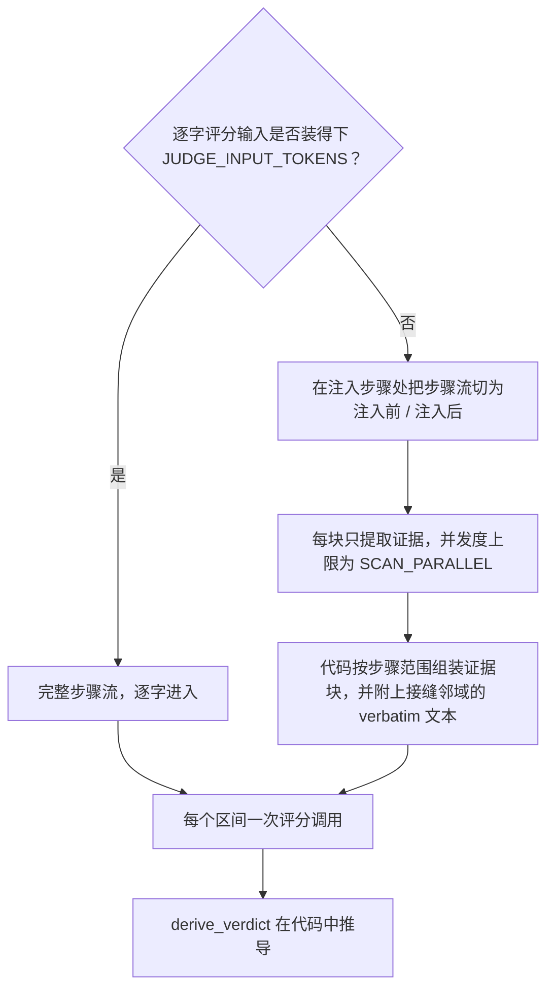

# 评分输入


每个区间一次评分调用。请求携带已录制的任务陈述（若有）、该区间，以及 agent 步骤流——每个已完成回合的推理、内容与工具结果。


区间头部会告诉评审：该区间在轨迹全部区间中的位置、产生这次注入的搜索查询，以及注入的呈现方式（录制到的 placement 类型，外加投递块开头的截断摘录；redact 的放置不录制内容）。每个投递条目都带一个稳定的区间本地 id（`[m1]`、`[m2]`……）——答案按这些 id 组织 rubric 条目，共用一个显示键的两个条目会被独立评分；录制允许时还带曝光标记：placement 与规范值做无关适配器的比对，placement 只载入前缀的值仅把已曝光前缀展示给评审（`EXPOSED CLIP`），无法匹配的值标记 `EXPOSURE UNVERIFIED` 而非默认全量可见。头部还会列出在任意早前区间投递过的键与自其上一次早前投递以来取值发生变化的键——任务陈述之外的新颖性基线（隔区间重投递——上一直邻区间中缺席——同样不算新内容）。

每个投递条目的足迹评判窗口各自从区间首步到该条目下一次被重投递处——重投递即取代，同一条记忆在两个区间投递不会被重复归功；头部逐条目列出各窗口，从未被重投递的条目窗口无上界。窗口按投递条目（区间本地 id）计算，不按显示键：共用一个键的多个身份各自保有自己的边界。

路由由 `JUDGE_INPUT_TOKENS` 决定，用 tiktoken `o200k_base` 在评分 system 提示词与评分 user 上计量：

## 装得下

完整步骤流逐字进入。短轨迹就是一次全文评分调用。

## 装不下

步骤流绝不截断硬塞，而是：

1. **分区。** 在区间首次注入步骤处划分为注入前与注入后两侧；每一步恰好落入一块，唯一例外是足迹窗口——当每个投递条目都会在后续被重投递时，注入后一侧在最大的窗口末步处停止（更晚的步骤属于重投递区间；而任何一个窗口保持开放的条目——从未被重投递的，或无身份而无法按重投递跟踪的——都会让注入后一侧一直开放到步骤流末尾，以免静默丢掉延迟出现的足迹；各条目窗口不一致时取并集范围，块头部会把逐条目边界告知提取）。块大小受 `SCAN_CHUNK_STEPS` 与 `SCAN_CHUNK_TOKENS` 约束。
2. **提取。** 每块发起一次**提取**调用，只返回证据项——不打评分信号，不给判定。提取预填 `[anchor]` 条目：某步骤在该条目的足迹窗口内逐字出现投递记忆的键或有区分度的值词时记一条——越过窗口的命中属于重投递区间的证据，不在此预填；被截断条目只用已曝光前缀生成锚点（未展示的后缀从未出现在 agent 面前）。锚点在数量与长度上均有上限，计入块预算；它为提取提供种子，不取而代之。
3. **组装。** 代码组装评分 user：按步骤范围分组的证据块，加上注入点两侧各 `SCAN_NEIGHBORHOOD` 步的 verbatim **接缝邻域**（与注入后一侧在同一窗口末步处截断；`0` 表示只保留注入步本身）。

### 保障

- 全文发送被端点以"过长"拒绝时（413，或带有长度/上下文窗口签名的 400/422——tiktoken 估算对真实评审分词器可能低估），回退到本扫描路径一次而不是把区间记为错误，并在该操作的 `input` 记录上标记 `length_fallback`、记入警告。
- 证据超上限或组装后仍超预算时，各做一次 LLM 摘要压缩；仍超则保留原文。证据超上限记入警告；超预算的组装体原样发送，并在该操作的 `input` 记录上标记 `over_budget`。
- 某块拿不到可用结果时，该区间记为指明该块的 `error` 判定。不会留下静默的覆盖缺口。
- 提取运行在带 `SCAN_*` 覆盖的评分配置副本上，提取过程中学到的层级降级绝不泄漏到评分。


提取按区间计费：每个区间的切分与提示词都不同，因此 *N* 个超预算区间要付 *N* 次完整提取。golden answer 与 correctness 附件（见 [injudge](injudge.md#golden-answer-与-correctness)）只加在评分调用上，绝不进入提取。


分块旋钮（`SCAN_*`）见[配置](configuration.md#扫描超预算路径)。LLM 对该输入返回什么，定义见[评分规则与判定推导](verdict-derivation.md#评分信号)。
