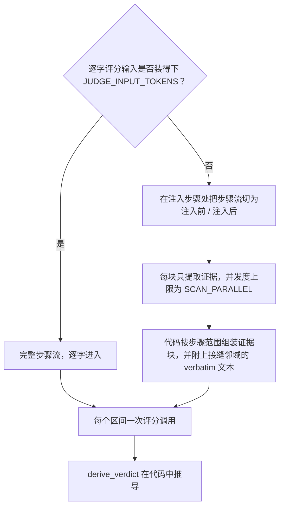

# 评分输入

每个区间一次评分调用。请求携带已录制的任务陈述（若有）、该区间，以及 agent 步骤流——每个已完成回合的推理、内容与工具结果。

路由由 `JUDGE_INPUT_TOKENS` 决定，用 tiktoken `o200k_base` 在评分 system 提示词与评分 user 上计量：

## 装得下

完整步骤流逐字进入。短轨迹就是一次全文评分调用。

## 装不下

步骤流绝不截断硬塞，而是：

1. 在区间首次注入步骤处划分为注入前与注入后两侧；每一步恰好落入一块。块大小受 `SCAN_CHUNK_STEPS` 与 `SCAN_CHUNK_TOKENS` 约束。
2. 每块发起一次**提取**调用，只返回证据项——不打评分信号，不给判定。提取预填 `[anchor]` 条目：某步骤逐字出现投递记忆的键或有区分度的值词时记一条。锚点在数量与长度上均有上限，计入块预算；它为提取提供种子，不取而代之。
3. 代码组装评分 user：按步骤范围分组的证据块，加上注入点两侧各 `SCAN_NEIGHBORHOOD` 步的 verbatim **接缝邻域**（`0` 表示只保留注入步本身）。

### 保障

- 证据超上限或组装后仍超预算时，各做一次 LLM 摘要压缩；仍超则保留原文。证据超上限记入警告；超预算的组装体原样发送，并在该操作的 `input` 记录上标记 `over_budget`。
- 某块拿不到可用结果时，该区间记为指明该块的 `error` 判定。不会留下静默的覆盖缺口。
- 提取运行在带 `SCAN_*` 覆盖的评分配置副本上，提取过程中学到的层级降级绝不泄漏到评分。


提取按区间计费：每个区间的切分与提示词都不同，因此 *N* 个超预算区间要付 *N* 次完整提取。golden answer 与 correctness 附件（见 [injudge](injudge.md#golden-answer-与-correctness)）只加在评分调用上，绝不进入提取。


分块旋钮（`SCAN_*`）见[配置](configuration.md#扫描超预算路径)。LLM 对该输入返回什么，定义见[评分规则与判定推导](verdict-derivation.md#评分信号)。
