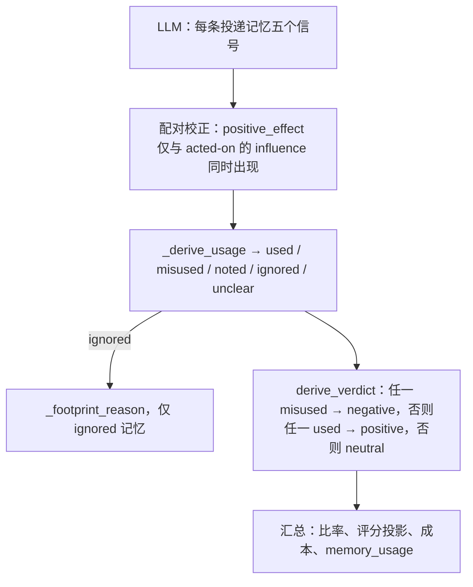

# 评分规则与判定推导


LLM 为每条投递记忆打五个信号，但从不选择区间判定。injudge 在代码中推导使用标签、足迹原因与区间判定（`injudge/judge.py`）。


这些标签如何计入比率与汇总，见[产物](artifacts.md#数字如何推导)。



## 评分信号

每条投递记忆独立打分。note 引用步骤流中的 step 与 seq。

| 信号 | 类型 | 问题 |
|---|---|---|
| `relevance` | bool | 注入点上，记忆是否与任务及 agent 当前子目标主题相关？依据区间首步之前的步骤判断。 |
| `accuracy` | enum | `corroborated`（有可观察证据为真）/ `uncontradicted`（无从判断）/ `contradicted`（有可观察证据为假）。 |
| `novelty` | enum | `novel`（任务陈述与注入前步骤中都未出现）/ `confirming`（敲定 agent 明确表达过的疑点）/ `redundant`（早已确立，无疑点）。任务陈述与 agent 的初始上下文与 agent 自己的注入前回合一律视为已在对话中。 |
| `influence` | enum | `none` / `referenced`（仅被提及）/ `acted_on`（影响了后续命令、编辑或测试）/ `decisive`（被明确归功的转向）。足迹是后续行为：从区间首步起算，若后续存在内容不同的区间，则以该区间的首步为界（内容变化即取代）。回声规则：agent 在区间之前已宣布、推理出或已应用的方向，不能归功于事后再投递的记忆——即使结果动作落在足迹窗口内。 |
| `positive_effect` | enum 或 null | `improved` / `no_effect` / `harmed`。仅当 influence 为 `acted_on` 或 `decisive` 时非空。 |


`positive_effect = no_effect` 对记忆系统不利：上下文与注意力被占用，工作并未改善。仅从某动作缺失推断出的跳过，记为 `influence = none`；缺失本身不是证据。


判定规则刻意不对称：被无视的垃圾注入是 **neutral**（无足迹），只有 acted-on 且无效（或有害）才是 **negative**。因此 negative 率为零绝不能单独读作"无害"：报告中它始终与 wasted-token share 一起出现——后者本身是区间级代理（neutral 区间里被引用的记忆计为浪费；positive 区间里被无视的记忆计为有效），占比过高时还会给出明确警告（见[产物](artifacts.md#判定率)）。

最终任务结果若可辨认，可以抬高或压低置信度，但不能单独决定任何信号。

## 分工

| 由 LLM 产出 | 由代码推导 |
|---|---|
| 逐记忆的 `relevance`、`accuracy`、`novelty`、`influence`、`positive_effect`（value + note） | 逐记忆的 `usage`（`used` / `misused` / `noted` / `ignored` / `unclear`） |
| 区间级 `analysis`、`evidence[]`、`confidence` | 被忽略记忆的 `reason`（`irrelevant` / `redundant` / `confirming_ignored` / `ignored_novel`） |
| | 区间 `verdict`（`positive` / `negative` / `neutral`） |
| | 投递成本、策略指标，以及全部 `summary.json` 比率 |

`accuracy` 会上报（`inaccurate_keys`），不进入判定路径。`relevance` 与 `novelty` 进入判定路径的唯一方式，是作为被忽略记忆未留足迹的原因。

## 组装

`_assemble_verdict` 把形状合法的评审对象变成内部记录。JSON schema 表达不了的语义检查在这里完成：

1. **每个 key 一条。** 同一次投递中同一 key 的多个版本折叠成一行评分（记警告）。没有 key 的记忆不进评分与使用记录；其投递成本仍计入。
2. **覆盖。** 评审数组中缺失的区间 key 会得到全空信号并记警告。区间内带 key 的记忆一条都未被覆盖时，立即记 `error` 判定——这是模型质量信号，不是推导出的 neutral。评审数组中的未知 key 会被丢弃。完全不含 key 记忆的区间不是错误：记警告并推导为 neutral，因为没有可打分对象。
3. **配对。** `positive_effect` 仅在 `influence` 为 `acted_on` 或 `decisive` 时适用。该情况下缺少 effect 会使 usage 为 `unclear`（记警告）。influence 为 `none` 或 `referenced` 时仍给出的 effect 会被强制改为 `null`（记警告）。
4. **使用、原因、判定。** `_derive_usage` 为每条记忆打标签；`_footprint_reason` 只对 `ignored` 运行；`derive_verdict` 读取使用标签。置信度被夹到 `[0, 1]`。

仅供展示的字段（`analysis`、证据 claim）会被复制并打码。畸形的证据列表会连同警告被丢弃，不使区间失败。

## 使用标签

`_derive_usage` 在配对校正之后读取 `influence` 与 `positive_effect`：

| `influence` | `positive_effect` | `usage` | 含义 |
|---|---|---|---|
| `acted_on` 或 `decisive` | `improved` | `used` | 记忆塑造了后续行为，并改善了工作。 |
| `acted_on` 或 `decisive` | `no_effect` 或 `harmed` | `misused` | 记忆塑造了后续行为但没有改善工作，或把 agent 带偏。 |
| `acted_on` 或 `decisive` | `null` | `unclear` | 已 acted-on 但缺少 effect 判断。 |
| `referenced` | （忽略；通常为 `null`） | `noted` | 仅被提及。行动并未因此改变。 |
| `none` | （忽略；通常为 `null`） | `ignored` | 没有可观察足迹。 |
| `null` / 未知 | 任意 | `unclear` | influence 本身未知。 |

使用条目上的 evidence 字符串，取 `positive_effect`、`influence`、`novelty` 中第一条非空 note。

## 足迹原因

`_footprint_reason` 只对 `ignored` 记忆运行。严格解析保证此时 `novelty` 是枚举值（覆盖缺口的全空条目会推导为 `unclear`，不会变成 `ignored`）。

| `relevance` | `novelty` | `reason` |
|---|---|---|
| `false` | 任意 | `irrelevant` |
| `true` | `redundant` | `redundant` |
| `true` | `confirming` | `confirming_ignored` — 敲定了未决疑点，但从未被归功 |
| `true` | `novel` | `ignored_novel` |

这些原因填入 `rubric.no_footprint_reasons`。它们不改变区间判定：被忽略的记忆已经不在 `used` / `misused` 之列。

## 区间判定

`derive_verdict` 读取已推导的使用标签。损害优先：

1. 任一记忆 `misused` → **negative**。
2. 否则任一记忆 `used` → **positive**。
3. 否则 → **neutral**。

`noted`、`ignored` 与 `unclear` 单独不会产生 negative。因此仅被提及永远不会得到 negative 区间。

```python
usages = [entry["usage"] for entry in memory_usage.values()]
if "misused" in usages:
    return "negative"
if "used" in usages:
    return "positive"
return "neutral"
```

### 示例

每行是一个区间。未列出的记忆表示不存在。

| 记忆 | 推导出的 usage | 区间判定 | 原因 |
|---|---|---|---|
| A：`acted_on` + `improved`；B：`none` | A `used`，B `ignored` | **positive** | 至少一个 used，没有 misused。 |
| A：`acted_on` + `no_effect` | A `misused` | **negative** | 被采纳但没有改善：上下文被占用却无收益。 |
| A：`acted_on` + `harmed` | A `misused` | **negative** | 主动损害。 |
| A：`decisive` + `improved`；B：`acted_on` + `harmed` | A `used`，B `misused` | **negative** | 损害优先于帮助。 |
| A：`referenced` | A `noted` | **neutral** | 提及但无行动。 |
| A：`acted_on` + `null` | A `unclear` | **neutral** | 有影响但无 effect 判断；不计为 used 或 misused。 |
| A：`none`，`relevance=false` | A `ignored`（`irrelevant`） | **neutral** | 无足迹。 |
| 其后没有 agent 回合（`auto`） | 占位 `unclear` | **neutral** | 规则判定；无 LLM 调用。见下。 |

## 规则判定与失败区间

| 情形 | `verdict` | 评审调用 | 汇总中的评分 / 使用 |
|---|---|---|---|
| 没有可归属的 agent 步骤 | `neutral`，`auto: no_subsequent_turn` | 无 | 占位的空评分与 `unclear` 使用。不计入评分比率、使用汇总与置信度。在判定率中计为已评判的 **neutral**。 |
| `--limit` 截断或 `--dry-run` | `unjudged` | 无 | 只计数。不是比率分母。 |
| 覆盖缺口、契约失败或尝试耗尽 | `error` | 已尝试 | 只计数。保留原始文本。不会被改写成 neutral。 |

这些标签如何计入 `summary.json` 的比率、成本与汇总，见[产物](artifacts.md#数字如何推导)。
