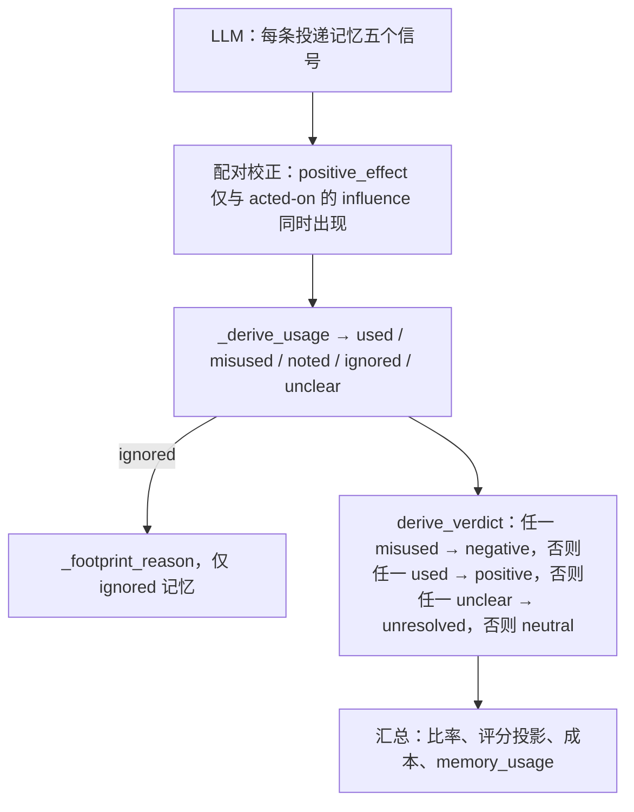

# 评分规则与判定推导


LLM 为每条投递记忆打五个信号，但从不选择区间判定。injudge 在代码中推导使用标签、足迹原因与区间判定（`injudge/judge.py`）。


这些标签如何计入比率与汇总，见[产物](artifacts.md#数字如何推导)。

## 评分信号

每个投递条目在其区间本地 id（`m1`、`m2`……按投递顺序）下独立评分：两个条目可能共用一个显示键——不同的已存记忆，或同次投递的两个版本——绝不折叠为一次评判。note 引用步骤流中的 step 编号；区间级 `evidence[]` 条目则携带 step 与 seq。录制允许时，每个条目还带**曝光标记**，标明 placement 实际向 agent 展示了其值的哪一部分；评审只评判已曝光的内容，绝不评判未展示的后缀。

| 信号 | 类型 | 问题 |
|---|---|---|
| `relevance` | bool | 记忆是否与已记录的任务和当前子目标相关？依据已记录的 episode 任务（gold 评分规则下 gold.md 是一种合法解答）、投递前可见的上下文与步骤文件判断。相关性独立于准确性、新颖性与使用情况：针对当前故障的诊断或修复即使被证伪也仍然相关；冗余或未被使用的记忆也可以相关；可迁移的技巧或有用的子目标即使指向其他库或其他缺陷，只要在此处适用也算相关，而其他缺陷自身的机制或产物不算——仅仅提到相同的文件、类或函数也不算。 |
| `accuracy` | enum | `corroborated`（有可观察证据为真）/ `uncontradicted`（无从判断）/ `contradicted`（有可观察证据为假），均在该断言自身的范围内（其仓库、版本、缺陷或情境）判断。当前代码与历史断言不同，本身不能反驳该历史断言；对当前问题的适用性应在 relevance 中单独判断。 |
| `novelty` | enum 或 null | `novel`（投递前基线支持新内容）/ `confirming`（敲定已有疑点）/ `redundant`（早已确立）/ `null`（可见性无法核实）。基线包括此前可用的任务、用户输入和步骤，但不包括目标投递自身或之后的更新。旧投递不能单独证明上下文重写后仍可见。以实质内容而非措辞判断：混合内容的记忆仅当每条实质主张均已确立时才是 `redundant`，说明中须列出已知与新增的主张。 |
| `influence` | enum | `none` / `referenced`（仅提及）/ `acted_on`（可用步骤中的动作采用已曝光记忆，而非此前独立可用的信息）/ `decisive`（可论证地改变了计划）。足迹从目标区间首步起，止于同 episode 的下一次该条目再曝光（显示其全部已示内容的投递）或该 episode 最后可用的全局步骤。以条目所显示的标识符选取它做后续操作——读取列出的候选——属于 `acted_on`；其效果取决于该后续操作带来了什么：后续步骤建立在这次读取之上时为 `improved`，包括使用新学到的信息或消除原有疑问；声称节省了工作需要此前已提出的方案或明确归功，不能仅凭读取后才首次表达的收窄；输出未被使用、agent 按原有方向继续时为 `no_effect`；其后果无法与 agent 自身进展区分时为 `null`。拒绝建议本身绝不算损害。任务、系统文本、早前推理及无关工具结果均可能是独立来源；搜索查询与隐藏的注解键是检索元数据（placement 中显示的标识符属于内容），gold 是评测方专有材料。此前已确立方向的回声不算改变动作，但恢复已丢失方向或补充缺失细节的提醒仍可能改变动作。已有方向须有投递前的来源：在区间首步或之后才首次出现的计划，不能证明它早于曝光。说明须指出投递步骤及每个动作所依据的来源；同时与记忆和任务重合的行为应标为归因不明，无法确立的使用写作"影响未确立"，而非断言记忆没有作用。只能把某来源确实包含的要素归于该来源；未引用记忆、仅与通用做法（先跑聚焦测试、最小修复）相符的动作是 `influence = none`（归因未确立），而非记忆使用。`acted_on`/`decisive` 须引用所属 episode 和条目窗口内的原始全局步骤**锚点**。 |
| `positive_effect` | enum 或 null | `improved` / `no_effect` / `harmed`，以该记忆窗口内可观察的下游事件判断（`improved`：下游事件把收益系于记忆塑形的动作；`no_effect`：该动作没有产生可观察的下游变化；`harmed`：错误位置、错误线索、丢失工作或状态）。仅当 influence 为 `acted_on` 或 `decisive` 时非空。accuracy 从不决定该信号：携带错误主张的记忆仍可能触发找到修复的诊断。 |


`positive_effect = no_effect` 对记忆系统不利：上下文与注意力被占用，工作并未改善。仅从某动作缺失推断出的跳过，记为 `influence = none`；缺失本身不是证据。


判定规则刻意不对称：被无视的垃圾注入是 **neutral**（未确立影响），已采取行动但效果未定是 **unresolved**，只有 acted-on 且无效（或有害）才是 **negative**。因此 negative 率为零绝不能单独读作"无害"：报告中它始终与无已证收益份额一起出现——后者本身是区间级代理，并单独标出其中的 unresolved 部分（positive 区间里被无视的记忆计为有收益），每一个报告的份额都附带该警告（见[产物](artifacts.md#判定率)）。所有投递都无法归属到 agent 步骤的区间（没有已归类的 agent 回合，或消费投递的回合缺失 / 未归类），不经 LLM 直接规则判定，并作为 **unassessable**（观察缺失，而非测得的零效应）单独报告，不进入任何方向性分母。

最终任务结果若可辨认，可以佐证判断，但不能决定任何信号。

新颖性比例描述的是相对于已记录的投递前基线的新内容，并不表示 agent 以前不知道：通用
做法也可以是 `novel`，而其未被引用的使用仍无法归因。基线缺失或不完整时仍应使用
`null`，不能仅凭未记录就判为新颖。新颖性涵盖每一条实质主张，即使该主张与任务无关，
因此相关性不能把此前不可用的内容变成冗余。如果证据确立了记忆促成对先前习惯或计划的
逆转，即使建议属于通用做法且未被显式引用，也可以是 `decisive`。

## 分工

| 由 LLM 产出 | 由代码推导 |
|---|---|
| 逐记忆的 `relevance`、`accuracy`、`novelty`、`influence`、`positive_effect`（value + note） | 逐记忆的 `usage`（`used` / `misused` / `noted` / `ignored` / `unclear`） |
| 区间级 `analysis`、`evidence[]`、`confidence` | 被忽略记忆的 `reason`（`irrelevant` / `redundant` / `confirming_ignored` / `ignored_novel` / `ignored_unknown_novelty`） |
| | 区间 `verdict`（`positive` / `negative` / `unresolved` / `neutral`） |
| | 投递成本、策略指标，以及全部 `summary.json` 比率 |

`accuracy` 会上报（`inaccurate_keys`），不进入判定路径。`relevance` 与 `novelty` 进入判定路径的唯一方式，是作为被忽略记忆未留足迹的原因。

## 组装

语义检查分两层，都在代码里完成。

**尝试循环内**（`_verdict_semantics`，由 `judge_span` 在 `_strict_parse` 之后对每个最终答案调用）——这些检查是区间相对的（任何静态 schema 都无法枚举出逐区间的 id 集合或逐条目的足迹窗口），因此走有界的纠正重试；耗尽预算即为 `error` 判定，绝不留下静默不完整的判定：

1. **精确 id 覆盖。** 答案为每个投递条目的区间本地 id 恰好各给一条——缺失条目是未作答的评判，未知条目是噪声，两者都不被接受。
2. **动作锚点。** `acted_on`/`decisive` 至少给出一个所属 episode 中的原始全局步骤号，且必须落在该条目的足迹窗口内（区间首步至同 episode 的下一次再曝光减一，或该 episode 最后一个可用步骤）。同一记忆之后以不同或更窄的已核实文本再次投递（如完整读取后的搜索预览，或反之）不会截断窗口；`span.md` 列出其步骤，各投递只按自身文本记功。窗口可能为空：重投递先于任何可用步骤时，`span.md` 对该条目不列出任何可用动作步骤，每个 `acted_on`/`decisive` 锚点都会被拒绝。episode 外或区间首步之前的锚点均被拒绝；注入前证据只可支持 novelty 或 accuracy 的 **note**，不能作为 influence 锚点。`influence` 为 `none` 时 `anchors` 必须为空。到达同一消费回合的投递在该步都可记功；只有未新增已核实文本的同步副本在共享步骤之后开窗。每个锚点还必须指向保留对话中实际读取过的步骤文件（`judge_span`）；仅有非零的读取计数不能支撑关于其他步骤的断言。
3. **信号正交。** novelty、accuracy、influence 与 effect 各自独立判定：任何跨信号组合都不构成契约违例。提醒效应（`redundant` + `acted_on`）、部分有误却促成了修复的记忆（`contradicted` + `improved`）、真正共享的足迹（两个条目携带相同内容，记入 shared 说明）都是可报告的状态，规则不得压制。

窗口内的决策若得到后续实际执行的支持，可以作为锚点；未执行的计划不获得动作信用。
来源说明须区分任务的原文要求、通用做法和曝光后的发现。即使支持事实已可见，明确存疑
仍优先对应 `confirming`。这些判断由评审智能体完成；验证器只检查锚点的归属及结构，
不会验证说明内容是否属实。

**组装时**（`_assemble_verdict`），作用于已验证的对象：

4. **配对。** `positive_effect` 仅在 `influence` 为 `acted_on` 或 `decisive` 时适用。该情况下 effect 为 null 是评分规则允许的不确定性出口（证据无法判定方向）：usage 推导为 `unclear` 并记录在案，但不算配对纠正。influence 为 `none` 或 `referenced` 时仍给出的 effect 会被强制改为 `null`（记警告并计入配对纠正）。
5. **使用、原因、判定。** `_derive_usage` 为每个条目打标签；`_footprint_reason` 只对 `ignored` 运行；`derive_verdict` 读取使用标签。置信度被夹到 `[0, 1]`。

完全不含投递记忆的区间不是错误：CLI 在任何评审调用之前就把它路由到 `auto_verdict_empty`——
规则判定为 `neutral`，带 `auto: "empty_delivery"`，不记 validation 警示，并在单独的 **empty**
汇总中计数，不进入任何比率分母与无已证收益份额。`_assemble_verdict` 追加的空投递警告
只覆盖直接调用方。

仅供展示的字段（`analysis`、证据 claim）会被复制并打码。畸形的证据列表会连同警告被丢弃，不使区间失败。

组装后的文字检查只添加 validation 警告，不改变标签、不改写说明，也不触发重试：
检查 `none` 条目的 note 中的 `independent` / `independently` / `unassisted` / `unaided`
或 `from code alone` 等排他来源措辞（任一条目为 `none`
时也检查区间 analysis），以及超过 60 个空白分隔词的 analysis。
任务来源检查仅适用于 influence note、novelty note 和 analysis：检查在空白、反引号和
大小写归一化后无法于 `task.md` 找到的局部任务引文，以及可识别却没有匹配引述的
任务要求断言，该匹配引述须至少包含一个三个或更多词的片段。
不同短引文或省略号分隔的片段不能合并词数来满足该下限；省略号（`...` 或 `…`）
仅当每个非空片段按任务顺序出现时才算匹配，而满足条件的引述即使来源前缀无法识别
也能避免缺引述警告。relevance note 可以描述任务而不把动作归因于它，因此被排除在
任务来源检查之外；独立性检查仍覆盖它们。这些只是词法审阅提示，不是覆盖率的度量。

## 使用标签

`_derive_usage` 在配对校正之后读取 `influence` 与 `positive_effect`：

| `influence` | `positive_effect` | `usage` | 含义 |
|---|---|---|---|
| `acted_on` 或 `decisive` | `improved` | `used` | 记忆塑造了后续行为，并改善了工作。 |
| `acted_on` 或 `decisive` | `no_effect` 或 `harmed` | `misused` | 记忆塑造了后续行为但没有改善工作，或把 agent 带偏。 |
| `acted_on` 或 `decisive` | `null` | `unclear` | 已 acted-on 但缺少 effect 判断。 |
| `referenced` | （忽略；通常为 `null`） | `noted` | 仅被提及。行动并未因此改变。 |
| `none` | （忽略；通常为 `null`） | `ignored` | 没有可观察足迹。 |
| `null` / 未知 | 任意 | `unclear` | influence 本身未知。 |

使用条目上的 evidence 字符串，取 `positive_effect`、`influence`、`novelty` 中第一条非空 note。

## 足迹原因

`_footprint_reason` 只对 `ignored` 记忆运行。未知新颖性与 `ignored_novel` 分开统计：缺失的基线证据不能确立新颖性档位。只有 `novelty` 与 `positive_effect` 允许 null，其他信号仍须满足现有布尔/枚举契约。未知新颖性不决定 influence、usage 或区间判定。

| `relevance` | `novelty` | `reason` |
|---|---|---|
| `false` | 任意 | `irrelevant` |
| `true` | `redundant` | `redundant` |
| `true` | `confirming` | `confirming_ignored` — 敲定了未决疑点，但从未被归功 |
| `true` | `novel` | `ignored_novel` |
| `true` | `null` | `ignored_unknown_novelty` |

这些原因填入 `rubric.no_footprint_reasons`。它们不改变区间判定：被忽略的记忆已经不在 `used` / `misused` 之列。

## 区间判定

`derive_verdict` 读取已推导的使用标签。损害优先：

1. 任一记忆 `misused` → **negative**。
2. 否则任一记忆 `used` → **positive**。
3. 否则任一记忆 `unclear` → **unresolved**。
4. 否则 → **neutral**。

`noted`、`ignored` 与 `unclear` 单独不会产生 negative。因此仅被提及永远不会得到 negative 区间。

### 示例

每行是一个区间。未列出的记忆表示不存在。

| 记忆 | 推导出的 usage | 区间判定 | 原因 |
|---|---|---|---|
| A：`decisive` + `improved`；B：`acted_on` + `harmed` | A `used`，B `misused` | **negative** | 损害优先于帮助。 |
| A：`acted_on` + `null` | A `unclear` | **unresolved** | 已 acted-on 但方向无法判定；不计为 used 或 misused，也不是 neutral。 |
| 其后没有 agent 回合（`auto`） | 占位 `unclear` | **neutral** | 规则判定；无 LLM 调用。见下。 |

## 规则判定与失败区间

| 情形 | `verdict` | 评审调用 | 汇总中的评分 / 使用 |
|---|---|---|---|
| 没有可归属的 agent 步骤 | `neutral`，`auto: no_subsequent_turn` | 无 | 占位的空评分与 `unclear` 使用。不计入评分比率、使用汇总与置信度。在汇总中计为 **unassessable**——不进入任何方向性比率，也不计入无已证收益份额。 |
| `--limit` 截断或 `--dry-run` | `unjudged` | 无 | 只计数。不是比率分母。 |
| 覆盖/锚点违反且纠正重试耗尽、契约失败 | `error` | 已尝试 | 只计数。原始文本保留并打码，上限 2000 字符。不会被改写成 neutral。 |

这些标签如何计入 `summary.json` 的比率、成本与汇总，见[产物](artifacts.md#数字如何推导)。
